# Linear Algebra and Learning From Data（线性代数与数据学习）· part005
## 书页 198-248 ｜ PDF 页 201-250 ｜ §III.5 收尾 + Part IV Special Matrices（§IV.1–§IV.7）

> <span style="color:#7f8c8d;">本卷为 Strang 原书 part005 的行内双语译稿：中文主体 + 英文术语行内嵌入（首次出现加中文括号），公式保留 LaTeX（行内 `$...$`、块级 ```math 围栏），配色沿用全系列（功能标签蓝 #2471a3、定理标题 #c0392b、定义核心句 #00838f、译者注 #1e8449、交叉引用 #7f8c8d）。页眉页脚与印页码不收录。</span>
>
> <span style="color:#7f8c8d;">书页映射（实测锚点）：page 201-203 = 书页 198-200（§III.5 收尾 + Problem Set III.5）｜page 204 = 书页 201（Part IV 章首目录）｜page 205-250 = 书页 203-248（§IV.1–§IV.7）。</span>

---

<!-- page 201 -->
> <span style="color:#7f8c8d;">本页为书页 198，属 §III.5 Compressed Sensing and Matrix Completion（压缩感知与矩阵补全）之末段与算法规整部分；页眉与印页码为重复元素，不译。</span>
> <span style="color:#1e8449;">**[note] 译者注（OCR 修正）：**</span> 本页 OCR 噪声中的 `蓋` 依语境为待补全矩阵 $X$，`儿` 为矩阵 $A$，`舻 / 4` 为 $n^{5/4}$ 一类幂次碎片（即 $K > C\,n^{5/4}r\log n$），`UEVT` 为 $U\Sigma V^{T}$，`血`／`处` 为 $X^{(k+1)}$。式（3）中 $A_k$ 的定义、式（4）整式在本页 OCR 中脱落，凡不可复原者不作臆造，只保留残存符号并就地标出。（原书此处 OCR 残缺）$A_k$ 的定义（依式（5）的残差形状，疑为「已知位置上取 $X^{(k)}$、其余位置取零」的矩阵）需回原书核对。
这个数学问题是：已知一个 $n \times n$、秩为 $r$ 的矩阵中 $K$ 个元素，我们能否期望完美恢复出整个矩阵？
答案是引人注目的——可以，只要 $K$ 足够大。
> <span style="color:#1e8449;">**[note] 从 $\ell_0$ 到 $\ell_1$：压缩感知为什么可以做凸松弛**</span>
> <span style="color:#1e8449;">先把这个问题的「形状」摆出来。本页问的是：已知 $n\times n$、秩为 $r$ 的矩阵中 $K$ 个元素，能否完美恢复整个矩阵；Strang 引 Candès–Recht 的结论说，$K > C\,n^{5/4}r\log n$ 时以高概率可以。这与本页之前压缩感知那一半是同一件事的两件外衣：向量版说「稀疏的 $x$ 可以从远少于 $n$ 个线性观测 $Ax=b$ 中恢复」，矩阵版说「低秩的 $X$ 可以从远少于 $n^2$ 个已知元素中恢复」。两者的共同困难在于：真正想最小化的那个量不是凸的。</span>
> <span style="color:#1e8449;">这个量就是 $\|x\|_0$（非零元个数）。它只数个数、不看大小——把某个分量从 $0.001$ 挪到 $0.002$，$\|x\|_0$ 一点不动，是阶梯函数，因此不凸，你在 Boyd 前五章学的梯度法、内点法这一整套都用不上；更糟的是 $\min\|x\|_0$ s.t. $Ax=b$ 本质上要在 $C(n,k)$ 种支撑集里挑一个再解一个小二乘，属于 6.006 里那种 NP-hard 的味道，规模一大就不可行。</span>
> <span style="color:#1e8449;">凸松弛的手法是换成形状相近但凸的 $\|x\|_1=\sum_i|x_i|$。几何理由看单位球：二维里 $\|x\|_1\le1$ 是菱形，四个尖角落在坐标轴上；把解集 $\{x:Ax=b\}$ 朝原点平移、直到第一次碰到范数球，碰点就是解。$\ell_2$ 球表面处处光滑、曲率相同，碰点一般落在各分量都不为零的位置；$\ell_1$ 球的尖角恰恰是最省范数的位置，于是碰点极容易落在某些分量等于零的角上——这就是稀疏性的几何来源，也是 Boyd 讲范数逼近与 $\ell_1$ 正则化（lasso 一类提法）时反复用的同一张图。凸性与稀疏性这两件事，就是靠「凸集有角」这一条同时拿到的。</span>
> <span style="color:#1e8449;">可迁移的结论有三条：①「非凸的组合量 + 它的凸包络」是通用配方，稀疏对应 $\ell_1$，低秩对应奇异值之和（本页下半部分正是后者的矩阵版本）；②判断一个松弛能不能用，先画单位球看有没有角；③松弛的保证通常以「高概率」出现——Candès、Romberg 与 Tao（*IEEE Trans. Inform. Theory* **52** (2006) 489–509）以及 Donoho（同刊 **52** (2006) 1289–1306）给出的是充分条件，病态例子总存在，只是随机模型下概率很小。这正是那批论文二十页证明真正在干的事。</span>

Candès 与 Recht 证明了：若 $K > C\, n^{5/4}\, r \log n$，则在一个合适的模型下（模型的选择是有讲究的！），以 high probability（高概率）对 $A$ 的恢复是完美的。

以下是对他们那篇二十页证明的几点评论，随后给出参考文献。
**1.** 所谓以 with high probability（高概率）并不意味着 certain（必然成立）。我们必须为一个 random matrices（随机矩阵）的模型而工作。一种选择是取 $U$ 与 $V$ 为随机正交矩阵，写 $A = U\Sigma V^{T}$。
**2.** 分析与证明用的是 §V.3 里那批统计学关键不等式的矩阵版本。
**3.** 以最小的 nuclear norm（核范数）求 $X$，可以表述为一个 semidefinite program（半定规划）：
```math
\begin{aligned}
&\text{Minimize the trace of}\quad \begin{bmatrix} W_1 & X \\ X & W_2 \end{bmatrix} \succeq 0\\
&\begin{array}{l}
X \text{ contains the known entries}\\
W_1,\ W_2 \text{ are positive semidefinite}
\end{array}
\end{aligned}
```
> <span style="color:#1e8449;">**[note] 核范数：秩的凸包络，以及推荐系统里的 Netflix 问题**</span>
> <span style="color:#1e8449;">本页出现了矩阵补全的中央公式：在所有与已知元素一致的矩阵中，挑 nuclear norm（核范数）$\|X\|_N$（奇异值之和）最小的那个。为什么是奇异值之和，而不是秩？因为秩就是奇异值中非零的个数，与上面说的 $\|x\|_0$ 是同一个函数，只不过作用在奇异值向量上：秩最小化同样非凸、同样组合式。把「数非零个数」换成「把奇异值加起来」，就得到凸的替代品。核范数因此是秩函数的凸包络，一行类比：$\|x\|_0$ 对 $\|x\|_1=\sum|x_i|$，正如 $\operatorname{rank}(X)$ 对 $\|X\|_N=\sum\sigma_i$。</span>
> <span style="color:#1e8449;">换成核范数究竟省下了什么？一个 $n\times n$ 的秩 $r$ 矩阵可写成 $X=U\Sigma V^{T}$，其中 $U$ 是 $n\times r$、$V$ 是 $n\times r$，独立参数约 $2nr$ 个（再加 $r$ 个奇异值），远小于 $n^2$。这正是推荐系统的工作假设：用户对电影的评分矩阵巨大而极稀疏（本页提到 Netflix 竞赛有 $8\times10^{9}$ 个元素），却假设近似低秩——因为「喜欢什么」背后只有少数几个潜在因子在起作用，而不是每个用户各有一套完全独立的偏好。已知元素个数只要超过 $2nr$ 那个量级的门槛，未知元素就能被唯一确定；Candès 与 Recht 在合适的随机模型下证明门槛是 $K > C\,n^{5/4}r\log n$（*Exact matrix completion via convex optimization*, Found. Comput. Math. **9** (2009) 717–736）。</span>
> <span style="color:#1e8449;">本页第 3 点还说明怎么把它送进现成的凸优化求解器：核范数最小化等价于一个半定规划——极小化 $\operatorname{trace}(W_1)+\operatorname{trace}(W_2)$，约束是分块矩阵 $\begin{bmatrix}W_1&X\\X^{T}&W_2\end{bmatrix}\succeq 0$，且 $X$ 在已知位置上取值固定。这个分块半正定条件本质上是让 $W_1$、$W_2$ 分别「盖住」$X$ 的两侧，使两条迹之和的下界恰为 $X$ 的奇异值之和；读懂它的全部工具，就是你在 Strang 教材里学的 SVD 与半正定矩阵的谱分解。</span>
> <span style="color:#1e8449;">还要记住核范数的一个「因子化」写法（出现在本页之后的 Problem Set III.5 第 5、6 题，书页 200）：$\|A\|_N=\min_{UV=A}\tfrac12(\|U\|_F^2+\|V\|_F^2)$。机制一眼可见：写 $A=(U\Sigma^{1/2})(\Sigma^{1/2}V^{T})$，再对矩阵内积 $\langle U,V\rangle=\operatorname{trace}(U^{T}V)$ 用柯西-施瓦茨不等式（Cauchy–Schwarz），即得 $\sum\sigma_i\le\|U\|_F\|V\|_F$。它的价值在于把「核范数最小化」这个抽象的谱问题改写成「找两个窄矩阵使范数平方和最小」——参数化之后可以直接用梯度法，这正是本页下半部分交替最小二乘算法的起点。一个漂亮特例：若 $A$ 半正定，则秩与非零特征值个数一致，核范数退化成迹 $\operatorname{trace}(A)$。</span>
**1.** 文献 D. Donoho：Compressed sensing（压缩感知），*IEEE Trans. Inform. Theory* **52** (2006) 1289–1306。
**2.** 文献 E. Candès, J. Romberg, and T. Tao：稳健不确定性原理——从高度不完备的傅里叶信息中精确重建信号（Robust uncertainty principles: Exact signal reconstruction from highly incomplete frequency information），*IEEE Transactions on Information Theory* **52** (2006) 489–509。
**3.** 文献 E. Candès and B. Recht：Exact matrix completion via convex optimization（通过凸优化精确补全矩阵），*Foundations of Computational Mathematics* **9** (2009) 717–736；arXiv:0805.4471，2008 年 5 月 29 日。
**4.** 文献 T. Hastie, R. Mazumder, J. Lee, and R. Zadeh：用快速交替最小二乘做矩阵补全与低秩 SVD（Matrix completion and low-rank SVD via fast alternating least squares），arXiv:1410.2596，2014 年 10 月 9 日。
> <span style="color:#1e8449;">**[note] 译者注（编号说明）：**</span> 本页有三套互不相干的编号并列：上面评论的 1.–3.、文献表的 1.–4.、以及下面算法的 1.–3.。正文说的「上面第 4 篇参考文献」指文献表第 4 条（Hastie 等人），与评论编号无关，读者按各自的列表数即可。
## Algorithms for Matrix Completion（矩阵补全的算法）
> <span style="color:#7f8c8d;">Strang LaLFD §III.5, p.198</span>
我们需要一个算法来补全矩阵 $A$，其中有些元素是固定的（记为 $A_{\text{known}}$）。
上面第 4 篇参考文献追溯了三种 alternating iterations（交替迭代）的发展——每一种新方法都在改进先前的算法。数值分析正是这样演进的。
**1.**（Mazumder 等人）对 $A_k$ 的 SVD 做 soft-threshold（软阈值）（$S_\lambda$ 的记号见 §VI.5）：
```math
A_k = U_k\Sigma_k V_k^{T} \quad \text{and} \quad B_k = U_k S_\lambda(\Sigma_k) V_k^{T}
\quad \text{with} \quad S_\lambda(\sigma) = \max(\sigma - \lambda,\, 0)
```
$S_\lambda$ 把 $B_k$ 中较小的奇异值置零，从而降低它的秩。接着 $A_{k+1}$ 极小化
```math
A_{k+1}\ \text{minimizes}\quad \tfrac{1}{2}\left\| (A - B_k)_{\text{known}} \right\|_F^{2} + \lambda \left\| B_k \right\|_N
\tag{5}
```
> <span style="color:#1e8449;">**[note] 软阈值：一个 $\max$ 函数如何同时干「压缩」和「降秩」两件事**</span>
> <span style="color:#1e8449;">本页那一步给出 $B_k=U_kS_\lambda(\Sigma_k)V_k^{T}$，其中 $S_\lambda(\sigma)=\max(\sigma-\lambda,0)$：从每个数里减去 $\lambda$，减到负数就按零处理。这个动作叫 soft thresholding（软阈值）。它看起来平淡，却同时做了两件本来要分开做的事：一是把大的分量整体拉小（压缩），二是把小于 $\lambda$ 的分量直接清零（稀疏化）；当作用对象是矩阵的奇异值时，清零奇异值就等于降低秩——这正是它出现在核范数最小化里的原因。</span>
> <span style="color:#1e8449;">它的来历可以直接算出来。考虑一维问题 $\min_x \tfrac12(a-x)^2+\lambda|x|$：当 $x>0$ 时，导数 $a-x+\lambda=0$ 给出 $x=a-\lambda$（要求 $a>\lambda$）；当 $x<0$ 时同理给出 $x=a+\lambda$（要求 $a<-\lambda$）。三段拼起来就是 $x^{*}=\operatorname{sign}(a)\max(|a|-\lambda,0)$。请特别注意 $a=0$ 附近那个折角：$|x|$ 在 $0$ 处不可导，正是这个不可导点制造了「一整段解恰好等于 $0$」的现象——当 $|a|\le\lambda$ 时，$0$ 处的次微分区间里包含了让一阶条件成立的取值，于是最优解就停在 $0$ 上。这是 Boyd 前五章里次梯度与 KKT 条件处理的典型情形，也是「凸集有角即出稀疏解」这一机制可以手算的例子。</span>
> <span style="color:#1e8449;">参数 $\lambda$ 把「拟合」与「结构」放到同一把尺子上：残差平方项与 $\lambda$ 乘结构量相加，$\lambda$ 越大，清零的越多、模型越简单；$\lambda$ 越小，越贴着已知数据。本页也给了尺度感的一个极端例子——Netflix 竞赛的数据里有 $8\times10^{9}$ 个元素，而每一步还要对 $A_k$ 做一次完整的奇异值分解。奇异值分解的成本随矩阵规模增长得很快，对这样的规模反复做它是不可行的，所以作者们「成功地削减了这一沉重代价」，并用上一次的 SVD 结果给下一次当起点（warm start，热启动）。这是数值线性代数的常规剧本：先用最干净的数学刻画问题（核范数 + 软阈值），再因为规模把它改写成逐步迭代并复用上一轮的结果。</span>
> <span style="color:#1e8449;">最后辨清一个常常含混的地方：核范数最小化与软阈值并不是两条并行的路线，而是同一个算子的两种说法。下一页（书页 199）会说明式（7）的交替最小二乘解恰好给出 $CR^{T}=S_\lambda(A)$，即「解矩阵等于 $A$ 的软阈值」。所以「我到底该最小化核范数，还是该做软阈值」这个问题本身就问错了：对同一族问题，它们指向同一个答案，区别只在于你用什么算法去够到它。可迁移的结论是：面对带结构惩罚的目标，先写出一维情形并把它解掉，往往能直接看出全局算子长什么样；不可导点不是麻烦，而是结构（稀疏、降秩）出货的地方。CSAPP 里「先把单条指令的行为吃透，再谈流水线」的还原式思路，在这里的对应物就是「先把 $\tfrac12(a-x)^2+\lambda|x|$ 做透，再推广到矩阵的奇异值上」。</span>
其缺点在于：每一步都要计算 $A_k$ 的 SVD。
在 Netflix 竞赛中，$A$ 含有 $8 \times 10^{9}$ 个元素。
作者们把这一沉重代价压了下来。
而且每一次先前的 SVD 都给下一次提供了好的 warm start（起点）。
新想法还在不断涌现。
**2.**（Srebro 等人）这些作者把解矩阵写成 $CR^{T} = (m \times r)(r \times n)$，并极小化
```math
\text{Minimize over } C \text{ and } R\quad
\tfrac{1}{2}\left\| (A - CR^{T})_{\text{known}} \right\|_F^{2} + \tfrac{\lambda}{2}\left( \|C\|_F^{2} + \|R\|_F^{2} \right)
\tag{6}
```
> <span style="color:#1e8449;">**[note] 译者注（OCR 修正）：**</span> 第 2 段的罚项在 OCR 中仅残存 `膘 + 一 (I ℃ 膘 + ）` 一类碎片，依「该极小化即逐列的 ridge regression（岭回归）」这一正文说明，还原为 $\tfrac{\lambda}{2}\bigl(\|C\|_F^{2}+\|R\|_F^{2}\bigr)$——因子 $\tfrac12$ 由下一步的解 $R^{T}=(C^{T}C+\lambda I)^{-1}C^{T}A$ 反推确认（若罚项系数为 $\lambda$ 而非 $\tfrac\lambda2$，解中会出现 $2\lambda$）。该式的编号在 OCR 中亦脱落，故不标注编号，以免与原文编号冲突；式（3）与式（5）之间的式（4）在 OCR 中完全丢失，其内容不可复原，未作臆造。（原书此处 OCR 残缺）该式在原文中是否确带 $\tfrac12$ 因子，请回原书确认。

---

<!-- page 202 -->
> <span style="color:#7f8c8d;">本页为书页 199，为 §III.5 Compressed Sensing and Matrix Completion（压缩感知与矩阵补全）中矩阵补全算法的续页，属 Part III 的收尾；页眉与印页码为重复元素，不译。</span>
> <span style="color:#7f8c8d;">Strang LaLFD §III.5, p.199</span>
> <span style="color:#1e8449;">**[note] 译者注（OCR 修正）：**</span> 本页 OCR 噪声中的 `乥`／`囡`／`刎`／`刁`／`毋` 等残码均按数学语境重建为矩阵 $A$、$C$、$R$ 或 $\Sigma$、$U$、$V$；`什 om` 为 from，`山`／`纪` 为 $C$ 的残码，`咒`／`月`／`刀`／`叻` 为 $R$，`0` 常为 $C$ 或 $O$ 之误；页眉残片 `田 5` 为节号 §III.5。
这一目标对单独的 $C$ 是凸的，对单独的 $R$ 也是凸的（即双凸，biconvex）。
于是 alternating algorithm（交替算法）是自然的：固定 $R$ 求 $C$，再固定 $C$ 求 $R$。
每个子问题都是针对 $C$ 的每一列、然后针对 $R$ 的每一列的 ridge regression（岭回归）。
> <span style="color:#1e8449;">**[note] 交替最小二乘为什么收敛得动：双凸性与岭回归**</span>
> <span style="color:#1e8449;">本页的核心句子是「这一目标对单独的 $C$ 是凸的，对单独的 $R$ 也是凸的（即双凸，biconvex）」。这里要小心区分两个层次：$\tfrac12\|(A-CR^{T})_{\text{known}}\|_F^2+\tfrac{\lambda}{2}(\|C\|_F^2+\|R\|_F^2)$ 对两个变量一起看不是凸的（因为 $CR^{T}$ 里两个变量相乘），但一旦固定 $R$，剩下的部分就是关于 $C$ 的二次函数，二次项系数正定，于是它是一个货真价实的凸问题，而且有闭式解。这种「联合非凸、分别凸」的结构叫双凸，交替算法（固定一个解另一个、来回迭代）就是它的自然算法。</span>
> <span style="color:#1e8449;">每个子问题为什么是岭回归，可以直接对照你在线性代数里学的最小二乘来看。原问题 $\min_x\|Ax-b\|^2$ 的正规方程是 $A^{T}Ax=A^{T}b$，解为 $x=(A^{T}A)^{-1}A^{T}b$；加上 $\lambda\|x\|^2$ 这一项后，方程变成 $(A^{T}A+\lambda I)x=A^{T}b$，解为 $x=(A^{T}A+\lambda I)^{-1}A^{T}b$。本页式（9）与式（10）的极小化正是它在「数据取 $C$、未知量取 $R$ 的每一列」时的样子（逐步更新 $R$、$C$ 与缩放因子 $D$）；两条式子的解 $R^{T}=(D^{2}+\lambda I)^{-1}DU^{T}A$ 与 $C=AVD(D^{2}+\lambda I)^{-1}$ 是同一件事的两种排列。那个 $\lambda I$ 有两个作用：一是缩小解的尺度（正则化），二是把可能奇异的 $C^{T}C$ 抬成可逆——这一条在你将来遇到病态或欠定问题时非常关键。</span>
> <span style="color:#1e8449;">交替推进的收敛图像是分块坐标下降：每次把当前点沿一个坐标方向推到该方向上的最优点，函数值单调不增。要留意的是它保证收敛到驻点，不一定收敛到全局最优——双凸问题的全局最优本身通常也算不动。Hastie 等人（arXiv:1410.2596，2014 年 10 月 9 日）分析的正是这个算法的收敛性与数值稳定性，并在 Netflix 竞赛的数据上做了实现。这里还有一个工程上的好处值得点出：每个子问题的核心是解一个形如 $(C^{T}C+\lambda I)x=b$ 的方程组，可以把它 Cholesky 分解一次、复用多次，代价与「未知量个数」的立方成正比，而不是与矩阵元素总数 $n^2$ 成正比——这正是它能把 $8\times10^9$ 个元素的规模撑下来的原因，也是 CSAPP 里「算法的常数因子与内存存取模式同样决定实际速度」的同一个教训。</span>
> <span style="color:#1e8449;">本页还有一处值得停下来看的地方：式（11）把 $A$ 写成「稀疏 + 低秩」之和——$A_{\text{known}} + (CR^{T})_{\text{unknown}} = (A-CR^{T})_{\text{known}} + CR^{T}$，即已知位置上取残差、未知位置上取上一步的低秩乘积。这样拆的好处是，缺失元素在每一步迭代中都由上一步的低秩乘积填补（方法因此叫 Soft-impute Alternating Least Squares，软填补交替最小二乘），从而消掉了「已知元素与未知元素混在同一整列」这个麻烦：算法不必对每一列单独挑出已知项，而是对所有元素一视同仁地做岭回归。用 6.006 里熟悉的说法，这就是把带条件的分支处理换成了统一的数据结构加迭代修正，代价是要多迭代几轮。</span>
这样得到的乘积 $CR^{T}$ 是一种 maximum margin factorization（最大间隔分解）。
**3.**（见上文参考文献 4）第三种算法出现在 2014 年。
它是第一种算法的变体——但像第二种那样在 $C$ 与 $R$ 之间交替。
如今的极小化把 $A - CR^{T}$ 的全部元素都纳入进来，而不只是那些位于已知位置的元素。
这大大简化了最小二乘问题，使我们能够处理“已知元素与未知元素混在同一整列”的列。
从下面这个（交替）最小二乘问题出发，此时矩阵 $A$ 正是 fully observed（完全可观测）：
```math
\begin{array}{c} \textbf{Minimize} \\ C \text{ and } R \end{array}
\quad \frac{1}{2} \|A - CR^T\|_F^2 + \frac{\lambda}{2} (\|C\|_F^2 + \|R\|_F^2)
\tag{7}
```
一个显式解是 $C = U_r S_\lambda(\Sigma_r)^{1/2}$ 与 $R = V_r S_\lambda(\Sigma_r)^{1/2}$。
包括这一个在内的所有解都满足 $CR^{T} = U_r S_\lambda(\Sigma_r)V_r^{T}$，即 $A$ 的 soft SVD（软奇异值分解）。
$S_\lambda$ 是 soft thresholding（软阈值），它显示了式（7）中惩罚项的作用。
令人惊叹而又美妙的是，那个乘积 $B = CR^{T}$ 恰好解出下面这个秩为 $r$ 的核范数问题：
```math
\begin{array}{c} \textbf{Minimize} \\ \text{rank}(B) \le r \end{array}
\quad \frac{1}{2} \|A - B\|_F^2 + \lambda \|B\|_N
\tag{8}
```
与式（7）的这一联系，催生了下面这个快速交替计算 $B = CR^{T}$ 的做法。
此刻先假设 $A$ 的所有元素都已知：没有缺失。
此刻从 $C = \text{random } m \times r$ 与 $D = I_r$ 出发。每一步依次更新 $R$、$C$ 与 $D$。
```math
\boxed{
\begin{array}{ll}
\textbf{1. Minimize over } R \ (n \times r) & \|A - CR^T\|_F^2 + \lambda \|R\|_F^2 \hfill (9) \\
\textbf{2. Compute this SVD } RD = U\Sigma V^T & \text{Set } D = \sqrt{\Sigma} \text{ and } R_{\text{new}} = VD \\
\textbf{3. Minimize over } C \ (m \times r) & \|A - CR^T\|_F^2 + \lambda \|C\|_F^2 \hfill (10) \\
\textbf{4. Compute this SVD } CD = U\Sigma V^T & \text{Set } D = \sqrt{\Sigma} \text{ and } C_{\text{new}} = UD
\end{array} }
```
**2.** 计算这个 SVD：$RD = U\Sigma V^{T}$。置 $D = \sqrt{\Sigma}$ 与 $R_{\text{new}} = VD$。
```math
\text{3. Minimize over } C\ (m \times r)\quad \left\| A - CR^{T} \right\|_F^{2} + \lambda \left\| C \right\|_F^{2}
\tag{10}
```
**4.** 计算这个 SVD：$CD = U\Sigma V^{T}$。置 $D = \sqrt{\Sigma}$ 与 $C_{\text{new}} = UD$。
反复执行这些步骤，直到 $CR^{T}$ 收敛到式（8）的解。
现在 Hastie 等人回到真正的问题：$A$ 中含有缺失元素——它们并不已知。
在每一次迭代中，那些缺失元素取自当前的矩阵 $CR^{T}$。
这就为 $A$ 产生了一种非常高效的 sparse plus low rank（稀疏加低秩）表示：
```math
A = A_{\text{known}} + (CR^{T})_{\text{unknown}} = (A - CR^{T})_{\text{known}} + CR^{T}
\tag{11}
```
最终算法只是式（9）–（10）的轻微修改，办法是使用来自式（13）的项。
式（9）与式（10）的解具有极为简单的形式，因为这些问题本质上都是岭回归（即最小二乘）：
```math
R^{T} = (D^{2} + \lambda I)^{-1} D U^{T} A \qquad \text{in } (9)
```
```math
C = A V D (D^{2} + \lambda I)^{-1} \qquad \text{in } (10)
```
合起来看，这个算法被称为 Soft-impute Alternating Least Squares（软填补交替最小二乘）。
Hastie 等人分析了它的收敛性与数值稳定性。
他们在 Netflix 竞赛的数据上测试了一个实现——并取得了成功。
> <span style="color:#1e8449;">**[note] 译者注（OCR 修正）：**</span> 本页公式在 OCR 中残缺严重：式（7）的罚项被误识为 `(l ℃ 勝 十 伍 勝 ）`，依其解迹（thresholded（阈值化）解）与式（9）的解形反推为 $\tfrac{\lambda}{2}\bigl(\|C\|_F^{2}+\|R\|_F^{2}\bigr)$；本页公式编号经对照原书确认依次为 (7)、(8)、(9)、(10)、(11)；方框内为四步（1. Minimize over $R$、2. $RD=U\Sigma V^{T}$ 置 $D=\sqrt{\Sigma}$、$R_{\text{new}}=VD$、3. Minimize over $C$、4. $CD=U\Sigma V^{T}$ 置 $D=\sqrt{\Sigma}$、$C_{\text{new}}=UD$）。正文「使用来自式（13）的项」一句中的 (13) 系原书自身的编号引用（本页编号止于 (11)），照原文保留。

---

<!-- page 203 -->
> <span style="color:#7f8c8d;">本页为书页 200，Problem Set III.5（习题集 III.5），是 §III.5 Compressed Sensing and Matrix Completion（压缩感知与矩阵补全）的收尾习题页；页眉 “Low Rank and Compressed Sensing” 与印页码为重复元素，不译。按体例，习题题干保留英文原文。</span>

> <span style="color:#7f8c8d;">本页（书页见页首说明）原书为 Problem Set III.5，共 7 道习题。按技能**铁律 9**（非必要习题不收录），此处不保留习题原文。</span>

---

<!-- page 204 -->
> <span style="color:#7f8c8d;">本页为书页 201，是 Part IV（第四部分）Special Matrices（特殊矩阵）的目录页；页眉、印页码为重复元素，不译。章节编号与页码按原文保留。</span>
## Part IV Special Matrices（第四部分 特殊矩阵）
> <span style="color:#7f8c8d;">Strang LaLFD Part IV, p.201</span>
> <span style="color:#1e8449;">**[note] 译者注（OCR 修正）：**</span> 本页 OCR 把章节编号中的罗马数字 `IV` 误识为 `l` 或 `皿`（如 `lV.6`、`lV•7`、`lV•8`、`皿 10`），`IV.3` 一行的 `A ． B` 为 $A \otimes B$（克罗内克积，Kronecker product）之误，`il ters` 还原为 filters，`0 感 ho gonal Pro crustes` 还原为 Orthogonal Procrustes。末三章的编号在 OCR 中只剩 `lV•8` 与 `皿 10`（即 IV.10），IV.9 脱落；依序号连续性补足为 IV.8、IV.9、IV.10。（原书此处 OCR 残缺）末三章与题目的对应（IV.8 Completing Rank One Matrices／IV.9 The Orthogonal Procrustes Problem／IV.10 Distance Matrices）请对照原书目录确认。
**IV.1** 傅里叶变换：离散与连续（Fourier Transforms: Discrete and Continuous）
**IV.2** Shift Matrices and Circulant Matrices（移位矩阵与循环矩阵）
**IV.3** 克罗内克积 $A \otimes B$（The Kronecker Product $A \otimes B$）
**IV.4** 由 Sine and Cosine Transforms from Kronecker Sums（克罗内克和导出的正弦与余弦变换）
**IV.5** Toeplitz Matrices and Shift Invariant Filters（托普利茨矩阵与平移不变滤波器）
**IV.6** 图、Graphs and Laplacians and Kirchhoff's Laws（拉普拉斯矩阵与基尔霍夫定律）
**IV.7** 用谱方法与 k-means Clustering by Spectral Methods and k-means（聚类）
**IV.8** Completing Rank One Matrices（补全秩一矩阵）
**IV.9** 正交 Procrustes The Orthogonal Procrustes Problem（问题）
**IV.10** Distance Matrices（距离矩阵）
> <span style="color:#1e8449;">**[note] 译者注（目录说明）：**</span> 本批正文只覆盖 IV.1–IV.7；IV.8–IV.10 三章属本部分其余内容，此处仅照录目录，供交叉引用时核对章号。

---

<!-- page 205 -->
> <span style="color:#7f8c8d;">本页为书页 203，是 Part IV（Special Matrices，特殊矩阵）的章首导言页；页眉与页脚印页码为重复元素，不译、不收录。</span>
## Part IV Special Matrices（特殊矩阵）
> <span style="color:#7f8c8d;">Strang LaLFD Part IV, p.203</span>
> <span style="color:#1e8449;">**[note] 译者注（OCR 修正）：**</span> 本页 OCR 噪声极重，按数学语境重建如下：`Founer` → Fourier（傅里叶）；`砀 “ r 忉 巳` → shift invariance（平移不变性）；`co “ 况` → convolution（卷积）；`孝 产` → filter（滤波器）；`山` → With；`0 n` → often；`fimte` → finite；`iS enormou &` → is enormous；`sto of CNN ， s` → story of CNN's；`CI “ s ca 五 0 视` → Classification；`Deep Co “ 况 Neural e ks` → Deep Convolutional Neural Networks；`蓋` → $A$（关联矩阵）；`baphlical` → graphical；`posiUve` → positive；`to 01` → tool。（原书此处 OCR 残缺）度矩阵一行 OCR 只留下 `by diagonal matrix with row sums of`，被求和的对象脱落，此处依 $L=A^{T}A=D-M$ 补为「邻接矩阵 $M$ 的行和」，请回原书确认。
本章展开两个宏大的主题：Discrete Fourier Transforms（离散傅里叶变换）所需的关键矩阵，以及 graphical models（图模型）所需的关键矩阵。
当问题具有特殊的结构时，这两个主题都会出现在机器学习之中——而这种结构正体现在神经网络的 architecture（架构）里。
Fourier（傅里叶）对应的是具有 shift invariance（平移不变性）的问题。
对图像中某一个像素所做的运算，与对下一个像素所做的运算是同一个运算。
在这种情形下，该运算就是一次 convolution（卷积）。
底层矩阵的每一行都是上一行的移位，每一列都是上一列的移位。
Convolutional nets（卷积网络）在每个像素周围使用同一组 weights（权重）。
有了这种 shift-invariant（平移不变）的结构，卷积矩阵（convolution matrix，在图像处理中称为滤波器，即 filter）就具有常数 constant diagonals（对角线）。
在一维问题中，$N \times N$ 矩阵完全由它的第一行与第一列决定。
很多时候该矩阵是 banded（带状的）——因为 filter（滤波器）具有有限 finite length（长度）——于是它在某一条对角线带之外全为零。
对于由重复的一维分块构成的二维问题，这种节省是巨大的。
这使得我们能够使用卷积神经网络（Convolutional Neural Net，简称 CNN 或 ConvNet），而一个装满了相互独立权重的 $N^{2} \times N^{2}$ 矩阵则是根本行不通的。
CNN 的一个重大突破是这篇 NIPS 2012 论文：Alex Krizhevsky、Ilya Sutskever 与 Geoffrey Hinton 的 *ImageNet Classification with Deep Convolutional Neural Networks*（用深度卷积神经网络做 ImageNet 分类）。
> <span style="color:#1e8449;">**[note] 译者注（文献补全）：**</span> 论文题名依原书文献信息补为英文原题 *ImageNet Classification with Deep Convolutional Neural Networks*；OCR 中该行仅存 `ImageNet CI “ s ca 五 0 视 w 氵 Deep Co “ 况 Neural e ks`。（原书此处 OCR 残缺）该题名的完整副题与出处 NIPS 2012请回原书核对。
他们的神经网络有 6000 万个参数。
Graphs（图）具有另一种结构。
它们由 node（节点）以及连接这些节点的 $m$ 条 edge（边）组成。
这些连接由 incidence matrix（关联矩阵）来表达：$m$ 行对应边，$n$ 列对应节点。
每一个图都关联着四个重要矩阵：
- incidence matrix（关联矩阵）$A$：$m \times n$ 矩阵，每一行中有一个 $-1$ 和一个 $1$。
- adjacency matrix（邻接矩阵）$M$：$n \times n$ 矩阵，当节点 $i$ 与节点 $j$ 相连时取 $1$。
- degree matrix（度矩阵）$D$：$n \times n$ 对角矩阵，对角元为该行的行和（即节点的度）。
- Laplacian matrix（拉普拉斯矩阵）$L = A^{T}A = D - M$：positive semidefinite（半正定）矩阵。
从深度学习的视角看，傅里叶问题与 CNN 相关联，而 graphical models（图模型）则导向 graphical nets（图网络）。
Graph theory（图论）已经成为我们理解网络上离散问题的最宝贵工具。

---

<!-- page 206 -->
> <span style="color:#7f8c8d;">本页为书页 204，是 §IV.1 的开篇正文页；页眉与印页码为重复元素，不译、不收录。</span>
## §IV.1 Fourier Transforms: Discrete and Continuous（傅里叶变换：离散与连续）
> <span style="color:#7f8c8d;">Strang LaLFD §IV.1, p.204</span>
经典的 Fourier transforms（傅里叶变换）作用于函数，而离散傅里叶变换（discrete Fourier transform，DFT）则作用于向量：
- Real Fourier series（实傅里叶级数）：实的周期函数 $f(x + 2\pi) = f(x)$；
- Complex Fourier series（复傅里叶级数）：复的周期函数；
- Fourier integral transforms（傅里叶积分变换）：$\mathbb{R}$ 上的复函数 $f(x)$；
- Discrete Fourier series（离散傅里叶级数）：复向量 $f = (f_0, f_1, \ldots, f_{N-1})$。
我们的焦点是最后一种——把向量变换为向量，而这一变换是靠矩阵来实现的，逆变换使用的则是逆矩阵。
所有这些变换都共享同一类傅里叶所用的 basis functions（基函数）：
| 变换 | 基函数 | 指标范围 |
| --- | --- | --- |
| Real Fourier series（实傅里叶级数） | cosines（余弦）$\cos kx$ 与 sines（正弦）$\sin kx$ | $k = 0, \pm 1, \pm 2, \ldots$ |
| Complex Fourier series（复傅里叶级数） | complex exponentials（复指数）$e^{inx}$ | $n = 0, \pm 1, \pm 2, \ldots$ |
| Fourier integral transforms（傅里叶积分变换） | complex exponentials（复指数）$e^{ikx}$ | $-\infty < k < \infty$ |
| Discrete Fourier series（离散傅里叶级数） | $N$ 个基向量 $b_k$，其分量为 $(b_k)_j = e^{2\pi i j k / N}$ | $j, k = 0, 1, \ldots, N-1$ |
每一个函数、每一个向量都被表示为傅里叶基函数的线性组合。那么所谓“transform（变换）”究竟是什么呢？它就是把这些组合中的 $f$ 与它的系数 $a_k$、$b_k$、$c_k$、$\hat f(k)$ 联系起来的规则：
Real series（实级数）
```math
f(x) = a_0 + a_1\cos x + b_1\sin x + a_2\cos 2x + b_2\sin 2x + \cdots
```
Complex series（复级数）
```math
f(x) = c_0 + c_1 e^{ix} + c_{-1} e^{-ix} + c_2 e^{2ix} + c_{-2} e^{-2ix} + \cdots
```
Fourier integrals（傅里叶积分）
```math
f(x) = \int_{-\infty}^{\infty} \widehat{f}(k) e^{ikx} \, dk
```
Discrete series（离散级数）
```math
\boldsymbol{f} = c_0 \boldsymbol{b}_0 + c_1 \boldsymbol{b}_1 + \cdots + c_{N-1} \boldsymbol{b}_{N-1} = Fc
```
最后一行即 Fourier matrix（傅里叶矩阵）$F$ 乘以系数向量 $c$。每一个傅里叶变换都把 $f$ 送进 frequency space（频率空间），成为它的系数 $c$；逆变换则从系数出发，重建原来的函数。计算系数是 analysis（分析），重建原来的对象（上面方框中所示）是 synthesis（合成）。对向量而言，命令 `fft` 与 `ifft` 分别从 $f$ 得到 $c$、从 $c$ 得到 $f$；这些命令是由快速傅里叶变换（Fast Fourier Transform，FFT）执行的。
> <span style="color:#1e8449;">**[note] 译者注（OCR 修正）：**</span> 本页 OCR 噪声按数学语境重建如下：`app ly to functionse` → apply to functions；`0 慑 focus` → Our focus；`transformmg` → transforming；`senes` → series；`COSines`/`sines` → cosines／sines；`exponenti 引 S` → exponentials；`Di screte` → Discrete；`t and i t` → `fft` and `ifft`；`c 什 om 六 f 什 om c` → $c$ from $f$ 与 $f$ from $c$；公式中的 `彳`／`）`／`歹`／`陶` 系括号与变量被吞，已据数学常识补全。离散级数一行的 `= bo + C1b1 + …` 中 $c_0$ 被 OCR 吞掉，依同页「$F$ 乘以系数向量 $c$」与书页 207 的 $f=F_Nc$ 补回为 $c_0b_0$。（原书此处 OCR 残缺）连续变换的 $2\pi$ 位置依全书约定（书页 208：「连续变换中的 $2\pi$ 对应离散变换中的 $N$」）定为分析式带 $\frac{1}{2\pi}$、合成为 $f(x)=\int F(k)e^{ikx}dk$，故此处 Fourier integrals 一行不含 $\frac{1}{2\pi}$；又 `takes in "c-space" to its coefficients in "frequency space"` 一句 OCR 不全，此处按「$f$ → 系数 $c$」的方向译出，原文措辞请回原书确认。

---

<!-- page 207 -->
> <span style="color:#7f8c8d;">本页为书页 205，属 §IV.1 Fourier Transforms: Discrete and Continuous（傅里叶变换：离散与连续）；页眉与页码为重复元素，不译。</span>
### Orthogonality（正交性）
> <span style="color:#7f8c8d;">Strang LaLFD §IV.1, p.205</span>
对四种 four transforms（变换）而言，系数都有漂亮的公式，这是因为 basis functions（基函数）是 orthogonal（正交的）。正交性正是所有著名变换的关键所在（基中往往含有某个对称算子的 eigenfunctions（特征函数）），正因如此，我们可以把每一个数分别求出来。对于向量，我们只需在 $f$ 与每一个正交基向量 $b_k$ 之间取（复数！）点积 $(b_k, f)$。下面是那个关键步骤：
```math
(b_k, f) = (b_k,\ c_0b_0 + c_1b_1 + \cdots + c_{N-1}b_{N-1}) = c_k(b_k, b_k). \text{ Then } \boxed{c_k = \frac{(b_k, f)}{(b_k, b_k)}}. \tag{1}
```
于是
```math
\text{Real series : } \int (\cos nx)^2 dx = \pi \quad \text{and} \quad \int (\sin nx)^2 dx = \pi \quad \text{and} \quad \int (1)^2 dx = 2\pi
```
在式（1）中，除 $(b_k, b_k)$ 之外，所有内积 $(b_k, b_j)$ 都为零。那些分母等于 $\pi$、$2\pi$ 或 $N$——对傅里叶基函数来说，这些分母算起来是件愉快的事：
```math
\int_0^{2\pi} (\cos nx)^2\,dx = \pi \quad \text{and} \quad \int_0^{2\pi} (\sin nx)^2\,dx = \pi \quad \text{and} \quad \int_0^{2\pi} (1)^2\,dx = 2\pi .
```
Real series（实级数）：
```math
\text{Discrete series : } \overline{b}_k^{\text{T}} b_k = 1 \cdot 1 + e^{2\pi ik/N} \cdot e^{-2\pi ik/N} + e^{4\pi ik/N} \cdot e^{-4\pi ik/N} + \cdots = N
```
Complex series（复级数）：
```math
\widehat{f}(k) = \int_{x=-\infty}^{\infty} f(x)e^{-ikx} dx \quad \text{and} \quad f(x) = \frac{1}{2\pi} \int_{k=-\infty}^{\infty} \widehat{f}(k)e^{ikx} dk. \tag{2}
```
Discrete series（离散级数），其中 $w = e^{2\pi i/N}$：
```math
\bar b_k^{T}b_k = 1\cdot 1 + e^{2\pi ik/N}\cdot e^{-2\pi ik/N} + e^{4\pi ik/N}\cdot e^{-4\pi ik/N} + \cdots = N,
b_k = \bigl(1, w^{k}, w^{2k}, \ldots, w^{(N-1)k}\bigr), \qquad
f = \sum_k c_k b_k .
```
若把基向量 normalize（归一化）到 $\|b_k\| = 1$，那么傅里叶矩阵就是正交的。
Fourier integral（傅里叶积分）这一情形最为微妙，我们写出式（2）之后便就此打住。它的无穷积分来自傅里叶级数：当周期 $2\pi$ 增大到 $2\pi T$、且 $T \to \infty$ 时，
```math
\hat f(k) = \int_{-\infty}^{\infty} f(x)\,e^{-ikx}\,dx \quad \text{and} \quad f(x) = \frac{1}{2\pi}\int_{-\infty}^{\infty} \hat f(k)\,e^{ikx}\,dk . \tag{2}
```
> <span style="color:#1e8449;">**[note] 译者注（OCR 修正）：**</span> 本页 OCR 噪声较多，按数学语境重建如下：`阳 four transforms` 为 `For four transforms`（不是 Our），`bo 山` 为 both，`慟`／`仞`／`而`／`忉` 为 $w = e^{2\pi i/N}$ 及其共轭 $\bar w = e^{-2\pi i/N}$，`丌`／`冠` 为 $\pi$，`诀`／`讠` 为虚数单位 $i$，`什 om`／`彳 om`／`丘 om` 为 from，`0 hogon` 为 orthogon（orthogonal），`孓` 为 $\le$，`尹` 为 $\bar F$，`厶` 为 $I$。本页式（1）在 OCR 中残缺，仅存等式右端，已按同段说明（取内积后其余内积为零）还原为 $(b_k, f) = c_k(b_k, b_k)$；`Discrete series ： bk bk` 一行系基向量定义式被吞，已按数学语境补为 $b_k = (1, w^{k}, \ldots, w^{(N-1)k})$。（原书此处 OCR 残缺）本页 OCR 把复级数与离散级数的正交性公式打散混排（`complex senes ： 1 ． 1 + e2 丌 诀 / 。 e 一 2 丌 / + …`），此处按数学语境归位——$1+w+\cdots+w^{N-1}=0$（$w=e^{2\pi i/N}$，分母为 $N$）属离散级数，$\int_0^{2\pi}e^{imx}e^{-inx}dx=0$ 与带 $\frac{1}{2\pi}$ 的系数公式属复级数；原书这两行的确切写法请回原书确认。
### Fourier Matrix $F$ and DFT Matrix $\Omega$（傅里叶矩阵 $F$ 与 DFT 矩阵 $\Omega$）
矩阵 $F_N$ 与 $\Omega_N$ 是 $N \times N$ 的矩阵，它们都是对称的（但是复的，complex）。它们拥有相同的列，只是列的顺序不同。$F_N$ 含 $w = e^{2\pi i/N}$ 的各次幂，而 $\Omega_N$ 含其复共轭 $\bar w = w^{-1} = e^{-2\pi i/N}$ 的各次幂——罗马字母与希腊字母之别。事实上，这两个矩阵互为复共轭：$\bar F_N = \Omega_N$。下面是 $F_4$ 与 $\Omega_4$，它们含 $w = e^{2\pi i/4} = i$ 与 $\bar w = e^{-2\pi i/4} = -i$ 的各次幂。行与列的编号都从零开始，所以 $F$ 与 $\Omega$ 的行是 $0, 1, 2, 3$：
```math
\begin{array}{cc}
\text{Fourier} & \text{DFT} \\
\text{matrix } F_4 = \begin{bmatrix} 1 & 1 & 1 & 1 \\ 1 & i & i^2 & i^3 \\ 1 & i^2 & i^4 & i^6 \\ 1 & i^3 & i^6 & i^9 \end{bmatrix} & \text{matrix } \Omega_4 = \begin{bmatrix} 1 & 1 & 1 & 1 \\ 1 & -i & (-i)^2 & (-i)^3 \\ 1 & (-i)^2 & (-i)^4 & (-i)^6 \\ 1 & (-i)^3 & (-i)^6 & (-i)^9 \end{bmatrix}
\end{array} \tag{3}
```
$\Omega$ 乘以 $f$ 得到 discrete Fourier coefficients（离散傅里叶系数）$c$ 的 $N$ 倍；$F$ 乘以 $c$ 则把向量 $f$ 带回来，这正是 $F\Omega = NI$ 的内容。
> <span style="color:#1e8449;">**[note] 译者注（OCR 修正）：**</span> `0 times f produces the discrete Fourier coefficients c` 与 `times c brings back the vector 4f = Nf bec ause FO = NI` 两句在 OCR 中符号残缺。依书页 207 的 $c=\frac1N \Omega_Nf$（命令 `fft` 乘 $\Omega$ 再除以 $N$）与书页 208 的 $f = \text{ifft}(c) = Fc$，此处译为「$\Omega$ 乘 $f$ 得 $Nc$、$F$ 乘 $c$ 得回 $f$」，其依据即 $F\Omega = NI$。（原书此处 OCR 残缺）原句是否正是这一对关系（而非 $F$ 做分析、$\Omega$ 做合成），请回原书确认。

---

<!-- page 208 -->
> <span style="color:#7f8c8d;">本页为书页 206，是 §IV.1 的续页；页眉“Special Matrices”与页码为重复元素，不译。</span>
### $F_N \Omega_N = NI$（傅里叶矩阵与 DFT 矩阵的乘积）
> <span style="color:#7f8c8d;">Strang LaLFD §IV.1, p.206</span>
若把 $F_N$ 乘以 $\Omega_N$，就会发现离散傅里叶变换的一个基本恒等式，它同时揭示了 inverse transform（逆变换）：
```math
\boxed{F_N \Omega_N = NI \quad \text{and therefore} \quad F_N^{-1} = \frac{1}{N} \Omega_N = \frac{1}{N} \bar F_N} \tag{4}
```
要想看清楚这一点，请仔细看 $F$ 的第二列中的 $N$ 个数 $1, w, w^2, \ldots, w^{N-1}$。这些数的模长全都等于 $1$；它们在复平面上均匀地分布在单位圆上（图 IV.1，Figure IV.1）。它们是 $N$ 次方程 $z^N = 1$ 的解。它们的复共轭 $1, \omega, \omega^2, \ldots, \omega^{N-1}$ 还是同一批数，只是 $\omega$ 的这些幂沿相反方向绕单位圆转（Roman $w$ 与 Greek $\omega$）。图 IV.1 画出了 $w = e^{2\pi i/8}$ 与 $\omega = e^{-2\pi i/8}$ 的 $8$ 个幂次，它们的辐角是 $45^\circ$ 与 $-45^\circ$：
```math
N = 8,\qquad w = e^{2\pi i/8} = e^{i(\pi/4)},\qquad \omega = e^{-2\pi i/8} = e^{-i(\pi/4)} .
```
```math
w = e^{2\pi i/8} = e^{i(\pi/4)}
```
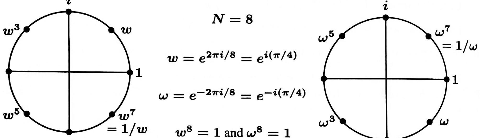
> <span style="color:#7f8c8d;">原书 Figure IV.1，书页 206（PDF p.208）；裁切自扫描页，图形未改动</span>

> <span style="color:#7f8c8d;">图 IV.1：$w$ 的各次幂也就是 $\omega$ 的各次幂。它们是 $z^N = 1$ 的 $N$ 个解。</span>
为证明 $F \Omega = NI$，我们需要下面这条性质：这些点之和为零！
```math
\text{For every } N \text{ the sum } \quad S = 1 + w + w^2 + \cdots + w^{N-1} \ \text{ is zero.} \tag{5}
```
证明的办法是把 $S$ 乘以 $w$，这样就得到 $w + w^2 + \cdots + w^N$。这与 $S$ 是同一个式子，因为末尾的 $w^N$ 与开头的 $1$ 是同一个数。于是 $Sw = S$，所以 $S$ 必定为零。你一眼就能看出，图 IV.1 中单位圆上的八个点之和为零，因为相对的 opposite pairs（两点）之和已经为零；当 $N$ 为奇数时，这种配对的办法行不通。这个事实 $S = 0$ 告诉我们：$F \Omega$ 的每一个 off-diagonal entry（非对角元）都是零，而对角元（$1$ 之和）当然等于 $N$。所以 $F_N \Omega_N = NI$。
> <span style="color:#1e8449;">**[note] 正交性为什么是全部公式的来源：从几何级数求和到 $F\Omega=NI$**</span>
> <span style="color:#1e8449;">本页要证的是一件很具体的事：$F_N\Omega_N=NI$，因此 $F_N^{-1}=\frac1N\Omega_N$。但真正值得带走的是它背后的机制——正交性。$F$ 的第 $k$ 列是 $b_k$，其第 $j$ 个分量是 $w^{jk}$（$w=e^{2\pi i/N}$）。两列取复内积（一个转置后取复共轭再点乘）时，第 $j$ 项是 $w^{-ij}w^{jk}=w^{j(k-i)}$，求和就变成几何级数 $1+r+r^2+\cdots+r^{N-1}$，其中 $r=w^{k-i}$。若 $k=i$，则 $r=1$，求和得 $N$（这就是对角元）；若 $k\ne i$，则 $r$ 是不等于 $1$ 的 $N$ 次单位根，于是 $r^{N}=1$，把和式乘以 $r$ 后首尾重合，得 $rS=S$，故 $S=0$。本页式（5）那个「把 $S$ 乘以 $w$」的两行证明，写的就是这件事。</span>
> <span style="color:#1e8449;">区分「和为零」和「模长为零」很重要。本页的 $S=0$ 说的是这些复数相加等于零，而每个 $w^{j}$ 的模长都等于 $1$：它们均匀分布在单位圆上，互相抵消。本页图 IV.1 的说明给了一个一眼可见的验证——当 $N$ 为偶数时，直径两端的两点（相差 $N/2$ 个位置，即相差一个因子 $w^{N/2}=-1$）作为一对相加已经为零，整个和自然是零；而当 $N$ 为奇数时这种配对不存在，但结论依然成立。</span>
> <span style="color:#1e8449;">正交性为什么是「全部公式的来源」，说清楚这一点比记住 $F\Omega=NI$ 更有用。任何向量 $f$ 都可以写成 $f=\sum_k c_kb_k$，要把系数 $c_k$ 单独解出来，通常意味着要解一个 $N$ 元线性方程组——很费事。但如果基向量两两正交，取内积时其余项全部消失，只剩下 $c_k(b_k,b_k)$，于是 $c_k=(b_k,f)/(b_k,b_k)$，每个系数各算各的、互不干扰。这正是书页 205（page_207）开头那段 Orthogonality（正交性）讲的意思：因为基函数正交，各系数才能被分别求出。你在 Strang 教材里已经熟悉的正交投影与最小二乘就是这么做的：把向量投到一组正交基上，投影系数就是内积比上长度平方；傅里叶变换只是把这套动作搬到了一个特殊的正交基（复指数）上，连逆矩阵都不必求——逆变换就是共轭转置除以 $N$。用 6.042J 里的话说，这相当于把「彼此有牵连」的等价类拆成互不相交的块、每块各自处理，$F\Omega=NI$ 就是这个「无耦合」性质的矩阵写法：乘积非对角元为零，说明不同频率之间没有任何串扰。</span>
> <span style="color:#1e8449;">顺带澄清本页之后那句矩阵恒等式。书页 207（page_209）讲 $\Omega=FP$，其中 $P$ 是把 $F$ 的列按 $1$ 与 $N-1$、$2$ 与 $N-2$ 对调的一个置换，且 $P^2=I$。结合 $F\Omega=NI$ 就得到 $F^4=N^2I$，于是 $F$ 的全部特征值只能落在 $\{\sqrt N,\,-\sqrt N,\,i\sqrt N,\,-i\sqrt N\}$ 这四个数里——一个 $N\times N$ 矩阵的特征值只能取四种值，规模一大就必然大量重根（书页 207 原文就说：对于大于 4 的规模，必定会有而且确实会有重复的特征值）。这也说明：决定 $F$ 的并不是它的谱（谱太贫乏了），而是它的特征向量结构。</span>
若把 $F$ 与 $\Omega$ 都除以 $\sqrt{N}$，那么这两个矩阵既是互逆的，又是复共轭的：它们都是 unitary matrices（酉矩阵）。
```math
\text{\textbf{Unitary matrices}} \quad \left( \frac{1}{\sqrt{N}} F_N \right) \left( \frac{1}{\sqrt{N}} \Omega_N \right) = \left( \frac{1}{\sqrt{N}} F_N \right) \left( \frac{1}{\sqrt{N}} \bar F_N \right) = I. \tag{6}
```
酉矩阵是正交矩阵的复版本。代替实情形的 $Q^{T} = Q^{-1}$（$Q$ 表示正交矩阵，与 DFT 矩阵 $\Omega$ 无关），这里我们有 $\bar Q^{T} = Q^{-1}$（上划线表示取复共轭）。对复矩阵做转置时，同时取复共轭是恰当的（大多数线性代数程序都会自动这样做）。同样地，实对称矩阵的复版本是 Hermitian matrix（埃尔米特矩阵），满足 $\bar S^{T} = S$。
> <span style="color:#1e8449;">**[note] 译者注（OCR 修正）：**</span> 本页 `讠` 还原为虚数单位 $i$，`冠`／`丌` 还原为 $\pi$，`仞`／`忉`／`慟` 还原为 $w$，`曰 O` 还原为 `Figure`，`厶` 还原为 $I$（单位矩阵），`况 刀 i 0` 还原为 `unitary`（酉矩阵），`U maüices` 还原为 `Unitary matrices`，`尹 O` 还原为 $F\Omega$。图中标注行（`3`、`5`、`1`、`7`、`= 1 / 慟`、`e / 4 ）` 等碎片）系插图内的点标注被 OCR 打散，图片本身无法翻译，仅保留图题与图注。（原书此处 OCR 残缺）本页末尾「酉矩阵与埃尔米特矩阵」一段在旧译中整段缺失，现据 OCR 残句（`Instead of QT = Q-1 we have QbarT = Q-1`、`a Hermitian matrix with SbarT = S`）补译；原书用的上划线记号究竟表示共轭还是共轭转置，请回原书确认。

---

<!-- page 209 -->
> <span style="color:#7f8c8d;">本页为书页 207，属 Part IV Special Matrices（特殊矩阵）之 §IV.1 Fourier Transforms: Discrete and Continuous（傅里叶变换：离散与连续）；页眉与页码为重复元素，不译。</span>
### The DFT Matrix $\Omega$ is a Permutation of the Fourier Matrix $F$（DFT 矩阵 $\Omega$ 是傅里叶矩阵 $F$ 的一个置换）
> <span style="color:#7f8c8d;">Strang LaLFD §IV.1, p.207</span>
矩阵 $F$ 与 $\Omega$ 拥有相同的各列，因此 $F$ 与 $\Omega$ 由一个 permutation matrix（置换矩阵）相连。那个置换 $P$ 不动第零列：即两个矩阵中全为 $1$ 的那一列；随后 $P$ 把 $F$ 的下一列 $(1, w, w^2, \ldots, w^{N-1})$ 与它的最后一列 $(1, w^{N-1}, w^{2(N-1)}, \ldots, w^{(N-1)^2})$ 互相交换。在它的第零行与第零列的那个 $1$ 之后，$P$ 就包含 reverse identity matrix（反序单位矩阵）$J$——即反对角线上全为 $1$ 者：
```math
P = \begin{bmatrix} 1 & 0 \\ 0 & J \end{bmatrix} = \begin{bmatrix} 1 & 0 & 0 & 0 \\ 0 & 0 & 0 & 1 \\ 0 & 0 & 1 & 0 \\ 0 & 1 & 0 & 0 \end{bmatrix}
\qquad
P^2 = I \quad \text{and} \quad \Omega = FP \quad \text{and} \quad \Omega P = FP^2 = F
```
下面是 $N=4$ 时 $\Omega = FP$ 的完整矩阵，以及矩阵恒等式 $P^2 = I$、$\Omega = FP$、$\Omega P = FP^2 = F$：
```math
\Omega = \begin{bmatrix} 1 & 1 & 1 & 1 \\ 1 & -i & (-i)^2 & (-i)^3 \\ 1 & (-i)^2 & (-i)^4 & (-i)^6 \\ 1 & (-i)^3 & (-i)^6 & (-i)^9 \end{bmatrix} = \begin{bmatrix} 1 & 1 & 1 & 1 \\ 1 & i & i^2 & i^3 \\ 1 & i^2 & i^4 & i^6 \\ 1 & i^3 & i^6 & i^9 \end{bmatrix} \begin{bmatrix} 1 & & & \\ & & & 1 \\ & & 1 & \\ & 1 & & \end{bmatrix} \qquad \begin{matrix} 1 = 1 \\ -i = i^3 \\ (-i)^2 = i^2 \\ (-i)^3 = i \end{matrix}
```
```math
```
这些矩阵恒等式引出一个引人注目的事实：$F^4 = \Omega^4 = N^2 I$。四次幂把原向量带回来（乘以 $N^2$）。只需把 $F\Omega = NI$ 与 $FP = \Omega$ 结合，并用 $P^2 = I$：
```math
F^2 P = F\Omega = NI \quad \text{so} \quad P F^2 = NI \quad \text{and} \quad F^4 = F^2 P P F^2 = N^2 I
```
由 $F^4 = N^2 I$ 推知，傅里叶矩阵 $F$ 与 DFT 矩阵 $\Omega$ 只有四种可能的 eigenvalues（特征值）！它们就是满足 $\lambda^4 = N^2$ 的那些数：$\sqrt{N}$、$-\sqrt{N}$、$i\sqrt{N}$ 以及 $-i\sqrt{N}$。对于大于 $4$ 的规模，必定会有而且确实会有重复的特征值 $\lambda$。$F$ 的 eigenvectors（特征向量）就不那么容易找出了。
### The Discrete Fourier Transform（离散傅里叶变换）
设 $f$ 为任意 $N$ 维向量 $f = (f_0, f_1, \ldots, f_{N-1})$。Discrete Fourier Series（离散傅里叶级数）把 $f$ 表示为傅里叶基向量的一种组合 $c_0 b_0 + c_1 b_1 + \cdots + c_{N-1} b_{N-1}$。那些基向量正是傅里叶矩阵 $F_N$ 的各列 $b_k$（其中含 $w$ 的各次幂）：
```math
\begin{bmatrix} f_0 \\ f_1 \\ \vdots \\ f_{N-1} \end{bmatrix} = \begin{bmatrix} b_0 & b_1 & \cdots & b_{N-1} \end{bmatrix} \begin{bmatrix} c_0 \\ c_1 \\ \vdots \\ c_{N-1} \end{bmatrix}
\qquad \begin{array}{l} f = F_N c \\ c = F_N^{-1} f \\ c = \frac{1}{N} \Omega_N f \end{array} \tag{7}
```
命令 `c = fft(f)` 乘以 DFT 矩阵 $\Omega$（再除以 $N$）。这一步是 analysis step（分析步骤），把信号分解为相互正交的分量。DFT 求出一个有限傅里叶级数 $f = c_0 b_0 + c_1 b_1 + \cdots + c_{N-1} b_{N-1}$ 的各个系数。
> <span style="color:#1e8449;">**[note] 译者注（OCR 修正）：**</span> 本页 OCR 噪声较多：`Foun er`／`Four 皿 s 皿 s` 等为 Fourier（傅里叶）之误；`O`／`0` 多为 DFT 矩阵 $\Omega$；`仞`、`国`、`歹`、`忉`、`五` 为 $w$（$w = e^{2\pi i/N}$）或 $N$ 之误；`co nnected`／`mutauion` 分别为 connected／permutation；`overlineI` 类上标按数学语境重建（如 `N21` = $N^2I$）；`ÄB` 之类残码按 §IV.1 的矩阵恒等式 $F\Omega = NI$、$FP = \Omega$、$P^2 = I$ 重建；`= 0 司 y` 还原为 `only four`（四种）。有限傅里叶级数一行的系数被 OCR 吞掉（`f = bo + · 。 《 + 一 1 一 1`），依上一段 $c_0b_0 + \cdots + c_{N-1}b_{N-1}$ 补回为 $f = c_0b_0 + c_1b_1 + \cdots + c_{N-1}b_{N-1}$。（原书此处 OCR 残缺）式（7）后半 `—\OmegaNf` 在 OCR 中只剩 `\Omega_Nf`，此处依命令 `fft` 的定义补上因子 $\frac{1}{N}$，写成 $c = \frac{1}{N}\Omega_Nf$；原书是否把两个方向都排进式（7），请回原书确认。

---

<!-- page 210 -->
> <span style="color:#7f8c8d;">本页为书页 208，承接书页 207 的 §IV.1（傅里叶变换：离散与连续）；页眉与页码为重复元素，不译。</span>
> <span style="color:#7f8c8d;">Strang LaLFD §IV.1, p.208</span>
synthesis step（合成步骤）就是逆变换 $f = \text{ifft}(c) = Fc$。它从那些系数 $(c_0, c_1, \ldots, c_{N-1})$ 出发，执行矩阵-向量乘法 $Fc$，从而恢复出 $f$。于是 $\text{ifft}(\text{fft}(f)) = f$。例子会让 $f$ 与 $c$ 这两个向量更清楚。
<span style="color:#2471a3;">**[example]**</span>
**例 1** $f = (1, 0, 0, 0)$ 的变换是 $c = (1, 1, 1, 1)/N$。
那个只有一个 spike（尖峰）的向量是一个离散 $\delta$ discrete delta function（函数）。它集中在一个点上；它的变换 $c$ 则铺开到 $N$ 个频率上。乘以 $\Omega$ 就把 $\Omega$ 的第零列挑了出来；因此 $c$ 从所有频率显示出相同的傅里叶系数 $1/N$。这里取 $N = 4$：
```math
c = \frac{1}{4}\Omega f = \frac{1}{4}\begin{bmatrix} 1 & \cdot & \cdot & \cdot \\ 1 & \cdot & \cdot & \cdot \\ 1 & \cdot & \cdot & \cdot \\ 1 & \cdot & \cdot & \cdot \end{bmatrix}\begin{bmatrix} 1 \\ 0 \\ 0 \\ 0 \end{bmatrix} = \frac{1}{4}\begin{bmatrix} 1 \\ 1 \\ 1 \\ 1 \end{bmatrix}
\qquad
f = Fc = \frac{1}{4}\left( \begin{bmatrix} 1 \\ 1 \\ 1 \\ 1 \end{bmatrix} + \begin{bmatrix} 1 \\ i \\ i^2 \\ i^3 \end{bmatrix} + \begin{bmatrix} 1 \\ i^2 \\ i^4 \\ i^6 \end{bmatrix} + \begin{bmatrix} 1 \\ i^3 \\ i^6 \\ i^9 \end{bmatrix} \right) = \begin{bmatrix} 1 \\ 0 \\ 0 \\ 0 \end{bmatrix}
```
一个 $\delta$ delta vector（向量）$f$ 的这种变换 $c$，就像“$\delta$ delta function（函数）”的连续变换。$\delta$ 函数把一切都集中在 $x = 0$；它的傅里叶变换平坦地铺开：
```math
\delta(x) = \sum_{k=-\infty}^{\infty} c_k e^{ikx} \quad \text{has} \quad c_k = \frac{1}{2\pi}\int_{-\pi}^{\pi} \delta(x)\, e^{-ikx}\, dx = \frac{1}{2\pi} \qquad \text{for every frequency } k . \tag{8}
```
可见连续变换中的 $2\pi$ 对应于离散变换中的 $N$。
<span style="color:#2471a3;">**[example]**</span>
**例 2** $f = (1, 1, \ldots, 1)$ 将变换回 delta vector（$\delta$ 向量）$c = (N, 0, \ldots, 0)$。
<span style="color:#2471a3;">**[example]**</span>
**例 3** 把 delta vector 移位到 $f = (0, 1, 0, \ldots, 0)$，会在它的变换中产生一次“modulation（调制）”。
这个移位后的 $f$ 挑出 $F$ 的下一列 $(1, w, \ldots, w^{N-1})$：
```math
c = \frac{1}{N} \Omega_N f = \frac{1}{N} \begin{bmatrix} 1 \\ \omega \\ \cdot \\ \omega^{N-1} \end{bmatrix} \quad \text{and} \quad f = Fc = \frac{1}{N} \begin{bmatrix} 1 & 1 & \cdot & 1 \\ 1 & w & \cdot & w^{N-1} \\ \cdot & \cdot & \cdot & \cdot \\ 1 & w^{N-1} & \cdot & w^{(N-1)^2} \end{bmatrix} \begin{bmatrix} 1 \\ \omega \\ \cdot \\ \omega^{N-1} \end{bmatrix} = \begin{bmatrix} 0 \\ 1 \\ \cdot \\ 0 \end{bmatrix}. \tag{9}
```
傅里叶级数中的位移是把 $f(x)$ 变成 $f(x - s)$，每个系数 $c_k$ 都乘以 $e^{-iks}$。这恰好就像把例 1 中的 $(1, 1, \ldots, 1)$ 逐项相乘，从而在例 3 中得到 $(1, \omega, \ldots, \omega^{N-1})$。
**Shift rule（移位法则）：** $c$ 空间中的一次移位，就是 $k$ 空间中各系数的乘法。
> <span style="color:#1e8449;">**[note] 译者注（OCR 修正）：**</span> 本页 `C — 1`／`c 一 1` 中的 `一` 为负号被吞，还原为 $c_{N-1}$；`1 frequencies` 中数值缺失，按上下文还原为 $N$ 个频率；`Multiplying Of` 还原为 Multiplying $\Omega$；`dc`／`诀 dc` 为 $e^{-ikx}\,dx$ 的残码；`1 ）` 等孤立括号为向量元被吞，已按 $N$ 维向量补全；`Thi s`／`Examp1es`／`tran sform` 为 OCR 空格噪声，不另注。（原书此处 OCR 残缺）式（8）在 OCR 中只存 `1`、`2 丌`（两处）、`诀 dc =`、`has Ck` 等碎片，此处依「连续变换中的 $2\pi$ 对应离散变换中的 $N$」这一平行关系（例 1 给出 $c=(1,1,1,1)/N$）重建为 $c_k=\frac{1}{2\pi}\int\delta(x)e^{-ikx}dx=\frac{1}{2\pi}$；又末尾 Shift rule 一句的 OCR 为 `A shift in c-space is multiplication of the coefficients in k-space`，而例 3 演示的其实是「$c$ 移位 ⇒ $f$ 各分量乘 $w^{j}$（调制）」，两种说法的原文措辞请回原书确认。

---

<!-- page 211 -->
> <span style="color:#7f8c8d;">本页为书页 209，属 §IV.1 Fourier Transforms: Discrete and Continuous（傅里叶变换：离散与连续）；页眉与印页码为重复元素，不译、不收录。</span>
> <span style="color:#1e8449;">[note] 译者注（OCR 修正）：</span> 本页 OCR 噪声说明：`忉`／`僦` 为 $w$（旋转因子），`馬` 为 $F_2$，`刀 512` 为 $D_{512}$，`12` 为 $I_{512}$，`C001ey` 为 Cooley，`w9 and k` 为 $w^{jk}$，`2 丌 讠 / 1024` 为 $2\pi i/1024$。对照原书：本页的两个展示式**没有编号**（式 (9) 在书页 208，本页编号只有 (10) 与 (11)），先前的 (9) 标签已按原书撤除；式 (10) 是 $F_4$ 的三矩阵分解，式 (11) 是 $F_{1024}$ 的第一步分解，两者的矩阵元素均按原书以 $i$ 的幂（$N=4$ 时 $w=i$）印出。
### One Step of the Fast Fourier Transform（快速傅里叶变换的一步）
> <span style="color:#7f8c8d;">Strang LaLFD §IV.1, p.209</span>
我们想把 $F$ 乘上向量 $c$，并让这个乘法尽可能快。
通常情况下，一个矩阵乘一个向量要做 $N^2$ 次单独的乘法——因为矩阵有 $N^2$ 个元素。
你也许会以为不可能做得更好了。
（当然，如果矩阵中含有零，那些乘法就可以跳过去不做；但 Fourier matrix（傅里叶矩阵）里一个零也没有！）
借助其元素的特殊规律 $w^{jk}$ 与 $w^{-jk}$，我们可以把 $F$ 与 $\Omega$ 分解成一种能产生许多零的形式。
这就是 FFT（快速傅里叶变换）。
关键在于 $F_N$ 与两个 $F_{N/2}$ 之间的关系。
假设 $N$ 是 $2$ 的幂（例如 $N = 2^{10} = 1024$）。
于是 $F_{1024}$ 与 $F_{512}$ 相连。
当 $N = 4$ 时，关键就在于 $F_4$ 与两个 $F_2$ 之间的关系：
```math
F_4 = \begin{bmatrix} 1 & 1 & 1 & 1\\ 1 & i & i^2 & i^3\\ 1 & i^2 & i^4 & i^6\\ 1 & i^3 & i^6 & i^9 \end{bmatrix} \qquad\text{and}\qquad \begin{bmatrix} 1 & 1 & & \\ 1 & i^2 & & \\ & & 1 & 1\\ & & 1 & i^2 \end{bmatrix}
```
左边是 $F_4$，其中没有零。
右边是一个一半元素为零的矩阵。
工作量被砍掉了一半——可是等一等，这两个矩阵并不相等。
我们还需要两个 sparse and simple（稀疏而简单）的矩阵，才能把这个分解补齐。
快速傅里叶变换用到三个矩阵：
```math
F_4 = \begin{bmatrix} 1 & & 1 & \\ & 1 & & i\\ 1 & & -1 & \\ & 1 & & -i \end{bmatrix} \begin{bmatrix} 1 & 1 & & \\ 1 & i^2 & & \\ & & 1 & 1\\ & & 1 & i^2 \end{bmatrix} \begin{bmatrix} 1 & & & \\ & & 1 & \\ & 1 & & \\ & & & 1 \end{bmatrix} \tag{10}
```
最后一个矩阵是 permutation matrix（置换矩阵）。
它把偶数下标的 $c$（即 $c_0$ 与 $c_2$）排到奇数下标的 $c$（即 $c_1$ 与 $c_3$）前面。
中间的矩阵分别在偶数 $c$ 与奇数 $c$ 上做两个半尺寸的变换 $F_2$。
最左边的矩阵把这两个半尺寸的输出合并起来——合并的方式恰好产生正确的全尺寸输出 $y = F_4c$。
当 $N = 1024$ 而 $M = \tfrac{1}{2}N = 512$ 时，同样的想法依然适用。
这里的数 $w$ 是 $w = e^{2\pi i/1024}$。
它位于单位圆上，角度为 $2\pi/1024$。
傅里叶矩阵 $F_{1024}$ 中充满了 $w$ 的幂。
快速傅里叶变换的第一步就是 Cooley 与 Tukey 发现的伟大分解（而 Gauss 在 1805 年已有先见）：
```math
F_{1024} = \begin{bmatrix} I_{512} & D_{512}\\ I_{512} & -D_{512} \end{bmatrix} \begin{bmatrix} F_{512} & \\ & F_{512} \end{bmatrix} \begin{bmatrix} \text{even-odd}\\ \text{permutation} \end{bmatrix} \tag{11}
```
其中 $I_{512}$ 是 identity matrix（单位矩阵）。
$D_{512}$ 是对角矩阵，其对角元为 $(1, w, \dots, w^{511})$。
两个 $I_{512}$ 正是我们预期的东西。
别忘了，它们用的是 $512$ 次单位根（也就是 $w^2$）。
置换矩阵把输入的向量 $c$ 分成偶数部分与奇数部分 $c' = (c_0, c_2, \dots, c_{1022})$ 与 $c'' = (c_1, c_3, \dots, c_{1023})$。
### [note] page_211 ｜ FFT 的分治结构：从 $N^2$ 到 $N\log N$ 的递归式
> <span style="color:#1e8449;">[note] Note（译者注）：本页在问一个很朴素的问题：把 $N\times N$ 的傅里叶矩阵乘上一个 $N$ 维向量，通常需要 $N^2$ 次乘法（矩阵里有 $N^2$ 个元素），能不能做得更快？回答是能，办法是把 $F_N$ 分解成三个矩阵的乘积。看 $N=4$ 的那组式子：右边那个置换矩阵把输入排成 $(c_0,c_2,c_1,c_3)$，偶下标在前；中间那个块对角矩阵在偶下标与奇下标上各做一次半尺寸变换 $F_2$；左边那个矩阵把两个半尺寸的输出用 $1$ 与 $w$ 的幂（以及对应的负号）合并起来。数一数每一步的非零元：置换矩阵有 $N$ 个（每行每列恰好一个 $1$），最左边的合并矩阵有 $2N$ 个（两个 $I_{N/2}$ 加一个对角矩阵 $D$），而中间的块对角矩阵本身并不稀疏——它是两个完整的 $F_{N/2}$，合起来有 $N^2/2$ 个非零元。所以「一步分解」只把工作量砍到大约一半（本页原话正是 the work is cut in half），真正的 $O(N\log N)$ 来自把中间那两个 $F_{N/2}$ 用同一招继续分解下去。</span>
> <span style="color:#1e8449;">为什么能把 $F_N$ 拆成两个 $F_{N/2}$，机制就在单位根上：偶数下标分量的变换用的是 $w_N^{2jk}=w_{N/2}^{jk}$（幂里的 $2$ 被吸收进底数），所以偶数下标那一半恰好是一个规模减半的傅里叶变换；奇数下标那一半再额外乘一个 $w_N^{j}$ 就同样化为半尺寸变换。这一步对应书页 210（page_212）把 $c$ 分成 $d'$ 与 $d''$、再用式（12）的 $y_j=y'_j+w^{j}y''_j$ 与 $y_{j+M}=y'_j-w^{j}y''_j$ 合并；两个半尺寸输出只需要一次加减和一次乘法就能拼出两个全尺寸输出（书页 210 说这些步骤因形状而被称为蝶形运算）。</span>
> <span style="color:#1e8449;">这里出现的递归式，就是你在 6.006 学过的分治复杂度分析。规模为 $N$ 的问题被拆成两个规模为 $N/2$ 的同样问题，而合并的一步要遍历 $N/2$ 个位置、每个位置做一次乘法和两次加减，即 $O(N)$。于是 $T(N)=2T(N/2)+O(N)$，按主定理（或直接展开 $\log_2N$ 层、每层总工作量都是 $O(N)$）得到 $T(N)=O(N\log N)$。书页 211（page_213）给出的具体数字是：$N=1024$ 时直接计算约需 $(1024)^2$ 即一百万次乘法，FFT 把它减到 $(5)(1024)=5120$ 次，节省因子 200；那一页还从「每层 $N/2$ 次乘法、共 $\log_2N$ 层」的角度把同一个计数重新推了一遍。两条推导路径值得对照：一条展开递归树数总工作量，一条数矩阵分解里非零元素的个数——它们给出同一个答案，因为稀疏分解正是递归的具体实现。</span>
> <span style="color:#1e8449;">要留意递归的两个前提。第一，$N$ 必须是 $2$ 的幂（本页明确假设 $N=2^{10}$），否则要在末尾补零到下一个 $2$ 的幂再做；第二，那些对角线上的 $w$ 的幂要预先算好并复用（就是 $w$ 的幂表），否则每次三角函数计算的开销会吃掉分治带来的好处。这两点在 6.006 讲分治时常被一带而过，在工程实现里却决定了常数因子。</span>
> <span style="color:#1e8449;">关于历史，本页的说法很谨慎：这个分解是 Cooley 与 Tukey 发现的，而 Gauss 在 1805 年已有先见。两条都能在公开文献里查到：Cooley 与 Tukey 的论文发表在 *Mathematics of Computation* **19** (1965) 297–301；Gauss 的相关工作收在其全集（*Werke*, Vol. 3）中，讲的是把插值节点按奇偶重新排列以复用计算，正是本页这套分解。所以「FFT 是 20 世纪的新发明」这个印象并不准确。</span>
> <span style="color:#1e8449;">可迁移的结论有两层。第一层是复杂度上的：稠密矩阵向量乘法是 $O(N^2)$，但当矩阵有可利用的规律时，把它分解成稀疏矩阵的乘积并用递归套用，往往能降到 $O(N\log N)$ 甚至 $O(N)$——FFT 是这个套路最著名的例子，在卷积、多项式乘法、大整数乘法里都能看到它的影子。第二层是思想上的：递归并不是「把函数调用自己」这么一句语法，而是要找到一个「规模减半后问题形状不变」的结构；本页的 $w_N^{2jk}=w_{N/2}^{jk}$ 就是那个让形状不变的关键等式。找得到它，分治就能套上；找不到，就只是把问题拆散而已。</span>

---

<!-- page 212 -->
> <span style="color:#7f8c8d;">本页为书页 210，属 §IV.1 Fourier Transforms: Discrete and Continuous（傅里叶变换：离散与连续），是 FFT 一步分解的续页；页眉与印页码为重复元素，不译、不收录。</span>
> <span style="color:#1e8449;">[note] 译者注（OCR 修正）：</span> 本页 OCR 噪声说明：`乥` 为 $\tfrac{1}{2}$，`仞`／`忉`／`細` 为 $w$，`什 om` 为 from，`刀` 为 $D$，`丆` 为 $F$；对照原书：(12) 是 $y'_j \pm (w_N)^jy''_j$ 两式，(13) 是三重求和恒等式，(14) 是 Rewrite (13) 的 $y'_j+(w_N)^jy''_j$ 形式；MATLAB 伪代码框已按原书三列内容（even/odd 的 ifft、向量 $d = w.^(0:N/2-1)$、合并 $y = [y'+d.*y''; y'-d.*y'']$）重写。
> <span style="color:#7f8c8d;">Strang LaLFD §IV.1, p.210</span>
下面这些代数公式与 $F_{1024}$ 的那个分解说的是同一件事（也就是 FFT 的一步）。
令 $M = \tfrac{1}{2}N$。
$y = F_Nc$ 的前 $M$ 个分量与后 $M$ 个分量，是由两个半尺寸变换 $y' = F_Mc'$ 与 $y'' = F_Mc''$ 合并而成的。
公式 (11) 表明，从 $N$ 到 $M = N/2$ 的这一步可写成 $y_j = y'_j + w^jy''_j$ 与 $y_{j+M} = y'_j - w^jy''_j$：
```math
y_j = y'_j + (w_N)^j y''_j, \quad j = 0, \dots, M-1
```
```math
y_{j+M} = y'_j - (w_N)^j y''_j, \quad j = 0, \dots, M-1. \tag{12}
```
把 $c$ 拆成 $c'$ 与 $c''$。
用 $F_M$ 把它们变换成 $y'$ 与 $y''$。
然后 (12) 重建出 $y$。
这些公式来自把 $c_0, \dots, c_{N-1}$ 分离成偶数下标的 $c_{2k}$ 与奇数下标的 $c_{2k+1}$，也就是 (13)：
```math
y_j = \sum_{0}^{N-1} w^{jk} c_k = \sum_{0}^{M-1} w^{2jk} c_{2k} + \sum_{0}^{M-1} w^{j(2k+1)} c_{2k+1} \qquad \text{with } M = \tfrac{1}{2}N,\ w = w_N . \tag{13}
```
偶数 $c$ 进入 $c' = (c_0, c_2, \dots)$，奇数 $c$ 进入 $c'' = (c_1, c_3, \dots)$。
接着做变换 $F_Mc'$ 与 $F_Mc''$。
关键之处在于 $w_N^{2} = w_M$，这给出 $w_N^{2jk} = w_M^{jk}$。
把 (13) 改写成两个半尺寸变换之和（这正是分离变量式的关键一步）：
```math
\text{Rewrite (13):}\qquad y_j = \sum (w_M)^{jk} c'_k + (w_N)^{j}\sum (w_M)^{jk} c''_k = y'_j + (w_N)^{j} y''_j \tag{14}
```
对 $j \ge M$，(12) 中的负号来自从 $w_N^{j}$ 中提出因子 $w_N^{M} = -1$。
在 MATLAB 里，很容易把偶数 $c$ 与奇数 $c$ 分开，并乘以相应的 $w^j$。
我们用 `conj(F)`，或者等价地使用 MATLAB 的逆变换 `ifft`，来产生 $y = Fc$。
请记住，`fft` 是基于 $\omega = \bar w = e^{-2\pi i/N}$ 的，它用 DFT 矩阵 $\Omega$ 从 $y$ 反算出 $c$。
```text
FFT step                     Transform even c's        y'  = ifft (c(0 : 2 : N-2)) * N/2;
from N to N/2                Transform odd c's         y'' = ifft (c(1 : 2 : N-1)) * N/2;
in MATLAB                    Vector 1, w, ... is d     d   = w.^(0 : N/2 - 1)';
                             Combine y' and y''        y   = [y' + d .* y''; y' - d .* y''];
```
> <span style="color:#7f8c8d;">（上框是原书边注为 “FFT step from N to N/2” 与 “MATLAB” 的伪代码框，英文按原样保留。）</span>
下一页的 flow graph（流程／信号流图）展示了偶数 $c$ 与奇数 $c$ 如何经过半尺寸的变换。
这些步骤因形状而被称为 “butterfly”（蝶形运算）。
随后输出 $y'$ 与 $y''$ 被合并起来（$y''$ 乘以来自 $D$ 的 $1, i$，也乘以来自 $-D$ 的 $-1, -i$），从而产生 $y = F_4c$。
这种把 $F_N$ 归约为两个 $F_M$ 的做法，几乎把工作量砍掉了一半——你从矩阵分解中就能看到那些零。
$50\%$ 的缩减虽然不错，但算不上了不起。
完整的 FFT 要强大得多，它节省的时间远不止一半。
其核心思想是 recursion（递归）。
而 $F$ 的这种分解同样适用于 conjugate matrix（共轭矩阵）$\Omega = \bar{F}$。
### [note] page_212 ｜ FFT 的数值误差：为什么 $\log N$ 层舍入不会把答案毁掉
> <span style="color:#1e8449;">[note] Note（译者注）：本页把 FFT 写成一组明确的代数运算（式（12）的 $y_j=y'_j+w^{j}y''_j$ 与 $y_{j+M}=y'_j-w^{j}y''_j$），这正好适合问一个 CSAPP 式的问题：这些浮点运算累积起来的误差有多大？先摆事实基础。你在 CSAPP 里学过 IEEE 754 的浮点表示：双精度有 53 位有效二进制位，规格化数的相对表示误差不超过一个常数倍的 $u\approx1.1\times10^{-16}$；关键的记账规则是，每做一次加减乘除，结果可以写成「精确结果乘上 $(1+\delta)$」，其中 $|\delta|\le u$。</span>
> <span style="color:#1e8449;">顺着这个规则数一遍 FFT 的误差。整个算法有 $\log_2N$ 层，每层每个位置做一次乘法（乘旋转因子 $w^{j}$）和两次加减；而旋转因子本身还要预先算出来——$w^{j}=e^{2\pi ij/N}$ 的实部与虚部是三角函数值，用双精度计算它们时同样带有约 $u$ 量级的相对误差，等于在第一层之前就先欠了一笔债。于是每经过一层，每个中间结果的相对误差至多加常数倍的 $u$。</span>
> <span style="color:#1e8449;">这里有个容易搞反的地方：误差是沿「层」累积的，不是沿「运算次数」累积的。虽然总共做了 $\tfrac N2\log_2N$ 次乘法，但这些乘法是并行的——第 $k$ 层只依赖第 $k-1$ 层，误差沿深度方向传播，所以传递到输出的相对误差量级是 $u$ 乘上 $\log_2N$，而不是 $u$ 乘上总运算次数。这就是「算法是数值稳定的」这句话的具体含义：这个增长很温和，$N$ 大到百万量级（$\log_2N$ 约 20）时误差仍在 $10^{-15}$ 量级。一个具体的对照是：直接做稠密矩阵乘法的 $F_Nc$，每个输出是 $N$ 项之和，误差按最坏情形可达 $u\cdot N$；FFT 的输出误差按 $L_2$ 范数计约是 $u\cdot\log N$ 量级，两者差了 $N/\log N$ 倍——对 $N=1024$ 就是约 100 倍。</span>
> <span style="color:#1e8449;">误差不会爆炸的机制值得自己推一遍：FFT 的每一步都只是在做范数不增的操作。旋转因子 $w^{j}$ 的模长恰好等于 $1$（书页 206（page_208）讲图 IV.1 时强调过这些点都在单位圆上），乘它不会放大任何分量；加减是良态的；整个变换在除以 $\sqrt N$ 归一化后是酉的。反过来说，误差的克星也因此很明确：如果输入 $f$ 的各分量尺度相差极大，或者你在实现里用递推 $w^{j+1}=w^{j}\cdot w$ 来生成整张旋转因子表，那么小量的相对误差会随递推步数累积，可能明显超出上面的估计——所以工程上更常见的做法是每一步用三角函数直接算，或对递推做周期性的重置。</span>
> <span style="color:#1e8449;">还有一处容易踩的坑与浮点数的表示范围有关：合成步骤 $f=Fc$ 是把 $N$ 项相加，书页 208（page_210）与本页都讲过 MATLAB 的 `ifft` 带了一个除以 $N$ 的因子，所以 `fft` 与 `ifft` 两次下来既不溢出也不下溢。但如果自己实现时忘了归一化，对很长的信号就可能把双精度的动态范围（约 $10^{308}$）逐步吃满，出现中间量超范围的问题。另外，两个几乎相等的大数相减会丢掉有效位——在傅里叶变换里，这意味着对「平缓信号求高频分量」这类情形，相对误差会显著变差，而这是问题本身的条件数带来的，任何稳定算法都救不回来。</span>
> <span style="color:#1e8449;">可迁移的结论：判断一个数值算法的误差，不要数运算次数，要数「误差沿依赖路径累积了多少步」，也就是关键路径的长度；并且检查每一步是不是范数不增或良态的。你在 CSAPP 里分析「浮点加法不满足结合律会导致不同求和顺序给出不同结果」时用的是同一套推理，只不过在那里关键路径是循环的长度，在这里是 $\log_2N$ 层。</span>

---

<!-- page 213 -->
> <span style="color:#7f8c8d;">本页为书页 211，属 §IV.1 Fourier Transforms: Discrete and Continuous（傅里叶变换：离散与连续）；页眉与印页码为重复元素，不译、不收录。左栏顶部残余的 `00 / C / 10 / 01 / evens − odds` 是上一页蝶形流程图的碎片，不单独成句翻译。</span>
> <span style="color:#1e8449;">[note] 译者注（OCR 修正）：</span> 本页 OCR 噪声极重：`Founer` 即 Fourier，`艹` 指 $F$（傅里叶矩阵），`丆` 指 $\bar{F}$，`办`／`仞` 为 $w$，`什 0 m` 为 from，`coples` 为 copies，`mvente d` 为 invented，`乙` 为乘法计数，`圭` 为 $\tfrac{1}{2}$，`砒` 为 that，`2 =` 为 $N^2$，`0 一 1` 为 $0$ 到 $N-1$。末句 `O = 丆` 依本书 $\Omega=\bar F$ 的约定（书页 205 定义 $\Omega$ 为 $F$ 的复共轭）还原为 $\Omega=\bar{F}$，（原书此处 OCR 残缺）原文末句是否写作 $\Omega=\bar F$ 而非 $\Omega=F/\sqrt N$。
### The Full FFT by Recursion（完整的 FFT：用递归实现）
> <span style="color:#7f8c8d;">Strang LaLFD §IV.1, p.211</span>
读到这里的读者，大概已经猜到下一步会发生什么了。
我们把 $F_N$ 归约到 $F_{N/2}$，再继续归约到 $F_{N/4}$。
每一次除以 $2$ 都把规模缩小一半：512 归到 256，256 再归到 128。
这就是递归。
递归是许多快速算法共有的基本原理。
下面是第 2 步：它用四个 $F_{256}$ 的副本，再加上对角矩阵 $D$（其中是 $w_{512}$ 的 256 次幂）。
偶下标的偶下标分量 $c_0, c_4, c_8, \ldots$ 排在前面，接着是 $c_2, c_6, c_{10}, \ldots$。
```math
\begin{bmatrix} F_{512} \\ & F_{512} \end{bmatrix} = \begin{bmatrix} I & D & & \\ I & -D & & \\ & & I & D \\ & & I & -D \end{bmatrix} \begin{bmatrix} F & & & \\ & F & & \\ & & F & \\ & & & F \end{bmatrix} \begin{bmatrix} \text{pick } 0, 4, 8, \dots \\ \text{pick } 2, 6, 10, \dots \\ \text{pick } 1, 5, 9, \dots \\ \text{pick } 3, 7, 11, \dots \end{bmatrix}.
```
我们要数一数其中单个乘法的次数，看看究竟省下了多少。
在 FFT 尚未被发明之前，计数是通常的 $N^2 = (1024)^2$，大约是 100 万次乘法。
我并不是说这些乘法本身耗时很久。
真正让代价变得庞大的是我们往往要做极多、极多次的变换——而这才是常态。
此时使用 FFT 的递归所带来的节省同样庞大：规模为 $N = 2^k$ 的代价从 $N^2$ 降到 $\tfrac{1}{2}N\log_2N$。
数 $1024$ 就是 $2^{10}$，所以 $\log_2 1024 = 10$。
于是原来 $(1024)^2$ 的计数被减到 $(5)(1024)$。
节省的因子是 200：100 万被压到 5000。
这就是为什么 FFT 彻底改变了 signal processing（信号处理）。
这一计数的推理依据如下。
共有 $\log_2N = k$ 层，从 $N = 2^k$ 一路向下走到 $N = 1$。
每一层都从对角矩阵 $D$ 带来 $N/2$ 次乘法，用来把下一层送来的半规模输出重新组装起来。
由此得到最终计数 $(N/2)\log_2N$。
关于这个了不起的算法，最后再补一点说明。
经过全部偶奇置换之后，各分量 $c$ 进入 FFT 的顺序遵循一条惊人的规律。
把 $0$ 到 $N-1$ 这些数写成二进制（例如 $N = 4$ 时为 $00, 01, 10, 11$），再把这些数位的顺序颠倒过来，得到 $00, 10, 01, 11$。
这就给出 bit-reversed order（位反转顺序）$0, 2, 1, 3$，其中偶下标仍然排在奇下标之前。
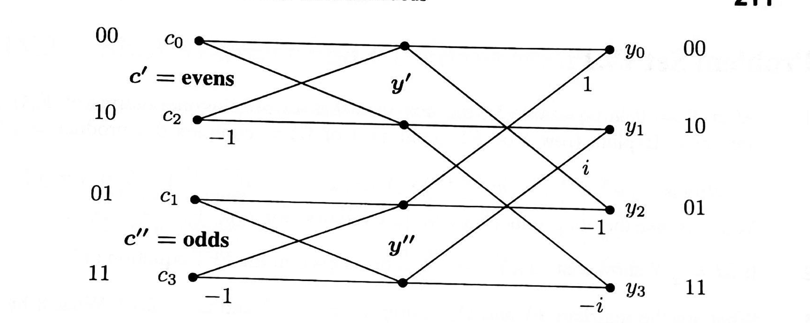
> <span style="color:#7f8c8d;">原书 Figure（FFT 递归的信号流图），书页 211（PDF p.213）；裁切自扫描页，图形未改动</span>

完整的图像展示了处于位反转顺序的各分量 $c$、递归的 $\log_2N$ 个步骤，以及最终输出 $y_0, \ldots, y_{N-1}$，它等于 $F_N$ 乘 $c$。
对 DFT matrix（DFT 矩阵）$\Omega = \bar{F}$ 而言，其 FFT 递归所用的思想完全相同。

---

<!-- page 214 -->
> <span style="color:#7f8c8d;">本页为书页 212，属 Problem Set IV.1（习题集 IV.1）；页眉 `Special Matrices`（Part IV 的篇名）与印页码为重复元素，不译、不收录。习题题干按本系列先例保留英文原文，仅把被 OCR 打散的公式还原为 LaTeX。</span>
> <span style="color:#1e8449;">[note] 译者注（OCR 修正）：</span> 本页 OCR 噪声说明：`FnON` 为 $F_N\Omega_N$（$\Omega$ 被读成 $O$、下标被吞），`O`／`03` 为 $\Omega$／$\Omega_3$，`讠 关 j` 为 $i \neq j$，`仞`／`WN` 为 $w$／$w_N$，`2 丌 3` 为 $2\pi i/3$，`歹` 为 $f$，`山 at 皿 ula` 为 that formula，`0 hogonal` 为 orthogonal；第 1、3、4、8、9 题中被打散的符号（复内积的两个因子、$w_N^{N/2} = -1$、$P$ 为 $3\times3$ 时的 $\Omega_3$、以及按列向量写出的秩一表示）均依数学语境还原。页边题号在 OCR 中只读出 1–9 共九个数字，而正文可归并出的题目块恰好也是九块，故把 `You must use the dot product for complex vectors, not $|f_1| + \cdots + |f_N|$` 一句并回第 1 题（它是对第 1 题的提示，本身不含提问），全页共 9 题，（原书此处 OCR 残缺）纸书是否实为 10 题（若如此，则本句为独立的第 2 题，其后各题号依次加 1）。

> <span style="color:#7f8c8d;">本页（书页见页首说明）原书为 Problem Set IV.1，共 9 道习题。按技能**铁律 9**（非必要习题不收录），此处不保留习题原文。</span>

---

<!-- page 215 -->
> <span style="color:#7f8c8d;">本页为书页 213，属 §IV.2 Shift Matrices and Circulant Matrices（移位矩阵与循环矩阵）；页眉与印页码为重复元素，不译、不收录。</span>
> <span style="color:#1e8449;">[note] 译者注（OCR 修正）：</span> 本页 OCR 中 `¯I` 为上标 $-1$，`尹 4`／`五` 为 $P^4$／$I$，`訂` 为 $5I$，`@` 为 $I$，`131` 为 $13I$，`什 0 m` 为 from，`lmp 0 皿 t` 为 Important；例子的规模 OCR 读作 $N = 3$ 与 $P^3 = I$，故式 (4) 的各矩阵均为 $3\times3$，并由此得到 $13I + 22P + 19P^2$；公式编号照原文保留，其中多项式乘法那一行原文未编号（下一页的普通卷积才是式 (5)）。
## IV.2 Shift Matrices and Circulant Matrices（移位矩阵与循环矩阵）
> <span style="color:#7f8c8d;">Strang LaLFD §IV.2, p.213</span>
当这个矩阵 $P$ 乘上一个向量时，各分量都向上移位：
```math
Px = \begin{bmatrix} 0 & 1 & 0 & 0 \\ 0 & 0 & 1 & 0 \\ 0 & 0 & 0 & 1 \\ 1 & 0 & 0 & 0 \end{bmatrix}\begin{bmatrix} x_1 \\ x_2 \\ x_3 \\ x_4 \end{bmatrix} = \begin{bmatrix} x_2 \\ x_3 \\ x_4 \\ x_1 \end{bmatrix} \tag{1}
```
> <span style="color:#7f8c8d;">（式 (1) 旁的边注：Upward shift（向上移位）／Cyclic permutation（循环置换）。）</span>
这个移位同时也是 cyclic permutation（循环置换）。
英文词 cyclic（循环的）与 circular（环形的）之所以适用于 $P$，是因为第一个分量 $x_1$ 跑到了末尾。
若把 $(x_1, x_2, x_3, x_4)$ 想成排在一个圆周上的数，那么 $P$ 把它们全体挪动一个位置。
而 $P^2$ 则把这个圆周转过两个位置：
```math
P^2x = \begin{bmatrix} 0 & 1 & 0 & 0 \\ 0 & 0 & 1 & 0 \\ 0 & 0 & 0 & 1 \\ 1 & 0 & 0 & 0 \end{bmatrix}\begin{bmatrix} 0 & 1 & 0 & 0 \\ 0 & 0 & 1 & 0 \\ 0 & 0 & 0 & 1 \\ 1 & 0 & 0 & 0 \end{bmatrix}\begin{bmatrix} x_1 \\ x_2 \\ x_3 \\ x_4 \end{bmatrix} = \begin{bmatrix} 0 & 0 & 1 & 0 \\ 0 & 0 & 0 & 1 \\ 1 & 0 & 0 & 0 \\ 0 & 1 & 0 & 0 \end{bmatrix}\begin{bmatrix} x_1 \\ x_2 \\ x_3 \\ x_4 \end{bmatrix} = \begin{bmatrix} x_3 \\ x_4 \\ x_1 \\ x_2 \end{bmatrix} \tag{2}
```
每多乘一个因子 $P$，就多一次移位。
于是 $P^4$ 给出完整的 $360^\circ$ 旋转，并且 $P^4 = I$。
接下来的幂 $P^5, P^6, P^7, P^8$ 重复同样的模式，再一次绕回原处。
注意 $P^3$ 就是 $P$ 的逆，因为 $(P^3)(P) = P^4 = I$。
### [note] page_215 ｜ 置换矩阵 $P$ 与位反转顺序：把置换拆成轮换来看
> <span style="color:#1e8449;">[note] Note（译者注）：本页的 $P$ 是「把每个分量向上移位一格、第一个分量绕到末尾」的那个矩阵。它值得单独立一条注，因为它把一个抽象的置换变成了可以数、可以画的东西。写下来就是：$P$ 作用在 $(x_1,x_2,x_3,x_4)$ 上得到 $(x_2,x_3,x_4,x_1)$。跟踪一个分量的足迹：位置 1 的分量先跑到位置 4，再到位置 3，再到位置 2，最后回到位置 1——四个位置被串成一个圈。这正是 6.042J 里「置换的轮换分解」：任意置换都可以唯一地（不计次序）写成若干互不相交的轮换之积，而 $P$ 的轮换分解就是一个长度为 4 的单轮换 $(1\,4\,3\,2)$。于是 $P^4=I$ 立刻可见：走一圈回到原处。同理 $P^3$ 是 $P$ 的逆（本页原文就是这样说的），因为再走三步就凑满一圈；一般 $N$ 情形下 $P^N=I$、$P^{N-1}=P^{-1}$。</span>
> <span style="color:#1e8449;">轮换分解还解释了本页后面那句「每条对角线都是常数」的循环矩阵为什么封闭。把 $C=c_0I+c_1P+c_2P^2+c_3P^3$ 当作 $P$ 的多项式，两个循环矩阵相乘就是两个多项式相乘，再把超过 $N-1$ 次的幂按 $P^N=I$ 折回来。两个多项式的乘法可交换，所以 $CD=DC$——本页说的重要事实不必逐个元素去验证，用轮换关系一句话就能说完。书页 214（page_216）把这个「折回来」写成了公式：式（5）的普通卷积 $(1,2,3)*(5,0,4)=(5,10,19,8,12)$ 有 5 项，而式（6）的循环卷积把最高的两项折回低位，得到 $(5+8,\;10+12,\;19)=(13,22,19)$——折回的规则正是 $P^3=I$（$P^3$ 折成 $I$）与 $P^4=P$（$P^4$ 折成 $P$），注意这个例子取的是 $N=3$。</span>
> <span style="color:#1e8449;">把这套工具用到 FFT 里的那个置换上，收获更具体。书页 211（page_213）说，全部偶奇置换做完之后，各分量进入 FFT 的顺序是位反转顺序：把 $0$ 到 $N-1$ 写成二进制，再把数位次序颠倒。$N=4$ 时得到 $0,2,1,3$。去查它的轮换分解：$0$ 与 $3$ 各自不动（固定点），$1$ 与 $2$ 互换，是一个对换。也就是说，这个置换是对合的——做两次就回到原处。这与书页 207（page_209）讲的 $\Omega=FP$、$P^2=I$ 属于同一类现象：偶奇打乱这类置换通常满足 $P^2=I$，因为「把偶数挑到前面」这件事重复做一次就把顺序还原了。</span>
> <span style="color:#1e8449;">一个小技巧随之出现：既然置换是对合的，它的置换矩阵必然是对称的（第 $i$ 行第 $j$ 列与第 $j$ 行第 $i$ 列同时为 $1$），而书页 207 里那个把 $F$ 的列前后翻转的 $J$（反对角线上全为 $1$ 的反序单位矩阵）确实是对称的。另外，数一数位反转置换的逆序数，还能确定它对应多少次行交换的奇偶性：$N=4$ 时 $0,2,1,3$ 只有一对逆序（$2$ 排在 $1$ 前面），是奇置换。这类「数逆序定奇偶」的练习在 6.042J 里出现过，在这里它给出一条实用的自检——如果你实现的位反转排序交换次数是偶数，那就一定有 bug。位反转顺序的实际意义也值得点一句：它让整张递归分解图可以原地执行，输入按位反转顺序排好后，每一层只在本层的相邻位置之间做蝶形运算，不需要额外的临时数组。</span>
> <span style="color:#1e8449;">可迁移的结论：遇到任何置换或重排（位反转、转置、分块洗牌、缓存行重排），第一件事是写它的轮换分解——轮换长度告诉你迭代几次回到原处（对合、单轮换、多轮换一目了然），固定点告诉你哪些位置完全不需要动（可以直接跳过，省时间），逆序数的奇偶性则可以给实现做自检。这与 CSAPP 里分析矩阵转置时的分块重排是同一个思路：先把数据移动的模式看清，才知道能不能原地做、要不要额外的缓冲区。</span>
下一个矩阵称为 circulant（循环矩阵）。
它无非是 $P, P^2, P^3$ 与 $P^4 = I$ 的组合，其特点是每条对角线都是常数：
```math
\text{Circulant matrix} \quad C = c_0I + c_1P + c_2P^2 + c_3P^3 = \begin{bmatrix} c_0 & c_1 & c_2 & c_3 \\ c_3 & c_0 & c_1 & c_2 \\ c_2 & c_3 & c_0 & c_1 \\ c_1 & c_2 & c_3 & c_0 \end{bmatrix} \tag{3}
```
该矩阵中的每一条对角线，其绕行方式与 $P$ 中那些 $1$ 完全一样。
带有 $c_1$ 的那条对角线，由底部第四个 $c_1$ 补全。
重要之处在于：两个循环矩阵 $C$ 与 $D$ 相乘，其乘积 $CD = DC$ 仍是循环矩阵。
当你计算 $CD$ 时，你是在把 $P$ 的幂相乘，从而得到 $P$ 的更高次幂。
而 $DC$ 做的完全是同一件事。
这个例子取 $N = 3$，于是 $P^3 = I$：
```math
CD = \begin{bmatrix} 1 & 2 & 3 \\ 3 & 1 & 2 \\ 2 & 3 & 1 \end{bmatrix} \begin{bmatrix} 5 & 0 & 4 \\ 4 & 5 & 0 \\ 0 & 4 & 5 \end{bmatrix} = \begin{bmatrix} 13 & 22 & 19 \\ 19 & 13 & 22 \\ 22 & 19 & 13 \end{bmatrix} \qquad \text{circulant} \tag{4}
```
```math
(I + 2P + 3P^2)(5I + 4P^2) = (5I + 4P^2)(I + 2P + 3P^2) = 5I + 10P + (15 + 4)P^2 + 8P^3 + 12P^4 = 13I + 22P + 19P^2
```

---

<!-- page 216 -->
> <span style="color:#7f8c8d;">本页为书页 214，属 §IV.2 Shift Matrices and Circulant Matrices（移位矩阵与循环矩阵）的续页；页眉与印页码为重复元素，不译、不收录。</span>
> <span style="color:#7f8c8d;">Strang LaLFD §IV.2, p.214</span>
> <span style="color:#1e8449;">[note] 译者注（OCR 修正）：</span> 本页 OCR 中的 `山 at` 为 that，`an d` 为 and，`什 om` 为 from，`皑` 类噪声为矩阵本体；普通卷积在原文中编号为 $(5)$、循环卷积编号为 $(6)$（OCR 已读出的两个编号即为此），`P3 = I` 与 `P4 = P` 是 $N=3$ 情形的正确读法，（原书此处 OCR 残缺）本页 $D$ 的顶行向量是 $(5,0,4)$（三元），不是 $(5,0,4,0)$。
在最后一步中，我需要并使用了循环关系 $P^3 = I$ 与 $P^4 = P$。于是 $C$ 的向量 $(1, 2, 3)$ 与 $D$ 的向量 $(5, 0, 4)$ 为 $CD$ 与 $DC$ 产生出同一个向量 $(13, 22, 19)$。这种作用在向量上的运算称为 cyclic convolution（循环卷积）。
总结一下：当我们把两个 $N\times N$ 的循环矩阵 $C$ 与 $D$ 相乘时，我们取向量 $(c_0, c_1, \cdots, c_{N-1})$ 与 $(d_0, d_1, \cdots, d_{N-1})$ 的 cyclic convolution（循环卷积）。ordinary convolution（普通卷积）给出的是把 $(c_0I + c_1P + \cdots + c_{N-1}P^{N-1})$ 乘以 $(d_0I + d_1P + \cdots + d_{N-1}P^{N-1})$ 时的各项系数；而 cyclic convolution（循环卷积）用到的则是 $P^{N} = I$ 这一关键事实。（续）卷积。ordinary convolution（普通卷积）求的是 $(c_0 + c_1 P + \cdots + c_{N-1}P^{N-1})$ 乘以 $(d_0 + d_1 P + \cdots + d_{N-1}P^{N-1})$ 之后的各项系数；而循环卷积用到的关键事实是 $P^N = I$。
```math
\text{Convolution}\qquad (1,2,3)*(5,0,4)=(5,10,19,8,12) \tag{5}
```
```math
\text{Cyclic convolution}\qquad (1,2,3)\circledast(5,0,4)=(5+8,10+12,19)=(13,22,19) \tag{6}
```
而普通卷积就是你二年级学过的乘法（因为没有向下一位“进位”，所以更简单）：
```math
\begin{array}{rrrrr}
& & 1 & 2 & 3\\
& & 5 & 0 & 4\\ \hline
& & 4 & 8 & 12\\
& 0 & 0 & 0 & \\
5 & 10 & 15 & & \\ \hline
5 & 10 & 19 & 8 & 12
\end{array}
\qquad = c * d
```
循环的那一步把 $5 + 8$ 合并起来，因为 $P^3 = I$；它把 $10 + 12$ 合并起来，因为 $P^4 = P$；结果就是 $(13, 22, 19)$。
> <span style="color:#7f8c8d;">（原书边注：Practice（练习）。）</span>
Practice（练习）：
```math
\begin{aligned}
(0,1,0) \circledast (d_0, d_1, d_2) &= (d_1, d_2, d_0)\\
(1,1,1) \circledast (d_0, d_1, d_2) &= (d_0 + d_1 + d_2,\ d_0 + d_1 + d_2,\ d_0 + d_1 + d_2)\\
(c_0, c_1, c_2) \circledast (d_0, d_1, d_2) &= (d_0, d_1, d_2) \circledast (c_0, c_1, c_2)
\end{aligned}
```
最后这一行说明：对循环矩阵有 $CD = DC$，对循环卷积有 $c \ast d = d \ast c$。$C$ 中 $P$ 的幂与 $D$ 中 $P$ 的幂彼此可交换。
如果你把 $1 + 2 + 3$ 加起来得 $6$、把 $5 + 0 + 4$ 加起来得 $9$，你就得到对卷积的一次快速检查。把 6 乘以 9 得 54，那么 54 应当（而且确实）等于 $5 + 10 + 19 + 8 + 12 = 54$，这正是普通卷积各项之和；而 $13 + 22 + 19 = 54$ 则是循环卷积各项之和。
$c_i$ 之和乘以 $d_j$ 之和，等于输出之和。这是因为在 $c * d$ 与 $c \ast d$ 中，每个 $c$ 都与每个 $d$ 相乘一次。
> <span style="color:#1e8449;">[note] 译者注（OCR 修正）：原 OCR 把「练习」一行的两个因子写成 `@0 ， dl ， d2 ） ． @0 ， CI ， C2` 一类的残缺串，其中卷积结果三个分量在 OCR 中完全相同（`do + dl + d2`），据此还原为「一个因子取 $(1,1,1)$、另一个取 $(c_0,c_1,c_2)$」这一使三个分量相等的写法，（原书此处 OCR 残缺）练习行原文的第二个因子究竟是 $(c_0,c_1,c_2)$ 还是 $(d_0,d_1,d_2)$。</span>

---

<!-- page 217 -->
> <span style="color:#7f8c8d;">本页为书页 215，属 §IV.2 Shift Matrices and Circulant Matrices（移位矩阵与循环矩阵）；页眉与印页码为重复元素，不译、不收录。</span>
### Eigenvalues and Eigenvectors of $P$（$P$ 的特征值与特征向量）
> <span style="color:#7f8c8d;">Strang LaLFD §IV.2, p.215</span>
> <span style="color:#1e8449;">[note] 译者注（OCR 修正）：本页 OCR 中的符号 `尸` 为置换矩阵 $P$ 之误，`仞` 为 $w$ 之误，`乃`、`纟`、`山`、`况` 等均为断字噪声，`1 = /\ 4` 为 $q_1 = \lambda q_4$；被破坏的公式按移位矩阵 $P$ 的数学语境重建，编号依原文。</span>
当 $N = 4$ 时，方程 $Pq = \lambda q$ 直接给出四个特征值与四个特征向量：
```math
Px = \begin{bmatrix} 0 & 1 & 0 & 0\\ 0 & 0 & 1 & 0\\ 0 & 0 & 0 & 1\\ 1 & 0 & 0 & 0 \end{bmatrix}\begin{bmatrix} x_1 \\ x_2 \\ x_3 \\ x_4 \end{bmatrix} = \begin{bmatrix} x_2 \\ x_3 \\ x_4 \\ x_1 \end{bmatrix} = \lambda\begin{bmatrix} x_1 \\ x_2 \\ x_3 \\ x_4 \end{bmatrix} \quad \text{gives} \quad \begin{array}{l} x_2 = \lambda x_1\\ x_3 = \lambda x_2\\ x_4 = \lambda x_3\\ x_1 = \lambda x_4 \end{array} \tag{7}
```
从最后一个方程 $x_1 = \lambda x_4$ 出发向上回代：$x_1 = \lambda x_4 = \lambda^2 x_3 = \lambda^3 x_2 = \lambda^4 x_1$，于是得到 $\lambda^4 = 1$，亦即 $\lambda^4 q_1 = q_1$，所以 $\lambda = 1$ 的四个四次方根之一成立。
**$P$ 的特征值就是 $1$ 的四个四次方根。**它们都是 $w = i$ 的各次幂 $i, i^2, i^3, 1$：
```math
\lambda = i, \qquad \lambda = i^2 = -1, \qquad \lambda = i^3 = -i, \qquad \text{and} \qquad \lambda = i^4 = 1 . 1 \tag{7}
```
```math
\tag{8}
```
这四个数正是 $\det(P - \lambda I) = 0$ 的四个解。它们均匀地分布在复平面的单位圆上（图 IV.2）。
当 $P$ 是 $N \times N$ 矩阵时，同样的推理由 $P^N = I$ 导出 $\lambda^N = 1$。特征值依然均匀地分布在圆周上，而此时它们是某个复数的各次幂，该复数的角度为 $360/N$ 度 $= 2\pi/N$ 弧度。
```math
\text{The solutions to } z^N = 1 \text{ are } \lambda = w, w^2, \ldots, w^{N-1}, 1 \quad \text{with } w = e^{2\pi i/N} . \tag{9}
```
在复平面中，第一个特征值 $w$ 就是 $e^{i\theta} = \cos\theta + i\sin\theta$，而角度 $\theta$ 为 $2\pi/N$。其余特征值的角度依次为 $2\theta, 3\theta, \ldots, N\theta$。由于 $\theta = 2\pi/N$，最后一个角度是 $N\theta = 2\pi$，相应的特征值等于 $\lambda = e^{2\pi i}$，即 $\cos 2\pi + i\sin 2\pi = 1$。
对于复数的幂运算，带有 $e^{i\theta}$ 的极坐标形式远比使用 $\cos\theta + i\sin\theta$ 更好。
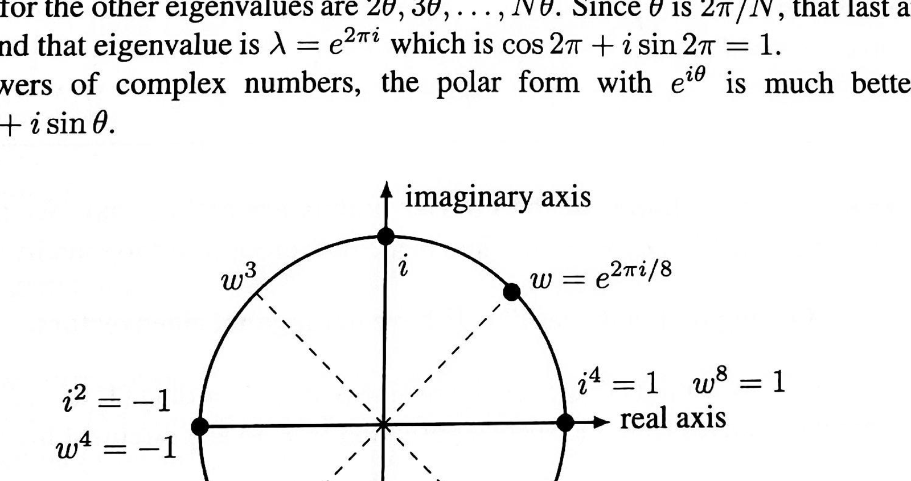
> <span style="color:#7f8c8d;">原书 Figure IV.2，书页 215（PDF p.217）；裁切自扫描页，图形未改动</span>

> <span style="color:#7f8c8d;">图 IV.2 图示：复平面中的单位圆，imaginary axis（虚轴）向上、real axis（实轴）向右；圆上标出 $i$（顶部）、$-1$（左）、$-i$（底部）、$1$（右），另有 $w^3$（第二象限）、$w = e^{\,2\pi i/8}$（第一象限）以及 $w^5$、$w^7$（分别位于第三、第四象限）；轴旁还标有左侧的 $i^2 = -1$、$w^4 = -1$，右侧的 $i^4 = 1$、$w^8 = 1$，以及底部的 $i^6 = -i$。</span>
> <span style="color:#7f8c8d;">图 IV.2：$P_N$ 的特征值——对于 $N = 4$，$\lambda = i$ 的 4 个幂之和必为零；对于 $N = 8$，$\lambda = w = e^{\,2\pi i/8}$ 的 8 个幂之和同样必为零。</span>
> <span style="color:#1e8449;">[note] 译者注（OCR 修正）：原 OCR 把 $N$ 误作空白，把图注中 $w = e^{2\pi i/4}$ 与 $w = e^{2\pi i/8}$ 的两句拆散在行间；指数 4 与 8 均依图注语境补回，公式环境内不保留中文。</span>

---

<!-- page 218 -->
> <span style="color:#7f8c8d;">本页为书页 216，属 §IV.2 Shift Matrices and Circulant Matrices（移位矩阵与循环矩阵）的续页；页眉与印页码为重复元素，不译、不收录。</span>
### Eigenvectors of $P$ and the Fourier Matrix（$P$ 的特征向量与傅里叶矩阵）
> <span style="color:#7f8c8d;">Strang LaLFD §IV.2, p.216</span>
> <span style="color:#1e8449;">[note] 译者注（OCR 修正）：本页 OCR 中的 `忉` 为 $\lambda$ 之误，`仞` 为 $w$ 之误，`Ä3` 为 $\lambda_3$ 之误，`什 om` 为 from 之误，`2 丌 / N`／`2 冠` 为 $2\pi/N$ 之误；被破坏的公式按傅里叶矩阵的数学语境重建，编号依原文。式 (11)、(12) 中的正交关系依本书 $\Omega=\bar F$、$F\Omega=NI$（书页 208）的约定写作 $\bar{F}^{\mathrm{T}}F = NI$，（原书此处 OCR 残缺）纸书此处印的是 $\bar F^{\mathrm{T}}F$ 还是 $F\Omega$。</span>
已知 $P$ 的 $N$ 个特征值为 $\lambda = 1, w, w^2, \dots, w^{N-1}$（它们来自 $P^N = I$），我们很快就能找出特征向量。令 $q$ 的第一个分量为 $1$，$q$ 的其余分量就是 $\lambda, \lambda^2, \lambda^3$。例如取 $\lambda = w$：
```math
P
\begin{bmatrix} 1\\ w\\ w^2\\ w^3 \end{bmatrix}
=
\begin{bmatrix} w\\ w^2\\ w^3\\ 1 \end{bmatrix}
=
w
\begin{bmatrix} 1\\ w\\ w^2\\ w^3 \end{bmatrix}
```
$P$ 的特征向量为
```math
q_0 =
\begin{bmatrix} 1\\ 1\\ 1\\ 1 \end{bmatrix},\quad
q_1 =
\begin{bmatrix} 1\\ w\\ w^2\\ w^3 \end{bmatrix},\quad
q_2 =
\begin{bmatrix} 1\\ w^2\\ w^4\\ w^6 \end{bmatrix},\quad
q_3 =
\begin{bmatrix} 1\\ w^3\\ w^6\\ w^9 \end{bmatrix}
\tag{10}
```
我们从零开始编号，正如研究傅里叶的人一贯所做的那样。第零个特征向量 $q_0$ 的特征值是 $w^0 = 1$。这个特征向量矩阵的各列依次为 $q_0, q_1, q_2, q_3$。$P$ 的这个特征向量矩阵就是 Fourier matrix（傅里叶矩阵）。
```math
\begin{array}{c}
\text{Eigenvector matrix}\\
N=4\\
\text{Fourier matrix}
\end{array}
\qquad
\begin{bmatrix}
1 & 1 & 1 & 1\\
1 & w & w^2 & w^3\\
1 & w^2 & w^4 & w^6\\
1 & w^3 & w^6 & w^9
\end{bmatrix}
\quad \text{has } \overline{F}^{\,T}F = 4I.
\tag{11}
```
对任意大小 $N$，这个模式都保持不变。第 $k$ 个特征值是 $w^k = (e^{2\pi i/N})^k = e^{2\pi ik/N}$。同样地，计数从零开始：$\lambda_0 = w^0 = 1$，$\lambda_1 = w$，$\ldots$，$\lambda_{N-1} = w^{N-1}$。**第 $k$ 个特征向量含 $w^k$ 的各次幂。**这个特征向量矩阵含全部 $N$ 个特征向量，它就是 $N\times N$ 的傅里叶矩阵，满足 $\bar F^{\mathrm{T}}F = NI$。$\lambda_1 = w$，$\ldots$，$\lambda_{N-1} = w^{N-1}$。第 $k$ 个特征向量含有 $w$ 的各次幂。该特征向量矩阵把全部特征向量都包含在内，它是一个 $N \times N$ 的傅里叶矩阵，并且 $\bar{F}^{\mathrm{T}} F = NI$。
```math
\boxed{
\begin{array}{l}
\textbf{Fourier matrix}\\
\textbf{Eigenvectors of } P
\end{array}
\quad
F_N =
\begin{bmatrix}
1 & 1 & 1 & \cdot & 1 \\
1 & w & w^2 & \cdot & w^{N-1} \\
1 & w^2 & w^4 & \cdot & w^{2(N-1)} \\
\cdot & \cdot & \cdot & \cdot & \cdot \\
1 & w^{N-1} & w^{2(N-1)} & \cdot & w^{(N-1)(N-1)}
\end{bmatrix}.
}
\tag{12}
```
> <span style="color:#1e8449;">[note] 译者注（OCR 修正）：第 $(12)$ 式在 OCR 中仅残存散落的幂次 1、2、4、$2(N-1)$、$(N-1)(N-1)$，现按「第 $k$ 个特征向量含 $w^k$ 的各次幂」的模式重建；原式编号 $(12)$ 依原文保留。</span>
我们再一次看到，傅里叶矩阵的各列是正交的。这里必须使用复内积 $(x, y) = \bar{x}^{\mathrm{T}} y$。下面是正交性的**新证明**：
**像 $P$ 这样的正交矩阵，其特征向量也相互正交。**
> <span style="color:#1e8449;">[note] 译者注（补充推导）：</span> 这一句可以直接算出来：$(\bar F^{\mathrm{T}}F)_{kl} = \sum_{j=0}^{N-1} \bar w^{\,jk} w^{\,jl} = \sum_{j=0}^{N-1} w^{\,j(l-k)}$，当 $k=l$ 时每一项都是 $1$、和为 $N$，当 $k\neq l$ 时它是公比 $w^{l-k}\neq1$ 的等比数列、和为 $0$。于是 $\bar F^{\mathrm{T}}F = NI$，即 $F^{-1} = \bar F^{\mathrm{T}}/N$。
```math
(\bar{F}^{\mathrm{T}} F)_{kl} = \sum_{j=0}^{N-1} \bar{w}^{\,jk} w^{\,jl} = \sum_{j=0}^{N-1} w^{\,j(l-k)} =
\begin{cases} N, & k = l\\ 0, & k \neq l \end{cases}
```
于是 $\bar{F}^{\mathrm{T}} F = NI$，即 $F^{-1} = \bar{F}^{\mathrm{T}} / N$。
### [note] page_218 ｜ 傅里叶基不是“记住的”，是解出来的
> <span style="color:#1e8449;">[note] Note（译者注）：这一页最容易被读成“记住结论”：$P$ 的特征向量是 $(1,w,w^2,w^3)$，$F$ 就是把这些特征向量排成的矩阵。但“为什么必然长这样”完全可以从定义算出来，只需要两件你已经有的工具。</span>
> <span style="color:#1e8449;">**第一件：把矩阵方程拆成逐分量的递推。** $P$ 的作用是把向量整体循环移位一格——$Pq$ 的第一个分量是 $q$ 的第二个分量，而 $Pq$ 的最后一个分量回到 $q$ 的第一个分量。于是 $Pq=\lambda q$ 这条向量方程等价于 $N$ 条标量方程：$q_2=\lambda q_1$、$q_3=\lambda q_2$、$\dots$、$q_1=\lambda q_N$。取 $q_1=1$，前 $N-1$ 条递推逼出 $q=(1,\lambda,\lambda^2,\dots,\lambda^{N-1})$。几何数列不是猜出来的，是被“每一步只向前看一格”这个结构逼出来的；这个“先写递推、再解递推”的套路你在 6.006 里已经做过很多次。</span>
> <span style="color:#1e8449;">**第二件：边界条件把连续的 $\lambda$ 钉成 $N$ 个离散值。** 剩下那条 $q_1=\lambda q_N$ 代进几何数列，得到 $1=\lambda^N$：$\lambda$ 必须是 $x^N=1$ 的根，而 $N$ 次方程恰好有 $N$ 个互不相同的根 $w^k$（$w=e^{2\pi i/N}$）。这才是本页的要害——特征值的**离散性**来自“循环”这个边界条件。把循环换成固定端点（$q_0=q_{N+1}=0$，就是 §IV.4 里的 fixed 边界），同一条递推会给出 $\sin$ 型特征向量，特征值变成另一串数。所以“边界条件决定特征函数族”这句话，在这里以最简形式第一次出现。</span>
> <span style="color:#1e8449;">$w$ 的乘法法则也值得停一下：$w^aw^b=w^{a+b}$，指数按模 $N$ 相加。这正是你在 6.042J 里做熟的“模 $N$ 同余”算术，只是对象从整数换成了复数；而正是它保证了 $F$ 的各列不会互相“串味”。</span>
> <span style="color:#1e8449;">**正交性也不需要新工具。** $(\bar F^{T}F)_{kl}=\sum_{j=0}^{N-1}w^{\,j(l-k)}$ 是一个等比数列求和，公比 $r=w^{\,l-k}$。当 $k\ne l$ 时 $r\ne1$ 而 $r^{N}=1$，和等于 $(1-r^{N})/(1-r)=0$；当 $k=l$ 时每项都是 $1$，和为 $N$。于是 $F^{-1}=\bar F^{T}/N$，$F/\sqrt N$ 是一个“保长度”的坐标变换。注意这里必须用共轭内积 $(x,y)=\bar y^{T}x$：共轭的作用是让 $\|x\|^2=\bar x^{T}x=\sum|x_i|^2>0$，否则“长度”会算出复数，正交、投影、最小二乘这一整套语言立刻塌掉。</span>
> <span style="color:#1e8449;">**一个来自 CSAPP 的提醒。** 按定义算 DFT 需要 $N^2$ 次复数乘加，FFT 只要 $(N/2)\log_2 N$ 次。运算次数不只是“快慢”：每一次浮点运算都会引入约 $2^{-52}\approx2.2\times10^{-16}$ 的相对舍入（CSAPP 第 2 章的 IEEE 754 部分），而误差沿着运算链累积。按定义算，每个输出要累加 $N$ 项、共有 $N^2$ 条长链；FFT 把计算组织成 $\log_2N$ 层，每层的链很短。算法的结构改变了舍入误差的累积路径——在这里，“算得更快”通常也意味着“算得更准”。</span>
> <span style="color:#1e8449;">**可迁移的结论**：看到某矩阵的特征向量“像是从天上掉下来的”，就回到 $Aq=\lambda q$ 的逐分量形式写一遍：多半得到一个递推加一个边界条件，递推给出解的**形状**（几何数列、正弦、指数），边界条件给出特征值的**取值**。这条思路在 §IV.5 的 Toeplitz matrix（托普利茨矩阵）与差分方程里会再来一遍，只是那时循环被打破——形状还在，取值变复杂。</span>
像 $P$ 这样的正交矩阵，其（复）特征向量也相互正交。于是 $P = F\Lambda \bar{F}^{\mathrm{T}}/N$，其中对角特征值矩阵为 $\Lambda = \operatorname{diag}(1, w, \ldots, w^{N-1})$。
> <span style="color:#1e8449;">[note] 译者注（OCR 修正）：原 OCR 此处的正交性证明与对角化公式仅残存 `（ ）= 而 T`、`P = FAFT /`、`= di ag （ 1 ， 仞 ，…）` 等片段，已按共轭转置与 $F^{-1} = \bar{F}^{T}/N$ 的语境重建为上式。</span>
下一页将从特殊的置换矩阵 $P$ 转向一般的循环矩阵 $C$。

---

<!-- page 219 -->
> <span style="color:#7f8c8d;">本页为书页 217，属 §IV.2 Shift Matrices and Circulant Matrices（移位矩阵与循环矩阵）的续页；页眉与印页码为重复元素，不译、不收录。</span>
### Eigenvalues and Eigenvectors of a Circulant $C$（循环矩阵 $C$ 的特征值与特征向量）
> <span style="color:#7f8c8d;">Strang LaLFD §IV.2, p.217</span>
> <span style="color:#1e8449;">[note] 译者注（OCR 修正）：本页 OCR 中的 `尹`、`尸` 均为置换矩阵 $P$，`Ä`、`/\` 为特征值 $\lambda$，`仞` 为 $w$，`@`、`。` 为卷积记号，`士` 为 $\pm$，`ls` 为 It；公式均按循环矩阵的数学语境重建。</span>
循环矩阵 $C$ 的特征向量尤其容易求：它与置换矩阵 $P$ 的特征向量完全相同。因此它们就是同一个 Fourier matrix（傅里叶矩阵）$F$ 的各列 $q_0, q_1, \dots, q_{N-1}$。下面写出第 $k$ 个特征向量与特征值所满足的 $C q_k = \lambda_k q_k$：
```math
C q_k = \bigl(c_0 I + c_1 P + \cdots + c_{N-1} P^{\,N-1}\bigr) q_k
= \bigl(c_0 + c_1 w^k + \cdots + c_{N-1} w^{\,k(N-1)}\bigr) q_k \tag{13}
```
请记住 $w^k = e^{\,2\pi i k/N}$ 正是 $P$ 的第 $k$ 个特征值，而这些数就藏在傅里叶矩阵 $F$ 之中。于是方程 $(13)$ 中 $C$ 的特征值具有一个近乎神奇的公式：把 $F$ 乘上 $C$ 顶行中的向量 $c$，就得到了全部特征值。
```math
\begin{bmatrix}
\lambda_0(C)\\
\lambda_1(C)\\
\lambda_2(C)\\
\cdot\\
\lambda_{N-1}(C)
\end{bmatrix}
=
\begin{bmatrix}
c_0 + c_1 + \cdots + c_{N-1}\\
c_0 + c_1 w + \cdots + c_{N-1} w^{\,N-1}\\
c_0 + c_1 w^2 + \cdots + c_{N-1} w^{\,2(N-1)}\\
\cdot\cdot\cdot\\
c_0 + c_1 w^{\,N-1} + \cdots + c_{N-1} w^{(N-1)(N-1)}
\end{bmatrix}
= F\begin{bmatrix} c_0\\ c_1\\ c_2\\ \cdot\\ c_{N-1} \end{bmatrix} = Fc \tag{14}
```
$C$ 的特征值就是 $Fc$ 的各个分量，也就是 $c$ 的 inverse Fourier transform（逆傅里叶变换）。
### [note] page_219 ｜ 一个 $F$ 为什么能同时对角化所有循环矩阵
> <span style="color:#1e8449;">[note] Note（译者注）：把 $(13)$ 式读慢一点，会看到一个相当强的事实——对**所有**循环矩阵 $C$，同一组向量 $q_0,\dots,q_{N-1}$ 都是特征向量，区别只在特征值。用矩阵的语言说，傅里叶矩阵 $F$ 同时对角化了整个循环矩阵族：$F^{-1}CF=\Lambda(C)$，$\Lambda(C)$ 就是把 $Fc$ 放上对角线。一个 $F$ 凭什么一次管完无穷多个矩阵？</span>
> <span style="color:#1e8449;">**机制一：每个循环矩阵都是 $P$ 的多项式。** 循环矩阵的定义式本身就是 $C=c_0I+c_1P+\dots+c_{N-1}P^{N-1}$，也就是 $C=p(P)$。于是只要 $Pq=\lambda q$，就有 $P^2q=\lambda^2q$，一般地 $P^kq=\lambda^kq$（对 $k$ 归纳一步）。把它线性组合起来：$Cq=(c_0+c_1\lambda+\dots+c_{N-1}\lambda^{N-1})q=p(\lambda)q$。这就是 $(13)$ 式的全部内容——循环矩阵不重新解特征方程，它**继承** $P$ 的特征向量，只把特征值换成多项式在 $\lambda$ 处的取值。令 $\lambda=w^k$ 就得到 $(14)$：$C$ 的特征值向量正是 $Fc$。</span>
> <span style="color:#1e8449;">**机制二：为什么这些特征向量“够用”。** 共享特征向量本身不稀奇（单位矩阵跟谁都共享）；关键是这 $N$ 个向量必须张满整个空间，同时对角化才有意义，否则 $F$ 不可逆，$F^{-1}CF$ 根本写不出来。这里靠的是 $\lambda^N=1$ 的 $N$ 个根互不相同，于是 $P$ 有 $N$ 个不同的特征值，而 $N\times N$ 矩阵最多也只有 $N$ 个独立特征向量——数量正好用满，$F$ 必可逆。这是一个值得记住的“数个数”论证：$N$ 维空间里的算子若有 $N$ 个互异特征值，其特征向量自动构成一组基，不必再单独验证线性无关。</span>
> <span style="color:#1e8449;">**和你在线性代数里学的判据接起来。** 有一条定理说：若 $AB=BA$，则两个矩阵共享特征向量。循环矩阵族是这条定理的最大号实例——它们全都是同一个 $P$ 的多项式，而 $P$ 的各次幂互相交换，所以任意两个循环矩阵可交换。反过来看更值钱：**可交换 ⇔ 存在一组公共坐标同时把它们变成对角**。所以以后见到“两个算子可交换”，第一反应不该是“代进去硬算”，而应该是“能不能找到一组基，让这两个算子在这组基下都只做伸缩、不做混合”。</span>
> <span style="color:#1e8449;">**工程含义。** $F^{-1}CF=\Lambda(C)$ 是一次换坐标，而这次换坐标的代价由 FFT 决定，是 $O(N\log N)$，不是稠密矩阵乘法的 $O(N^3)$。$(14)$ 还说明“求循环矩阵的 $N$ 个特征值”与“做一次 DFT”是同一件事：长度为 $N$ 的向量 $c$ 和 $N\times N$ 的循环矩阵一一对应，$F$ 只是这两套坐标之间的翻译。这正是 6.042J 里常见的那种“同一个对象、两套描述”：在空间（系数）里看是卷积，在频率（特征值）里看是逐点乘法。</span>
> <span style="color:#1e8449;">**可迁移的结论**：对角化 = 换一组坐标，让算子只管伸缩不管混合。“能不能把 $N$ 个耦合的方程拆成 $N$ 个独立的一元方程”，等价于“能不能找到同时对角化这组算子的基”。下一节 §IV.3 的 Kronecker sum（克罗内克和，特征值 $\lambda+\mu$）与 §IV.5 的 Toeplitz matrix（托普利茨矩阵，找不到这样的基，只能拿循环矩阵当近似）都在这条主线上：**找到基，问题就散了；找不到，就留下边界那条尾巴。**</span>
<span style="color:#2471a3;">**[example]**</span>
例：取 $N = 2$，此时 $w = e^{2\pi i/2} = -1$。此时置换矩阵、循环矩阵、系数向量与傅里叶矩阵依次为
```math
P = \begin{bmatrix} 0 & 1\\ 1 & 0\end{bmatrix}
\quad\text{and}\quad
C = \begin{bmatrix} c_0 & c_1\\ c_1 & c_0\end{bmatrix}
\quad\text{and}\quad
c = \begin{bmatrix} c_0\\ c_1\end{bmatrix}
\quad\text{and}\quad
F = \begin{bmatrix} 1 & 1\\ 1 & -1\end{bmatrix}
```
$P$ 的特征向量同时也是 $C$ 的特征向量，它们都是 $F$ 的各列。$P$ 的特征值为 $\pm 1$，而 $C = c_0 I + c_1 P$ 的特征值则是 $c_0 + c_1$ 与 $c_0 - c_1$。这些 $C$ 的特征值正是 $F$ 乘以 $c$ 的各个分量：
```math
\text{Eigenvalues of } C \qquad Fc =
\begin{bmatrix} 1 & 1\\ 1 & -1\end{bmatrix}
\begin{bmatrix} c_0\\ c_1\end{bmatrix}
=
\begin{bmatrix} c_0 + c_1\\ c_0 - c_1\end{bmatrix} \tag{15}
```
对任意的 $N$，只要取 $c = (0, 1, 0, \dots, 0)$，置换矩阵 $P$ 本身就是一个循环矩阵 $C$：
```math
P =
\begin{bmatrix}
0 & 1 & & & \\
 & 0 & 1 & & \\
 & & \ddots & \ddots & \\
 & & & 0 & 1\\
1 & & & & 0
\end{bmatrix}
```
$P$ 的特征值就在列向量 $Fc$ 之中，而 $Fc$ 正是傅里叶矩阵 $F$ 中的 $(1, w, w^2, \dots, w^{\,N-1})$ 这一向量，也就是 $F$ 的第二列。这与式（8）中 $N = 4$ 时 $P$ 的特征值 $1, i, i^2, i^3$ 一致。与方程 $(8)$ 中 $P$ 的特征值 $w^p$ 完全一致，取 $N = 4$ 即可验证。
> <span style="color:#1e8449;">[note] 译者注（OCR 修正）：原 OCR 把移位矩阵 $P$ 误作 `尸`，把 $w$ 的各次幂写成 `（1, w^0, w^1, …）` 一类的残缺串；此处按 $c = (0,1,0,\dots,0)$ 时 $Fc = (1, w, w^2, \dots, w^{N-1})$ 这一事实重建。</span>

---

<!-- page 220 -->
> <span style="color:#7f8c8d;">本页为书页 218，属 §IV.2 Shift Matrices and Circulant Matrices（移位矩阵与循环矩阵）的续页；页眉与印页码为重复元素，不译、不收录。</span>
### The Convolution Rule（卷积法则）
> <span style="color:#7f8c8d;">Strang LaLFD §IV.2, p.218</span>
> <span style="color:#1e8449;">[note] 译者注（OCR 修正）：本页 OCR 中的 `刀` 为循环矩阵 $D$，`Ä`、`/\` 为特征值 $\lambda$，`南` 为 $c_0$，`@` 为卷积记号 $\ast$，`厂` 为 $F^{-1}$，`A(c)`、`A(D)` 为对角矩阵 $\Lambda(C)$、$\Lambda(D)$，`。*`、`·*` 为逐分量乘法记号 `.*`，`朊 旎`、`豆`、`R` 为原文两条标注行的残迹；公式均按数学语境重建。</span>
这条法则把卷积与乘法作比较。请务必明白，二者是相当不同的两件事，但它们被傅里叶矩阵 $F$ 优美地联系在了一起。
我从两个循环矩阵 $C$ 与 $D$ 出发，它们的顶行分别是向量 $c$ 与 $d$。本节开头的方程 $(4)$ 已经给出了 $CD$ 顶行的一个例子。
```math
\text{Top row of } CD = \text{cyclic convolution} = c \otimes d \tag{16}
```
于是根据方程 $(14)$，$CD$ 的特征值都装在向量 $F(c \circledast d)$ 之中。现在我们用另一种方式求 $CD$ 的这些特征值。特征值 $\lambda(C)$ 装在向量 $Fc$ 中，特征值 $\lambda(D)$ 装在向量 $Fd$ 中。而特征向量 $q_k$ 对 $C$ 与 $D$ **是同一组**——它们都是 $F$ 的各列。所以每个特征值 $\lambda_k(CD)$ 恰好等于 $\lambda_k(C)$ 乘以 $\lambda_k(D)$。这种逐项相乘称为 Hadamard product（哈达玛积），在 MATLAB 中记作 `.*`：
```math
\begin{bmatrix}
\lambda_0(CD)\\ \vdots\\ \lambda_{N-1}(CD)
\end{bmatrix}
=
\begin{bmatrix}
\lambda_0(C)\lambda_0(D)\\ \vdots\\ \lambda_{N-1}(C)\lambda_{N-1}(D)
\end{bmatrix}
= \begin{bmatrix} \lambda_0(C) \\ \vdots \\ \lambda_{N-1}(C) \end{bmatrix} \mathbin{.*} \begin{bmatrix} \lambda_0(D) \\ \vdots \\ \lambda_{N-1}(D) \end{bmatrix} = Fc \mathbin{.*} Fd
```
记号 `.*` 表示两个向量按分量逐个相乘。convolution rule（卷积法则）把我们对 $CD$ 特征值写出的两个公式作了比较：
```math
\text{Convolution Rule}\qquad F(c \otimes d) = (Fc) \mathbin{.*} (Fd) \tag{17}
```
> <span style="color:#7f8c8d;">（式 (17) 旁的边注：Convolve vectors（先卷积向量）／Multiply transforms（再相乘变换）。）</span>
先卷积向量：先把 $c$ 与 $d$ 卷积起来，再用 $F$ 作变换。
再相乘变换：先用 $F$ 作变换，再把 $Fc$ 与 $Fd$ 按分量逐个相乘。
### [note] page_220 ｜ 循环卷积就是多项式乘法在模 $x^N-1$ 下做
> <span style="color:#1e8449;">[note] Note（译者注）：卷积法则是这一部分的枢纽，但“绕回”（wraparound）这个动作在数学上究竟是什么，值得单独讲清楚：**循环卷积就是多项式乘法在模 $x^N-1$ 意义下的结果**。看清这一点，$(17)$ 式就不再是“神奇的公式”，而是一件必然的事。</span>
> <span style="color:#1e8449;">**先把两个对象对上。** 给向量 $c=(c_0,\dots,c_{N-1})$ 配一个多项式 $c(x)=c_0+c_1x+\dots+c_{N-1}x^{N-1}$。两个多项式普通相乘得到的是非循环卷积：$e_n=\sum_k c_kd_{n-k}$，$n$ 从 $0$ 取到 $2N-2$——这正是 §IV.5 里 Toeplitz matrix（托普利茨矩阵）做的事（先补零，再把结果投影回前 $N$ 项）。循环卷积多了一个动作：把所有下标 $\ge N$ 的项搬回前面，即认定 $x^{N}=1$、$x^{N+m}=x^{m}$。于是“$CD$ 的顶行是 $c\ast d$”翻译过来就是“$c\ast d$ 是 $c(x)d(x)$ 在模 $x^N-1$ 下的系数向量”。</span>
> <span style="color:#1e8449;">**这正是你在 6.042J 学过的模运算，只换了一层皮。** 6.042J 里 $a\equiv b\pmod N$ 说的是“两者相差 $N$ 的倍数，可以当成同一个东西”；等价关系一旦定好，加减乘都必须验证“良定义”（$a\equiv a'$、$b\equiv b'\Rightarrow ab\equiv a'b'$）。这里完全一样：等价关系是“$x^{N+m}\sim x^{m}$”，乘法同样良定义。你在 6.042J 里算 $3^{100}\bmod 7$ 时用的“把指数折叠”技巧，和这里把 $x^{13}$ 折成 $x$ 是同一招；唯一的差别是整数取模时“商”是数，多项式取模时“商”是多项式，所以“余数唯一”要靠多项式除法来保证。</span>
> <span style="color:#1e8449;">**为什么在 $w$ 上求值就对了（6.006 的分治视角）。** 6.006 讲多项式乘法时给的方案是“求值—逐点相乘—插值”：在两个多项式上取若干点求值，点乘，再插回系数。选点有讲究：要选那些让“折叠”在求值这一步看不见的点。$N$ 次单位根 $w^{k}$ 恰好满足 $(w^{k})^N=1$，于是 $x^{N+m}$ 与 $x^{m}$ 在它们上面取值相同，模 $x^N-1$ 的折叠消失了。所以 $(Fc)\cdot(Fd)$ 就是 $c\ast d$ 在这 $N$ 个点上的值，也就是 $F(c\ast d)$——$(17)$ 得证。分治把它降到 $O(N\log N)$：$T(N)=2T(N/2)+O(N)$，6.006 里最标准的一条递推。</span>
> <span style="color:#1e8449;">**三件事，一件事。** 到这里应该能把下面三句话当成同一句话来读：① 与循环矩阵相乘；② 做循环卷积；③ 在模 $x^{N}-1$ 下做多项式乘法。它们的共同点是“常数对角线 + 绕回”，而绕回正是 §IV.5 要单独拆开讨论的那个额外条件。</span>
> <span style="color:#1e8449;">**可迁移的结论**：遇到环状结构（周期边界、环形拓扑、圆上的差分方程）就把问题读成“模 $x^{N}-1$”，再用“在单位根上求值”把乘法降级成逐点乘法。这是“把卷积对角化”的通用配方，也是 FFT 存在的根本理由。反过来，一旦边界不再绕回（真实图像只有有限大小、信号有起点和终点），配方就失效，“逐点相除”求解也要打折扣——那正是 Toeplitz matrix（托普利茨矩阵）那一节的麻烦。</span>
这正是信号处理中最基本的恒等式！有了 FFT（快速傅里叶变换），变换本身是很快的。
理解卷积法则的另一条途径，是去乘那些装着 $C$ 与 $D$ 特征值的对角矩阵 $\Lambda(C)$ 与 $\Lambda(D)$。$C$ 由 $F$ 对角化，即 $F^{-1}CF = \Lambda(C)$：
```math
(F^{-1}CF)(F^{-1}DF) = F^{-1}CDF = \Lambda(C)\,\Lambda(D) = \Lambda(CD) \tag{18}
```
这一步之所以成立，是因为所有循环矩阵都拥有同一组特征向量，也就是 $F$ 的各列。卷积法则可以直接验证（见习题 1）。取 $N = 2$ 看一看是很有好处的：
```math
F = \begin{bmatrix} 1 & 1 \\ 1 & -1 \end{bmatrix}
\qquad
c \otimes d = \begin{bmatrix} c_0 d_0 + c_1 d_1 \\ c_0 d_1 + c_1 d_0 \end{bmatrix}
\qquad
Fc = \begin{bmatrix} c_0 + c_1 \\ c_0 - c_1 \end{bmatrix}
\qquad
Fd = \begin{bmatrix} d_0 + d_1 \\ d_0 - d_1 \end{bmatrix}
```
卷积法则 $(17)$ 说的就是：$F(c \ast d)$ 等于按分量逐个相乘所得的向量
```math
F(c \otimes d) = \begin{bmatrix}
c_0 d_0 + c_1 d_1 + c_0 d_1 + c_1 d_0\\
c_0 d_0 + c_1 d_1 - c_0 d_1 - c_1 d_0
\end{bmatrix}
=
\begin{bmatrix}
(c_0 + c_1)(d_0 + d_1)\\
(c_0 - c_1)(d_0 - d_1)
\end{bmatrix} = (Fc).*(Fd)
```
```math

\begin{bmatrix}
c_0 d_0 + c_1 d_1 + c_0 d_1 + c_1 d_0\\
c_0 d_0 + c_1 d_1 - c_0 d_1 - c_1 d_0
\end{bmatrix}
```
> <span style="color:#1e8449;">[note] 译者注（OCR 修正）：原 OCR 把卷积结果写成 `南 + C1d1` 与 `dl + C1do`，`南` 为 $c_0$ 之误，已按 $c \ast d$ 的矩阵乘法结果改正；末尾「按分量相乘所得向量」的两个分量依 $(c_0 \pm c_1)(d_0 \pm d_1)$ 展开补全。</span>

---

<!-- page 221 -->
> <span style="color:#7f8c8d;">本页为书页 219，属 §IV.2 Shift Matrices and Circulant Matrices（移位矩阵与循环矩阵）的正文收尾（函数相乘、卷积、互相关与自相关）；页眉与印页码为重复元素，不译、不收录。</span>
## IV.2 Shift Matrices and Circulant Matrices（移位矩阵与循环矩阵）
> <span style="color:#7f8c8d;">Strang LaLFD §IV.2, p.219</span>
> <span style="color:#1e8449;">**[note] 译者注（OCR 修正）：**</span> 本页 OCR 中的 `歹`、`9` 均为函数 $f$ 或 $g$ 之误，`乥` 为求和号 $\Sigma$，`儿`、`九` 为 Fourier 系数 $f_n$，`丌` 为 $\pi$，`一` 为减号或上划线；各公式已按数学语境重建，函数记号统一为 $f$、$g$。
### Multiplication and Convolution of Functions（函数相乘与卷积）
若 $f(c) = \sum_k c_k e^{ikc}$、$g(c) = \sum_m d_m e^{imc}$，那么 $f(c)\,g(c)$ 的 Fourier coefficients（傅里叶系数）是什么？
这里我们是在把两个 $2\pi$-periodic functions（以 $2\pi$ 为周期的函数）$f$ 与 $g$ 相乘。
乘法 $fg$ 发生在 $x$-space（$x$ 空间）之中。
按照 convolution rule（卷积法则），我们预期要在 frequency space（频率空间）中对 $c \ast d$ 做卷积。
$f$ 与 $g$ 都是周期函数（$-\pi \le x \le \pi$），它们的 Fourier series（傅里叶级数）都是无穷的（$k = 0, \pm 1, \pm 2, \ldots$）。
于是 cyclic convolution（循环卷积）不再出现，我们是在把两条无穷 Fourier series 相乘：
```math
f(x)g(x) = \left(\sum_{k=-\infty}^{\infty} c_k e^{ikx}\right)\left(\sum_{m=-\infty}^{\infty} d_m e^{imx}\right) = \sum_{n=-\infty}^{\infty} h_n e^{inx} \tag{19}
```
当 $e^{ikx}$ 乘以 $e^{imx}$ 时，何时产生 $e^{inx}$？
要求是 $k + m = n$。
```math
k + m = n \tag{19}
```
系数 $h_n$ 把满足 $k + m = n$ 的那些乘积 $c_k d_m$ 组合起来：于是 $m = n - k$：
```math
h_n = \sum_{k=-\infty}^{\infty} c_k d_{n-k} \tag{20}
```
其中 $c_k d_{n-k}$ 正是无穷向量 $c$、$d$ 的 convolution（卷积）$h = c \ast d$。
接下来，我们在 $k$-space（$k$ 空间）中相乘系数 $c_k d_k$。
所以反过来看，我们是在 $x$-space 中对 $f \ast g$ 做卷积！
两个 $2\pi$ 周期函数的 convolution（卷积）：
```math
(f \ast g)(x) = \int_{t=-\pi}^{\pi} f(t)\,g(x-t)\,dt \tag{21}
```
周期函数的 convolution rule（卷积法则）：$f \ast g$ 的 Fourier coefficients 等于 $2\pi c_k d_k$。
```math
\widehat{(f \ast g)}_k = 2\pi\, c_k d_k \tag{22}
```
要在 (21) 式中看出 $f \ast g = g \ast f$，只需作变量替换 $T = x - t$（即 $t = x - T$）。
delta function（$\delta$ 函数）是卷积的恒等元——就像乘法中的 $I$：
```math
(\delta \ast g)(x) = \int \delta(t)\,g(x-t)\,dt = g(x) \qquad \text{and} \qquad (1,0,0) \circledast (a,b,c) = (a,b,c) .
```
### Cross-correlation and Autocorrelation（互相关与自相关）
这里，cross-correlation（互相关）与 convolution（卷积）很相似，但一个重要的差别被记号 $\ast\ast$ 标了出来。
对向量而言
```math
[\text{Not } n-k]\qquad h_n = \sum_k c_k d_{n+k} \tag{23}
```
这给出向量的 cross-correlation（互相关）$h = c \ast\ast d$。
对函数而言
```math
(f \ast\ast g)(x) = \int f(t)\,g(x+t)\,dt = f(x) \ast g(-x) \tag{24}
```
我们是在平移向量 $d$，再把它与 $c$ 逐项做内积。
我们是在把函数 $g$ 沿 $c$ 轴滑动，再把它与 $f$ 做内积。
当向量 $c$、$d$（以及函数 $f$、$g$）彼此对齐时，这些内积取到最大值。
拥有这样一个找出最佳对齐方式的简单办法，是很有价值的。

---

<!-- page 222 -->
> <span style="color:#7f8c8d;">本页为书页 220，属 §IV.2 正文收尾与 Problem Set IV.2（习题集 IV.2）；页眉「Special Matrices」与印页码为重复元素，不译、不收录。</span>
<span style="color:#1e8449;">**[note] 译者注（OCR 修正）：**</span> 本页 `CTD`、`AT`、`Sn`、`C¯IE` 分别按语境重建为矩阵乘积 $C^{T}D$、$A^{T}A$、移位向量 $S^{n}c$、解式 $C^{-1}E$，`c ． d` 为循环卷积 $c \circledast d$；页边题号的 OCR 输出夹带 `0`、`9` 噪声，题号依正文顺序排定。
特例 $c = d$ 与 $f = g$ 最为重要，而且无疑是对齐得最好的。
在这两种情形下，cross-correlation（互相关）$c \ast\ast c$ 与 $f \ast\ast f$ 就称为 autocorrelation（自相关）。
convolution（卷积）与 cross-correlation（互相关）与矩阵乘法完全对应！
- $c \ast d$ 给出 $Cd$ 中的各个元素（infinite constant-diagonal matrices，无穷常数对角矩阵）
- $c \circledast d$ 给出 $CD$ 中的各个元素（finite circulant matrices，有限循环矩阵）
- $c \ast\ast d$ 给出 $C^{T}D$ 中的各个元素，而 $a \ast\ast a$ 给出 $A^{T}A$ 中的各个元素
---

> <span style="color:#7f8c8d;">本页（书页见页首说明）原书为 Problem Set IV.2，共 8 道习题。按技能**铁律 9**（非必要习题不收录），此处不保留习题原文；仅保留被正文引用的第 1 题的英文原题。</span>

<span style="color:#2471a3;">**[problem]**</span> **Problem 1.** Find $c \ast d$ and $c \circledast d$ for $c = (2,1,3)$ and $d = (3,1,2)$.

---

<!-- page 223 -->
> <span style="color:#7f8c8d;">本页为书页 221，属 §IV.3 The Kronecker Product（克罗内克积）的正文首页；页眉与印页码为重复元素，不译、不收录。</span>
## （首节）The Kronecker Product $A \otimes B$（克罗内克积 $A \otimes B$）
> <span style="color:#7f8c8d;">Strang LaLFD §IV.3, p.221</span>
> <span style="color:#1e8449;">**[note] 译者注（OCR 修正）：**</span> 本页 OCR 噪声较多：`蓋`、`丆`、`方` 均为矩阵 $A$，`刀`、`召` 为矩阵 $B$，`什 om`、`什 0 m` 为 from，`¯I` 为上标 $-1$，`．` 为 $\otimes$（克罗内克积），`ÄB` 一类为 $\approx$；公式均按数学语境重建。
§IV.1 描述了 1 维信号 $f$ 的 Discrete Fourier Transform, DFT（离散傅里叶变换）。
本节将描述 2 维 DFT——图像处理正需要它。
当 1 维变换使用一个规模为 $N$ 的矩阵时，2 维变换需要一个规模为 $N^2$ 的矩阵（而视频还会引入第三个维度）。
这些 2 维矩阵将会很大。
我们希望从 1 维 Fourier 矩阵 $F$ 与 $\Omega$ 出发，轻松地把它们构造出来。
这一构造用到的正是 Kronecker product（克罗内克积）$F \otimes F$ 与 $\Omega \otimes \Omega$。
这个运算更早的名字是 tensor product（张量积）。
MATLAB 命令是 `kron(F,F)` 与 `kron(\Omega,\Omega)`。
> <span style="color:#1e8449;">**[note] 译者注：**</span> （原书此处 OCR 残缺）OCR 此处仅残存 `怊 “ ro` 三枚符号，疑为 tensor product（张量积）的残迹；已按「克罗内克积亦称张量积」这一通行事实重建，如需精确核对，请对照原书相应页。
这个运算对许多目的都极其方便。
因此本节围绕 $K = A \otimes B$ 展开关键思想与运算：如何求逆，如何求解 $(A \otimes B)x = y$，以及如何求 $A \otimes B$ 的特征值、特征向量与 SVD。
关于 Kronecker 积首先要知道的，是 $A \otimes B = \mathrm{kron}(A, B)$ 的规模：
**1** 若 $A$ 与 $B$ 都是 $n$ 阶方阵，则 $A \otimes B$ 是 $n^2$ 阶方阵。
**2** 若 $A$ 是 $m$ 行 $n$ 列、$B$ 是 $M$ 行 $N$ 列，则 $A \otimes B$ 有 $mM$ 行与 $nN$ 列。
$A \otimes B$ 的元素，是（$A$ 的全部 $mn$ 个元素）乘以（$B$ 的全部 $MN$ 个元素）。
下一个事实是这些乘积在大矩阵中的位置。
规则是：把 $A$ 的每个元素乘以整个矩阵 $B$。
于是 $A \otimes B$ 是一个 block matrix（分块矩阵）。
每个块都是 $B$ 的一个倍数：
<span style="color:#2471a3;">**[definition]**</span> <span style="color:#c0392b;">**Kronecker product（克罗内克积）**</span>
```math
\text{Kronecker product} \qquad A \otimes B = \begin{bmatrix}
a_{11}B & \cdots & a_{1n}B\\
\vdots & & \vdots\\
a_{m1}B & \cdots & a_{mn}B
\end{bmatrix} \tag{1}
```
最简单的情形是 $A$ 与 $B$ 都取单位矩阵：$(2 \times 2) \otimes (3 \times 3) = 6 \times 6$。
```math
\begin{bmatrix} 1 & 0 \\ 0 & 1 \end{bmatrix} \otimes
\begin{bmatrix} 1 & 0 & 0 \\ 0 & 1 & 0 \\ 0 & 0 & 1 \end{bmatrix}
=
\begin{bmatrix}
1 & 0 & 0 & & & \\
0 & 1 & 0 & & & \\
0 & 0 & 1 & & & \\
& & & 1 & 0 & 0\\
& & & 0 & 1 & 0\\
& & & 0 & 0 & 1
\end{bmatrix} \tag{2}
```
一个更难（但并非不可能）的情形，是把两个 Kronecker 积相乘：
```math
A \otimes B \quad \text{times} \quad C \otimes D \qquad \text{equals} \quad AC \otimes BD \tag{3}
```
```math
A \otimes B \quad \text{times} \quad A^{-1} \otimes B^{-1} \qquad \text{equals} \quad I \otimes I \tag{4}
```
方程 (3) 允许矩阵是长方形的。
方程 (4) 针对可逆方阵。
$I \otimes I$ 是规模 $nN$ 的单位矩阵。
所以 $A \otimes B$ 的逆是 $A^{-1} \otimes B^{-1}$。
> <span style="color:#1e8449;">**[note] 译者注：**</span> （原书此处 OCR 残缺）OCR 只捕获到编号 (2)(3)(4)，未见 (1)。此处按编号连续性把「分块定义式」定为 (1)、把单位矩阵的例子定为 (2)；如需精确核对，请对照原书相应页。
<span style="color:#2471a3;">**[note]**</span>
> <span style="color:#1e8449;">**[note] 译者注 ｜ 克罗内克积就是「把两个下标拼成一个下标」：**</span> 克罗内克积第一次见会觉得「浪费」：把两个矩阵的所有元素两两相乘，堆成一个 $mM\times nN$ 的大矩阵，图什么？答案是它把两个方向上的问题**拆开**了。本页给出的分块规则（「把 $A$ 的每个元素乘以整个 $B$」）本质上是在定义一个**下标编码**，而看懂这个编码，是理解后面 $I\otimes \Omega$、$\Omega\otimes I$、$A\oplus B$、$\mathrm{vec}$ 的前提。
>
> <span style="color:#1e8449;">**把下标拼成一个下标。** 设 $A$ 是 $m\times n$、$B$ 是 $M\times N$。$A\otimes B$ 的第 $(i,j)$ 块就是 $a_{ij}B$，所以大矩阵的一个位置由「块坐标 $(i,j)$」与「块内坐标 $(p,q)$」共同决定。按行优先把它们压成整数下标：行号 $r=(i-1)M+p$、列号 $s=(j-1)N+q$，则 $(A\otimes B)_{rs}=a_{ij}b_{pq}$。用 6.042J 的话说，$(i,p)\mapsto(i-1)M+p$ 是一个双射（配对函数），它没丢任何信息，只是把二维的块结构编码进一维下标。</span>
>
> <span style="color:#1e8449;">**这和 CSAPP 里的行主序是同一件事。** 一维地址 = 基址 + 行号 × 每行字节数 + 列号，本身就是一个下标编码函数。克罗内克积相当于把「块的下标」放在高位、「块内下标」放在低位，也就是把 $A$ 当粗粒度、$B$ 当细粒度。于是同一批数字可以有完全不同的排布：C 语言按行主序摊平二维数组，Fortran/MATLAB 按列主序，而 page_227 定义的 $\mathrm{vec}(A)$ 是按**列**堆叠。三套约定都合法，混用就会出现最经典的那类 bug——推导全对，程序跑出来却是转置的结果。page_229 习题 6 里 $Y=G\,X^{T}F^{T}$ 再配 `reshape` 的写法，正是被这条「约定差」反复咬过之后才写得出来的。</span>
>
> <span style="color:#1e8449;">**运算律为什么好记。** $(A\otimes B)(C\otimes D)=AC\otimes BD$ 做一次分块乘法就看出来了：左端第 $(i,j)$ 块是 $\sum_k(a_{ik}B)(c_{kj}D)$，而 $a_{ik}$、$c_{kj}$ 是标量，标量与矩阵相乘天然可以自由换序，于是 $(a_{ik}B)(c_{kj}D)=a_{ik}c_{kj}(BD)$，求和后正好是 $(AC)_{ij}(BD)$。这一步之所以轻松，全靠「分块里出现的是标量倍数」这个特殊结构。两条最有用的推论可以直接抄下：$(A\otimes B)^{-1}=A^{-1}\otimes B^{-1}$（即 $(4)$ 式），以及 $A\otimes B$ 的特征值是全部乘积 $\lambda_i\mu_j$（page_226）。</span>
>
> <span style="color:#1e8449;">**一个可以自己验算的结论。** 由特征值 $\lambda_i\mu_j$ 立刻得到：若 $A$ 是 $m\times m$、$B$ 是 $n\times n$，则 $\det(A\otimes B)=\det(A)^{n}\det(B)^{m}$（每个 $\lambda_i$ 出现 $n$ 次、每个 $\mu_j$ 出现 $m$ 次）。拿一对 $2\times2$ 矩阵手算行列式就能确认。这也是「记住 $a_{ij}B$ 的排布」+「把 $\otimes$ 读成两个独立方向」两招就够复现全部运算律的例子。</span>
>
> <span style="color:#1e8449;">**可迁移的结论**：看到 $\otimes$ 就在心里读成「两个互不相干的坐标方向上的笛卡尔积作用」。凡是能写成 $\otimes$ 的矩阵，都绝不要真的按稠密矩阵去乘：$N^2\times N^2$ 的稠密矩阵有 $N^4$ 个元素，而它的结构其实只由两个 $N\times N$ 的小矩阵决定；能否利用这一点，就是「算得动」与「算不动」的分界线。</span>

---

<!-- page 224 -->
> <span style="color:#7f8c8d;">本页为书页 222，属 §IV.3 的正文续页，末尾进入 Two-dimensional Discrete Fourier Transforms（二维离散傅里叶变换）；页眉与印页码为重复元素，不译、不收录。</span>
<span style="color:#2471a3;">**[proof]**</span>
方程 (3) 的证明来自 Kronecker 积的 block multiplication（分块乘法）：
```math
\begin{bmatrix} a_{11}B & a_{12}B \\ a_{21}B & a_{22}B \end{bmatrix}
\begin{bmatrix} c_{11}D & c_{12}D \\ c_{21}D & c_{22}D \end{bmatrix}
=
\begin{bmatrix}
(a_{11}c_{11} + a_{12}c_{21})BD & (a_{11}c_{12} + a_{12}c_{22})BD \\
(a_{21}c_{11} + a_{22}c_{21})BD & (a_{21}c_{12} + a_{22}c_{22})BD
\end{bmatrix} \tag{5}
```
这正是 $(AC) \otimes (BD)$。
一个规模为 $N^2$ 的矩阵乘以一个规模为 $N^2$ 的矩阵，结果仍然是规模为 $N^2$ 的矩阵。
最后一条基本恒等式给出 $A \otimes B$ 的转置：
```math
(A \otimes B)^{\mathrm{T}} = A^{\mathrm{T}} \otimes B^{\mathrm{T}}
\qquad
\begin{bmatrix} a_{11}B & a_{12}B \\ a_{21}B & a_{22}B \end{bmatrix}^{\mathrm{T}}
=
\begin{bmatrix} a_{11}B^{\mathrm{T}} & a_{21}B^{\mathrm{T}} \\ a_{12}B^{\mathrm{T}} & a_{22}B^{\mathrm{T}} \end{bmatrix} \tag{6}
```
> <span style="color:#1e8449;">**[note] 译者注：**</span> （原书此处 OCR 残缺）编号 $(6)$ 在本页 OCR 中缺失（OCR 只显示转置前后的两个分块矩阵，其右侧另有 `AT ． BT` 一行可读作 $(A\otimes B)^{T}=A^{T}\otimes B^{T}$）。此处按编号连续性补出（本页有 $(5)$、下一页有 $(7)$，中间的转置恒等式只能是 $(6)$）；如需精确核对，请对照原书相应页。
### Two-dimensional Discrete Fourier Transforms（二维离散傅里叶变换）
> <span style="color:#7f8c8d;">Strang LaLFD §IV.3, p.222</span>
从一个 $N \times N$ 的图像开始。
它可以是一张照片，含有 $N^2$ 个很小的像素，由手机拍摄而来。
它也可以是 Chuck Close 的一幅画（他意识到你的眼睛会把这些小方块融合成一幅连续的图像——手机相机的工作原理也是如此）。
我们有 $N^2$ 个数。
于是我们面临一个选择。
我们可以把这些数展平成一个长度为 $N^2$ 的长向量；也可以把它们保留在一个 $N \times N$ 的矩阵中，使得图像中彼此靠近的像素依然靠近。
用一个称为 vec 的算子展平成向量，将在本节后面描述。
眼下我们把 $\mathbb{R}^{N^2}$ 中的一个向量想成是排布在一个正方形中的 $N^2$ 个分量。
我们打算对 $f$ 施加一个 2 维 Discrete Fourier Transform（离散傅里叶变换）。
结果将是一个 2 维向量 $c$。
你可以把这个过程想成两步。
**1.** Row by row（逐行做）：对每一行像素分别施加 1 维 DFT。
**2.** Column by column（逐列做）：按列重新排列输出，并变换每一列。
每一步的矩阵都是 $N^2 \times N^2$ 的。
先一次考虑一行的 $N$ 个像素，把长向量中的每一行乘以一维 DFT 矩阵 $\Omega_N$：
```math
\Omega_{\text{row}} f = \begin{bmatrix} \Omega_N & & & \\ & \Omega_N & & \\ & & \cdot & \\ & & & \Omega_N \end{bmatrix}\begin{bmatrix} \text{row 1} \\ \text{row 2} \\ \text{row 3} \\ \text{row 4} \end{bmatrix}
\qquad (f \text{ 与 } \Omega_{\text{row}} f \text{ 的长度都是 } N^2) \tag{7}
```
那个矩阵是 $\Omega_{\text{row}} = I_N \otimes \Omega_N$。
它是规模为 $N^2$ 的 Kronecker 积，即一个 $N^2 \times N^2$ 的矩阵。
现在，输出 $\Omega_{\text{row}} f$ 被（在心里、而非在电子上）重新排列成列。
2 维变换的第二步，是把那张「中途」图像 $\Omega_{\text{row}} f$ 的每一列乘以 $\Omega_N$。
这里我们又乘上一个规模为 $N^2 \times N^2$ 的矩阵 $\Omega_{\text{column}}$。
完整的 2 维变换就是 $\Omega_N \otimes \Omega_N$。
```math
\text{That matrix } \Omega_{\mathrm{column}} \text{ is the Kronecker product } \Omega_N \otimes I_N .
```
2 维变换把行步骤与列步骤合到一起成为 $\Omega_{N \times N}$：
```math
\Omega_{N \times N} = \Omega_{\mathrm{column}} \Omega_{\mathrm{row}} = (\Omega_N \otimes I_N)(I_N \otimes \Omega_N) = \Omega_N \otimes \Omega_N. \tag{8}
```
<span style="color:#2471a3;">**[note]**</span>
> <span style="color:#1e8449;">**[note] 译者注 ｜ 二维 DFT 的可分离性：从 $O(N^4)$ 到 $O(N^2\log N)$：**</span> 本页说 2D 变换 = 先逐行、再逐列，两个步骤的矩阵是 $I\otimes \Omega_N$ 与 $\Omega_N\otimes I_N$，合起来是 $\Omega_N\otimes \Omega_N$。这句话背后是一次数量级的胜利，值得把账算清楚——它是「利用结构」这件事最干净的样板。
>
> <span style="color:#1e8449;">**第一段账：按定义硬算 $O(N^4)$。** $N\times N$ 的图像有 $N^2$ 个像素，2D DFT 也有 $N^2$ 个输出；每个输出按定义要对全部 $N^2$ 个输入求和，于是 $N^2\times N^2=N^4$ 次复数乘加。$N=1024$ 时是 $10^{12}$ 次运算，而且那个 $N^2\times N^2$ 的变换矩阵本身就有 $10^{12}$ 个元素——光是存下来都不可能。</span>
>
> <span style="color:#1e8449;">**第二段账：可分离性给出 $O(N^3)$。** 先对每行做一次一维 DFT：$N$ 行、每行朴素 $O(N^2)$，共 $O(N^3)$；再对每列做一次，又一个 $O(N^3)$。注意这里有个容易忽略的细节：$I\otimes \Omega_N$ 名义上是 $N^2\times N^2$ 的矩阵，但它是**分块对角**的（只有 $N$ 个非零块，每块 $N\times N$），乘一个长向量只要 $N\times N^2=O(N^3)$ 次。所以「矩阵很大」和「计算很贵」是两件事——**永远不要照着一个 Kronecker 矩阵的表面尺寸去估复杂度**。</span>
>
> <span style="color:#1e8449;">**第三段账：FFT 给出 $O(N^2\log N)$。** 每一行的 DFT 用 FFT 是 $O(N\log N)$，$N$ 行就是 $O(N^2\log N)$，列同理，总共 $O(N^2\log N)$。对比一下：把整幅图拍平成长度 $N^2$ 的一维向量再做一维 FFT，代价是 $O(N^2\log N^2)=O(2N^2\log N)$——比二维可分做法还多一个常数因子。**二维比拍平成一维更快**，因为可分离性把额外的结构用上了。这就是 6.006 里那条分治递推 $T(N)=2T(N/2)+O(N)$ 的二维版本：同一个分治在两个方向上各用一次。</span>
>
> <span style="color:#1e8449;">**CSAPP（机器层面的账）。** 逐行做 FFT 时内存访问是连续的，缓存友好；按列做时，若数组是行主序（C 语言），同一列相邻两个元素的地址相差整整一行。缓存一次取 64 字节，而你每次只用 8 字节（一个 double），命中率会掉到大约八分之一，行越长越糟。这就是本页那句「被（在心里、而非在电子上）重新排列成列」的真正代价所在：真的在内存里转置要额外付 $O(N^2)$ 次搬运，只是「心里」换下标则要付缓存缺失；成熟的 FFT 库（例如 FFTW）在二维以上变换里大量使用转置、分块和缓存无关递归，正是在这两笔开销之间做取舍。</span>
>
> <span style="color:#1e8449;">**可迁移的结论**：① 遇到高维变换，先问「这个 $N^2\times N^2$ 的矩阵是不是 Kronecker 结构」，是的话复杂度立刻降一个数量级；② 可分离性 = 沿每个方向各做一次一维处理，这个模式在克罗内克和 $A\oplus B=A\otimes I+I\otimes B$（page_225–226，把两个方向的差分相加）里会再出现一次；③ 矩阵层面漂亮的结构，到了真实机器上会被内存层次重新定价——算法复杂度和实际运行时间是两笔账。</span>

---

<!-- page 225 -->
> <span style="color:#7f8c8d;">本页为书页 223，属 §IV.3（Kronecker 积）的正文续页；页眉与印页码为重复元素，不译、不收录。</span>
> <span style="color:#1e8449;">**[note] 译者注（OCR 修正）：**</span> 本页 OCR 中的 `04` 为 $\Omega_4$，`蓋`、`C` 为克罗内克和记号 $\oplus$，`厶` 为矩阵 $A$，`孓` 为 $\le$，`刀` 为 $D$ 或 $N$，`行 om`、`什 om` 为 from；残缺的分块矩阵按书页 205（page_207）确立的记号补全为 $\bigl[\bar w^{\,jk}\Omega_4\bigr]$（$\bar w = w^{-1} = -i$，行与列的编号都从 $0$ 起），OCR 残存的 $(\text{—}i)^4$、$(\text{—}i)^6$、$(\text{—}i)^9$ 与这一读法一致。
## （续）The Kronecker Product $A \otimes B$（克罗内克积 $A \otimes B$）
> <span style="color:#7f8c8d;">Strang LaLFD §IV.3, p.223</span>
<span style="color:#2471a3;">**[example]**</span> **Example 1（例 1）**
取 $N = 4$，则一个正方形中共有 $N^2 = 16$ 个像素。
二维变换（2D transform）所对应的 block matrix（分块矩阵）是 $16 \times 16$ 的：
```math
\Omega_{4\times4} = \Omega_4 \otimes \Omega_4 = \begin{bmatrix}
\Omega_4 & \Omega_4 & \Omega_4 & \Omega_4\\
\Omega_4 & -i\,\Omega_4 & (-i)^2\Omega_4 & (-i)^3\Omega_4\\
\Omega_4 & (-i)^2\Omega_4 & (-i)^4\Omega_4 & (-i)^6\Omega_4\\
\Omega_4 & (-i)^3\Omega_4 & (-i)^6\Omega_4 & (-i)^9\Omega_4
\end{bmatrix}
```
> <span style="color:#1e8449;">**[note] 译者注：**</span> （原书此处 OCR 残缺）原译把分块写成 $i^{\,j+k-2}\Omega_4$（即「外和」型），与 Kronecker product 的「外积」定义不符；此处按 $\Omega_4 = [\bar w^{\,jk}]$（书页 205 明言行列编号从 $0$ 起）重建为 $\bar w^{\,jk}\Omega_4$，此时 $\Omega_{4\times4}=\Omega_4\otimes \Omega_4$ 才成立。如需精确核对，请对照原书相应页。
这个矩阵还必须整体除以 $4 \times 4 = 16$，才能与一维变换（1D transform）$\Omega_4/4$ 正确匹配。
于是这个 $16 \times 16$ 矩阵的逆就给出二维逆 DFT（two-dimensional inverse DFT）——它就是 $F_4 \otimes F_4$。
把关于 Kronecker 积的逆公式（4）用上去：
```math
\left( \frac{1}{16}\Omega_4 \otimes \Omega_4 \right)^{-1} = F_4 \otimes F_4 = \text{Kronecker product of 1D inverses} .
```
也就是两个一维逆变换的 Kronecker 积。
> <span style="color:#1e8449;">**[note] 译者注：**</span> （原书此处 OCR 残缺）原译此处写成 $\frac{1}{16}\overline{\Omega_4}\otimes\overline{\Omega_4}=F_4^{-1}\otimes F_4^{-1}$，与该书自身记号不符：由 $\bar F_N=\Omega_N$、$F_N\Omega_N=NI$（书页 205）得 $\bigl(\tfrac{1}{16}\Omega_4\otimes \Omega_4\bigr)^{-1}=\overline{\Omega_4}\otimes\overline{\Omega_4}=F_4\otimes F_4$，即「两个一维逆变换 $F_4$ 的 Kronecker 积」，既不乘 $1/16$ 也不是 $F_4^{-1}$。如需精确核对，请对照原书相应页。
### The Kronecker Sum $A \oplus B$（克罗内克和 $A \oplus B$）
二维 Fourier transform（傅里叶变换）是两个步骤的乘积：先按行作变换，再把结果按列作变换。
这两个步骤分别是 $I \otimes \Omega$ 与 $\Omega \otimes I$。
在另一些问题中，我们要的却是 sum（和）而不是乘积，这会生成一个不同的矩阵。
它的规模仍然等于 $N^2$ 或 $MN$。
这个和的定义为
```math
\boxed{
\begin{aligned}
&A \text{ is } M \text{ by } M \\
&B \text{ is } N \text{ by } N
\end{aligned}
\quad \text{The Kronecker sum } A \oplus B = A \otimes I_N + I_M \otimes B \text{ is } MN \text{ by } MN.
} \tag{9}
```
其中 $A$ 是 $M \times M$ 的，$B$ 是 $N \times N$ 的。
这一构造对于二维的 Laplace's equation（拉普拉斯方程，即 Poisson's equation 泊松方程）十分自然：
```math
\text{Laplace equation in a square} \quad -\frac{\partial^2 u}{\partial x^2} - \frac{\partial^2 u}{\partial y^2} = F(x, y) \quad \text{for } 0 \leq x \leq 1, 0 \leq y \leq 1
```
把这个单位正方形分成 $N^2$ 个边长为 $h = 1/N$ 的小正方形。
在小正方形的角点处放置节点（node，又称网格点 meshpoint），一共会有 $(N+1)^2$ 个节点。
然后我们把 Laplace 的二阶微分方程换成联系各节点取值 $u_{jk}$ 的二阶 second order difference equation（差分方程）：
```math
\text{In one dimension } -\frac{\partial^2 u}{\partial x^2} \ \text{ becomes a second difference } \frac{-u(x+h) + 2u(x) - u(x-h)}{h^2}
```
在一维情形下，$\dfrac{d^2u}{dx^2}$ 就是这样变成一个二阶 second difference（差分）的。
对一条含 $N+1$ 个节点的直线，这些二阶差分被装进一个规模为 $N+1$ 的矩阵 $\Delta$：
```math
\begin{array}{c} N = 4\\ h = 1/4 \end{array}\qquad \Delta_5 = \frac{1}{(1/4)^2}\begin{bmatrix}
1 & -1 & & & \\
-1 & 2 & -1 & & \\
& -1 & 2 & -1 & \\
& & -1 & 2 & -1\\
& & & -1 & 1
\end{bmatrix} \tag{10}
```
请注意对角线上的第一个和最后一个元素：它们是 $1$ 而不是 $2$。
这反映了该行两端的 boundary condition（边界条件）。
我们在第 1 行和第 5 行选择的是自由 free condition（条件）$\partial u/\partial x = 0$。
（若取固定 fixed condition（条件）$u = 0$，整条对角线都将出现 $2$。）

---

<!-- page 226 -->
> <span style="color:#7f8c8d;">本页为书页 224，属 §IV.3 The Kronecker Product（克罗内克积）的续页；页眉「Special Matrices」与印页码为重复元素，不译、不收录。</span>
> <span style="color:#1e8449;">**[note] 译者注（OCR 修正）：**</span> 本页 OCR 中的 `^ 5`、`厶` 为矩阵 $\Delta_5$，`蓋`、`S` 为克罗内克和记号 $\oplus$，`IAT` 为 $A^{T}A$，`皿` 为不定冠词 an，`02` 为编号 $(12)$；`A5 ． 15` 与 `厶 5 ． 15` 依上下文读作 $I_5 \otimes \Delta_5$ 与 $\Delta_5 \otimes I_5$；末段「eigenvalue umes 1」按数学语境读作「eigenvalue $\lambda$ times $1$」，行末残缺的编号按前后引用补为 $(11)$、$(12)$、$(13)$。
second difference matrix（二阶差分矩阵）$\Delta_5$ 是 positive semidefinite（半正定）的。
它的 nullspace（零空间）包含列向量 $\mathbf{1} = (1,1,1,1,1)$。
这个矩阵 $\Delta_5$ 沿每一 row（行）代替 $-\partial^2/\partial x^2$，沿每一 column（列）代替 $-\partial^2/\partial y^2$。
我们要的是那个 $25 \times 25$ 的矩阵 $\Delta_{\text{row}}$：它一次求出沿**所有行**的二阶差分；另外还要 $\Delta_{\text{column}}$，一次求出沿**所有列**的二阶差分：
```math
\Delta_{\text{row}} = \begin{bmatrix} \Delta_5 & & \\ & \ddots & \\ & & \Delta_5 \end{bmatrix} = I_5 \otimes \Delta_5
```
```math
\Delta_{\text{column}} = \text{(column at a time)} = \Delta_5 \otimes I_5
```
到目前为止，这与 discrete Fourier transform（离散傅里叶变换）的作法相同：都是全行操作加上全列操作。
区别在于我们要把这些矩阵相加。
我们的目标是逼近 $-\partial^2/\partial x^2 - \partial^2/\partial y^2$。
整个二维有限差分矩阵（2D finite difference matrix）就是下面这个 $25 \times 25$ 的 Kronecker sum（克罗内克和）：
```math
\Delta_{5\times5} = I_5 \otimes \Delta_5 + \Delta_5 \otimes I_5 = \Delta_{\text{row}} + \Delta_{\text{column}} . \tag{11}
```
同一个矩阵 $\Delta_{5 \times 5}$ 也可以由 finite element method（有限元方法，指线性有限元 linear finite element）得到。
这个矩阵同时还是一个 graph Laplacian（图拉普拉斯矩阵）！
它所对应的图是 $5 \times 5$ 的方形节点阵列，共 $25$ 个节点。
该图有 $20$ 条水平 horizontal edge（边）和 $20$ 条垂直 vertical edge（边）。
它的 incidence matrix（关联矩阵）是 $40 \times 25$ 的。
于是它的 graph Laplacian $A^{T}A$ 正是同一个 $25 \times 25$ 矩阵 $\Delta_{5 \times 5}$。
<span style="color:#2471a3;">**[note]**</span>
> <span style="color:#1e8449;">**[note] 译者注 ｜ 这个 $25\times25$ 的差分矩阵其实是一张图的拉普拉斯矩阵：**</span> 本页说同一个矩阵 $A_{5\times5}=\Delta_5\otimes I_5+I_5\otimes \Delta_5$ 有三个身份：二维差分算子、有限元的刚度矩阵、图拉普拉斯矩阵 $A^{T}A$。第三个身份最值得展开——它把「离散化」和「图论」接了起来，而且接得完全精确，不是比喻。
>
> <span style="color:#1e8449;">**它是怎么对上的。** 把 $5\times5$ 网格看成一张图：$25$ 个节点，$20$ 条水平边 + $20$ 条垂直边，共 $40$ 条边。关联矩阵 $A$ 是 $40\times25$：每条边一行，在这条边的两个端点处分别取 $+1$ 与 $-1$（差一个方向约定）。那么 $A^{T}A$ 的第 $(i,i)$ 个元素是节点 $i$ 的度数（网格内部为 $4$、边界非角点为 $3$、角点为 $2$），第 $(i,j)$ 个元素在 $i$ 与 $j$ 相邻时为 $-1$、否则为 $0$。回头看 $\Delta_5\otimes I+I\otimes \Delta_5$：非对角元正是 $-1$，对角元正是度数。也就是说，离散拉普拉斯矩阵就是「度数矩阵 − 邻接矩阵」。</span>
>
> <span style="color:#1e8449;">**一个能当场验算的检查。** $\operatorname{trace}(A^{T}A)$ 等于 $A$ 的所有元素平方和，而每条边贡献 $1^2+(-1)^2=2$，所以是 $2\times40=80$。另一条路：$4$ 个角点度数 $2$、$12$ 个边界点度数 $3$、$9$ 个内部点度数 $4$，合计 $8+36+36=80$。两个数字必须相等，因为 $\operatorname{trace}(A^{T}A)=\sum_i\sum_j a_{ij}^2$，这正是 Strang 反复强调的 $A^{T}A$ 的对角线含义。</span>
>
> <span style="color:#1e8449;">**连接 6.042J：图论里的概念在这里全部变成矩阵语言。**</span>
> <span style="color:#1e8449;">① **连通性 ↔ 零空间维数**：$A^{T}A$ 的零空间维数等于图的连通分量个数。这里只有 $1$ 维（只有常数向量 $\mathbf{1}\otimes\mathbf{1}$ 满足 $A^{T}A x=0$，因为 $\|Ax\|^2=0$ 意味着每条边两端取值相同），所以网格图连通。若把网格切成互不相连的两块，零空间变成 $2$ 维，方程 $-KU=F$ 的解就不唯一（可以整体加常数）——这就是差分方程里「解差一个常数」的可解性条件，也是线性代数里「$Ax=b$ 可解 $\Leftrightarrow$ $b\perp$ 左零空间」的几何意义在图上的样子。</span>
> <span style="color:#1e8449;">② **生成树计数 ↔ 行列式**：Kirchhoff（基尔霍夫）的矩阵树定理说，把拉普拉斯矩阵任意删去一行一列，剩下子式的行列式就等于图的生成树个数。你在 6.042J 里用「删边 / 缩边」递推算过的网格生成树数目，在这里就是一个 $24\times24$ 子式的行列式。一个纯计数的整数等于一个矩阵的行列式——这是「线性代数的不变量」与「图的结构量」是同一件事的最好证据。</span>
> <span style="color:#1e8449;">③ **半正定性**：$x^{T}A^{T}Ax=\|Ax\|^2\ge0$，$A^{T}A$ 必然半正定。这正是最小二乘法方程成立的根基：$\|Ax-b\|^2$ 能求导、能化成 $A^{T}Ax=A^{T}b$，靠的就是 $A^{T}A$ 的对称半正定。</span>
>
> <span style="color:#1e8449;">**CSAPP 视角：稀疏性决定可行性。** $A$ 是 $40\times25$，$A^{T}A$ 是 $25\times25$，但真正非零的只有 $25+2\times40=105$ 个位置，占 $25^2=625$ 的 $17\%$。若网格是 $n\times n$ 个节点，矩阵是 $n^2\times n^2$：稠密存储要 $n^4$ 个 double，稀疏存储只要 $O(n^2)$ 个非零元。$n=1000$ 时前者是 $10^{12}$ 个元素（约 8 TB），后者约 $5\times10^6$ 个（几十 MB）。CSAPP 讲缓存时说「局部性决定性能」，在这里升级成了「稀疏结构决定可行性」。</span>
>
> <span style="color:#1e8449;">**可迁移的结论**：以后看到「物理或图像问题被离散化后得到一个大矩阵」，先问三句：它是稀疏的吗（非零元是 $O(n)$ 还是 $O(n^2)$，注意这里 $n$ 指节点数）？它是哪张图的拉普拉斯矩阵、零空间维数告诉我什么？有没有一组特殊向量能把它对角化？这三问在 §IV.6（图拉普拉斯与基尔霍夫定律）里会变成主线。</span>
这个矩阵是 positive semidefinite 的，但 not invertible（不可逆）。
我们将在 §IV.6 中研究 graph Laplacian。
$\Delta_{5 \times 5}$ 的 nullspace 包含由 $25$ 个 $1$ 组成的向量，而这个向量就是 $\mathbf{1} \otimes \mathbf{1}$。
### Eigenvectors and Eigenvalues of $A \otimes B$ and $A \oplus B$（$A \otimes B$ 与 $A \oplus B$ 的特征向量与特征值）
> <span style="color:#7f8c8d;">Strang LaLFD §IV.3, p.224</span>
假设 $x$ 是 $A$ 的 eigenvector（特征向量）：$Ax = \lambda x$。
假设 $y$ 是 $B$ 的 eigenvector：$By = \mu y$。
那么 $x$ 与 $y$ 的 Kronecker 积就是 $A \otimes B$ 的 eigenvector。
相应的 eigenvalue（特征值）是 $\lambda \mu$：
```math
(A \otimes B)(x \otimes y) = (Ax) \otimes (By) = (\lambda x) \otimes (\mu y) = \lambda\mu\,(x \otimes y) . \tag{12}
```
这里 $A$ 是 $n \times n$ 的，$B$ 是 $N \times N$ 的。
因此 $x$ 是 $n \times 1$ 的，$y$ 是 $N \times 1$ 的。
所以 $A \otimes B$ 是一个规模为 $nN$ 的方阵，而 $x \otimes y$ 是长度为 $nN$ 的向量。
同样的模式对 Kronecker sum 也成立——用的是同一个 eigenvector $x \otimes y$。
$A \oplus B$ 的 eigenvalue 是 $\lambda + \mu$：
```math
(A \oplus B)(x \otimes y) = (A \otimes I_N)(x \otimes y) + (I_n \otimes B)(x \otimes y) = (\lambda + \mu)\,(x \otimes y) . \tag{13}
```
向量 $y$ 当然是单位矩阵 $I_N$ 的 eigenvector（特征值为 $1$）。
向量 $x$ 当然是 $A$ 的 eigenvector（特征值为 $\lambda$）。
所以关于 Kronecker sum 的方程 $(13)$，不过是对关于 Kronecker product 的方程 $(12)$ 作两次应用而已。
$A \otimes I_N$ 的 eigenvalue 是 $\lambda$ 乘 $1$，而 $I_n \otimes B$ 的 eigenvalue 是 $1$ 乘 $\mu$。
两种情形下的 eigenvector 都是 $x \otimes y$。
于是把两者相加，就得到特征值为 $\lambda + \mu$ 的方程 $(13)$。
> <span style="color:#1e8449;">**[note] 译者注：**</span> （原书此处 OCR 残缺）$(13)$ 式的编号在 OCR 中只见于后文引用（`equation (13)`），其显示位置残缺。此处按「$A \oplus B$ 的特征值是 $\lambda+\mu$」这一句之后插入（本页末尾即讨论 $A \otimes I_N$ 与 $I_M \otimes B$ 的相加），如需精确核对，请对照原书相应页。

---

<!-- page 227 -->
> <span style="color:#7f8c8d;">本页为书页 225，属 §IV.3 The Kronecker Product（克罗内克积）；页眉「§IV.3 The Kronecker Product $A \otimes B$」与印页码为重复元素，不译、不收录。</span>
> <span style="color:#1e8449;">**[note] 译者注（OCR 修正）：**</span> 本页 OCR 噪声较重：`刊 1 e` 为 The，`lt is` 为 it is，`e qu atio n` 为 equation，`c-derivatives`、`Dc2`、`D2/Dc2` 分别为 $x$-derivatives、$\partial x^2$、$\partial^2/\partial x^2$，`锐`、`鬱`、`屿 处` 为 $u$，`仞`、`忉` 为 $w$，`04` 为编号 $(14)$，`襯` 为 $m$，`刀` 为 $n$；公式均按数学语境重建。
### Separation of Variables（分离变量法）
上一页的讨论非常形式化。
但其思想既简单又重要。
它是 Laplace's equation（拉普拉斯方程）——以及所有把 $x$ 方向导数与 $y$ 方向导数相加的同类方程——对特征函数最有用技巧的矩阵版本：
```math
\text{Eigenvalues } \alpha \text{ of the Laplacian}\qquad \frac{\partial^2 u}{\partial x^2} + \frac{\partial^2 u}{\partial y^2} = \alpha\,u(x,y) . \tag{14}
```
这里的技巧是把 $u$ 写成分离形式 $u(x,y) = v(x)\,w(y)$。
把它代入 Laplace 特征值方程 $(14)$：
```math
\text{Separation of variables } x \text{ and } y\qquad \left( \frac{d^2 v}{dx^2} \right) w(y) + v(x)\frac{d^2 w}{dy^2} = \alpha\, v(x) w(y) . \tag{15}
```
此时出现的是 ordinary derivatives（常导数）而非 partials（偏导数）：$v$ 只依赖于 $x$，而 $w$ 只依赖于 $y$。
把方程 $(15)$ 除以 $v$ 乘 $w$。
左端的结果是一个只含 $x$ 的函数加一个只含 $y$ 的函数：
```math
\frac{d^2 v / dx^2}{v(x)} + \frac{d^2 w / dy^2}{w(y)} = \alpha = \text{constant}. \tag{16}
```
如果这对每个 $x$ 与每个 $y$ 都成立，那么每一项本身就必须是常数：
```math
\text{Separated equations}\qquad \frac{d^2 v}{dx^2} = \lambda v \quad \text{and} \quad \frac{d^2 w}{dy^2} = \mu w \quad \text{with } \lambda + \mu = \alpha . \tag{17}
```
> <span style="color:#1e8449;">**[note] 译者注：**</span> （原书此处 OCR 残缺）OCR 在此处只剩 `（ k about is ！ ）` 一枚括号残片，「（这一步是关键的一步）」是按语气重建；另 OCR 的 $(16)$、$(17)$ 两个编号连排，此处按后文「化归为两个常微分方程 $(17)$」把 $(17)$ 判给「Separated equations」、把「= constant」判给 $(16)$。两点均如需精确核对，请对照原书相应页。
<span style="color:#2471a3;">**[note]**</span>
> <span style="color:#1e8449;">**[note] 译者注 ｜ 分离变量法：把一个二维特征值问题拆成两个一维问题：**</span> 本页的技巧只有一个动作：把 $u$ 写成乘积 $u(x,y)=v(x)w(y)$，代进拉普拉斯特征值方程，然后左右除以 $vw$，于是左边变成「一个只含 $x$ 的东西 + 一个只含 $y$ 的东西 = 常数」。这一步为什么能推出「每一项各自是常数」，值得说透，因为它是全书最常被「跳过去」的一步。
>
> <span style="color:#1e8449;">**关键那一步的机制。** 设 $f(x)+g(y)=C$ 对所有 $x,y$ 成立。固定 $y_0$，则对一切 $x$ 有 $f(x)=C-g(y_0)$——右端与 $x$ 无关，所以 $f$ 必为常数；$g$ 同理。这里唯一用到的事实是「$x$ 与 $y$ 可以各自独立取值」，也就是你在 100B 里练过的那种「把变元看成独立自由度」的论证方式：只要两个变元互不牵连，恒等式就能被「钉」在其中一个变元上。换来的是什么？一个二元方程变成了两个一元方程 $d^2v/dx^2=\beta v$、$d^2w/dy^2=\gamma w$，并且 $\lambda=\beta+\gamma$。**特征值相加**——这句话在离散情形就是 page_226 的 $(A\oplus B)(x\otimes y)=(\lambda+\mu)(x\otimes y)$。</span>
>
> <span style="color:#1e8449;">**离散与连续是同一件事的两种写法。** 连续：拉普拉斯算子是 $\partial^2/\partial x^2$ 与 $\partial^2/\partial y^2$ 的「和」，特征函数是 $(\sin j\pi x)(\sin k\pi y)$。离散：$K=I\otimes D+D\otimes I$，特征向量是 $u_j\otimes u_k$，也就是两个一维特征向量的外积（分量逐一相乘）。所以 §IV.3 与 §IV.4 讲的是同一条定理：**「两个方向的算子相加」对应「特征值相加、特征向量取外积」**。看到「两个方向的导数相加」就在心里读成克罗内克和；看到「两个方向的算子嵌套」就读成克罗内克积。</span>
>
> <span style="color:#1e8449;">**连接 6.006 的分治形状。** 分离变量法本质是「把一个二维问题拆成两个互相不耦合的一维问题」，形状与分治的「拆—解—合」完全一致：拆（$u=vw$）→ 解（两个一维特征值问题）→ 合（把一维解相乘）。差别在于分治会递归地把规模变成一半再调用自己，而分离变量只拆一次就停在了一维上——因为拆完之后两个方向已经互不干扰，没有继续拆的必要。这个「拆到什么程度算拆够」的判断，就是「变量已经分离」的判断。</span>
>
> <span style="color:#1e8449;">**连接 6.431。** 这也是概率论里独立性那条性质的同一个姿势：当两个方向互不影响时，联合对象写成乘积，二维问题降维成一维。你在 6.431 里用 $p_{XY}(x,y)=p_X(x)p_Y(y)$ 把二维求和拆成一维求和，机制完全平行——「独立性」在概率里对应「算子可分离」在这里。</span>
>
> <span style="color:#1e8449;">**边界条件决定特征函数族。** 由 $\beta,\gamma$ 必须为负（否则解是指数增长，在边界上无法满足 $u=0$），特征函数只能是 $\sin$ 或 $\cos$ 这类振荡函数，而不是任意指数。离散版本里这个选择被写在矩阵的边界行上：$D_{\text{fixed}}$ 的特征向量给出正弦向量，$D_{\text{free}}$ 的给出余弦向量——这正是 §IV.4 的 DST 与 DCT 的出处，也是 JPEG 用余弦基的原因（它对应「自由/自然」边界条件）。</span>
>
> <span style="color:#1e8449;">**可迁移的结论**：判断一个偏微分方程能不能用分离变量法，只需看算子能不能写成「只在 $x$ 上作用的算子 + 只在 $y$ 上作用的算子」。能写成加法（$\partial_{xx}+\partial_{yy}$）就得到「特征值相加」的克罗内克和；能写成乘法结构就得到「特征值相乘」的克罗内克积。这一条判据在热传导、波动方程、薛定谔方程里都通用。</span>
于是 $\lambda + \mu$ 就是 Laplace 方程 $(14)$ 的一个 eigenvalue（特征值）。
$(14)$ 左端的 Laplacian（拉普拉斯算子）正是 $A = \partial^2/\partial x^2$ 与 $B = \partial^2/\partial y^2$ 的 Kronecker sum（克罗内克和）。
关键点在于：特征函数 $u(x,y) = v(x)\,w(y)$ 是两个一维特征函数 $v(x)$ 与 $w(y)$ 的乘积。
这里讨论的是连续情形而非离散情形，用的是导数而不是差分矩阵，用的是特征函数而不是特征向量。
这个 partial differential equation（偏微分方程）被化归为两个 ordinary differential equations（常微分方程）$(17)$。
### The Matrix to Vector Operation $\mathrm{vec}(A)$（矩阵到向量的运算 $\mathrm{vec}(A)$）
> <span style="color:#7f8c8d;">Strang LaLFD §IV.3, p.225</span>
我们常常想要把矩阵「拉直」。
从一个 $m \times n$ 矩阵出发，把它的各列依次堆叠起来，就得到一个长度为 $mn$ 的列向量 $\mathrm{vec}(A)$：
```math
\textbf{vec}(A) = \begin{bmatrix} \text{column 1} \\ \vdots \\ \text{column } n \end{bmatrix}
\qquad
\textbf{vec}\left( \begin{bmatrix} a & b \\ c & d \end{bmatrix} \right) = \begin{bmatrix} a \\ c \\ b \\ d \end{bmatrix} . \tag{18}
```

---

<!-- page 228 -->
> <span style="color:#7f8c8d;">本页为书页 226，属 §IV.3 The Kronecker Product（克罗内克积）的续页，含 Reference（参考文献）；页眉与印页码为重复元素，不译、不收录。</span>
> <span style="color:#1e8449;">**[note] 译者注（OCR 修正）：**</span> 本页 `2 6` 为印页码 226，`2 刀 Fourier matnx` 依上下文读作 2D Fourier matrix（二维傅里叶矩阵，即 $\Omega_N \otimes \Omega_N$），`0f 2 Fourier coefficients` 为 $N^2$ 个 Fourier coefficients，`mafrix` 为 matrix，`Kro necker` 为 Kronecker，`G00 法` 为 Good，`operati 0 n`、`multiplicaüon` 分别为 operation、multiplication，`p d 张`、`张 q Kmnecker p d` 为 product，`A is m × “ and rnn = MN` 依上下文读作 $A$ 是 $m \times n$ 且 $mn = MN$。
这个长度为 $N^2$ 的向量，被二维 Fourier matrix（傅里叶矩阵）——一个规模为 $N^2 \times N^2$ 的 Kronecker product $\Omega_N \otimes \Omega_N$——相乘，从而产生由 $N^2$ 个 Fourier coefficients（傅里叶系数）构成的向量。
而这个长度为 $(N+1)^2$ 的向量，则在正方形区域上 Laplace's equation（拉普拉斯方程）的 finite difference approximation（有限差分近似）中，被 graph Laplacian matrix（图拉普拉斯矩阵）——一个 Kronecker sum——相乘。
> <span style="color:#1e8449;">**[note] 译者注：**</span> （原书此处 OCR 残缺）原译把此句读作「被 $2N$ 阶 Fourier matrix 相乘、产生 $2N$ 个系数」，与上下文不符——句首明说该向量长度为 $N^2$（$N \times N$ 图像），故只能是二维 Fourier matrix $\Omega_N\otimes \Omega_N$（$N^2 \times N^2$）、输出 $N^2$ 个系数；OCR 的 `2 刀` 应为 `2D`。如需精确核对，请对照原书相应页。
因此我们需要看清这个简单的 $\mathrm{vec}$ 运算如何与矩阵乘法相互作用。
下面就是关键恒等式：当矩阵 $B$ 左乘矩阵 $A$、右乘矩阵 $C$ 时：
```math
\textbf{vec}(ABC) = (C^{\mathrm{T}} \otimes A)\, \textbf{vec}(B). \tag{19}
```
先核对维数：当 $A, B, C$ 都是 $n \times n$ 时，$ABC$ 是 $n \times n$，而 $\mathrm{vec}$ 把它变成 $n^2 \times 1$。
Kronecker product 是 $n^2 \times n^2$，它乘上 $n^2 \times 1$ 的向量 $\mathrm{vec}(B)$，所以 $(19)$ 的右端长度也是 $n^2$。
而若 $ABC$ 是 $m \times p$，则矩阵 $C^{T} \otimes A$ 应有 $mp$ 行，事实正是如此。
很好。
但请注意运算次数上的巨大差别。
在 $n \times n$ 的情形中，$ABC$ 里的两次乘法需要 $2n^3$ 次单独的乘加运算。
右端的 Kronecker product 有 $n^4$ 个元素！
所以如果我们没有察觉它是一个 Kronecker product，这次矩阵-向量乘法就需要 $n^4$ 次乘加运算。
要想利用 Kronecker 结构，reshape（重塑）是必不可少的：
```math
A \text{ is } m \times n \text{ and } mn = MN; \qquad B = \textbf{reshape}(A,\, M,\, N) \text{ is } M \times N;
\qquad \textbf{vec}(B) = \textbf{vec}(A).
```
若 $A$ 是 $3 \times 2$，则 $B = \mathrm{reshape}(A, 1, 6)$ 产生 $B = [\,a_{11}\ a_{21}\ a_{31}\ a_{12}\ a_{22}\ a_{32}\,]$。（续） 的各分量依次为 $a_{11}\ a_{21}\ a_{31}\ a_{12}\ a_{22}\ a_{32}$——与 $\mathrm{vec}(A)$ 完全相同。
> <span style="color:#1e8449;">**[note] 译者注：**</span> （原书此处 OCR 残缺）OCR 此处为 `B = （ ， 1 ， 6 ）`，$M,N$ 两个参数不可辨；已按「$A$ 是 $3\times2$、$MN=6$、$B$ 与 $A$ 形状不同才说明问题」取 $\mathrm{reshape}(A,2,3)$。如需精确核对，请对照原书相应页。
我们需要理解 $\mathrm{vec}$ 恒等式 $(19)$。
先从 $B = [\,x_1\ x_2\,]$ 有两列、而 $C$ 是 $2 \times 2$ 的情形入手。
$(19)$ 的右端不过是一次矩阵-向量乘法，其中 $x = \mathrm{vec}(B)$，而我们已经认出 $K$ 是一个 Kronecker product $C^{\mathrm{T}} \otimes A$。
该乘法产生一个向量 $y$：
```math
y = Kx = (C^{\mathrm{T}} \otimes A)\begin{bmatrix} x_1 \\ x_2 \end{bmatrix}
= \begin{bmatrix} c_{11}A & c_{21}A \\ c_{12}A & c_{22}A \end{bmatrix}\begin{bmatrix} x_1 \\ x_2 \end{bmatrix}
= \begin{bmatrix} c_{11}Ax_1 + c_{21}Ax_2 \\ c_{12}Ax_1 + c_{22}Ax_2 \end{bmatrix} \tag{20}
```
这个向量 $y$ 恰好就是恒等式 $(19)$ 的左端：当 $B = [\,x_1\ x_2\,]$ 时，$\mathrm{vec}(ABC)$ 为
```math
\textbf{vec}\left( \begin{bmatrix} Ax_1 & Ax_2 \end{bmatrix}\begin{bmatrix} c_{11} & c_{12} \\ c_{21} & c_{22} \end{bmatrix} \right)
= \textbf{vec}\begin{bmatrix} c_{11}Ax_1 + c_{21}Ax_2 & c_{12}Ax_1 + c_{22}Ax_2 \end{bmatrix}
```
> <span style="color:#1e8449;">**[note] 译者注：**</span> （原书此处 OCR 残缺）原译把左端写成 $\mathrm{vec}\bigl(C[b_1\ b_2]\bigr)$，但 $C$ 是 $2\times2$、$[b_1\ b_2]$ 是 $n\times2$，该乘积在维数上不成立；恒等式左端是 $\mathrm{vec}(ABC)$，此处 $A = I$，故应为 $\mathrm{vec}\bigl([b_1\ b_2]\,C\bigr)$，其两列正是 $c_{11}b_1+c_{21}b_2$ 与 $c_{12}b_1+c_{22}b_2$，与 $(20)$ 右端严格吻合。如需精确核对，请对照原书相应页。
所以若我们面对一个系数矩阵 $K$ 为 Kronecker 矩阵的线性方程组 $Kx = b$，$(19)$ 就能把它的规模降下来。
二维图像（$n \times n$ 的像素值）由 $\mathrm{vec}$ 堆叠成一个列向量（长度为 $n^2$，若带 RGB 颜色则为 $3n^2$）。
一段含 $T$ frame（帧）的视频则是在 $T$ 个不同时刻上的一串图像。
此时 $\mathrm{vec}$ 把整段视频堆叠成一个长度为 $Tn^2$ 的列向量。
### Reference（参考文献）
> <span style="color:#7f8c8d;">Strang LaLFD §IV.3, p.226</span>
C. Van Loan, The ubiquitous Kronecker product（无处不在的克罗内克积）, J. Comp. Appl. Math. 123 (2000) 85–100.
Also The Kronecker Product（克罗内克积）, https://www.cs.cornell.edu/cv/ResearchPDF/KPhist.pdf

---

<!-- page 229 -->
> <span style="color:#7f8c8d;">本页为书页 227，属 §IV.3 The Kronecker Product（克罗内克积）的习题页 Problem Set IV.3；题干保留英文原文，题号与原文一致，OCR 乱码按数学语境修正为 LaTeX；页眉与印页码为重复元素，不译、不收录。</span>
> <span style="color:#1e8449;">**[note] 译者注（OCR 修正）：**</span> 本页 `蓋`、`月`、`风` 均为矩阵 $A$，`．`（原 OCR 读作 `@`）为 Kronecker product（克罗内克积）记号 $\otimes$，`丫` 为 $Y$，`入` 为 $\lambda$，`闺` 为 $\mu$，`什 om`、`0 “` 分别为 from、of，`（ 尹 ． G)` 中的 `尹` 为 $F$，`皿` 为 $N$，`0 3 ）`、`0 6 ）` 为 $O(m^3+n^3)$、$O((mn)^3)$ 的残缺写法；代码行中混入的噪声记号按 MATLAB 语境重建。

> <span style="color:#7f8c8d;">本页（书页见页首说明）原书为 Problem Set IV.3，共 8 道习题。按技能**铁律 9**（非必要习题不收录），此处不保留习题原文；仅保留被正文引用的第 6 题的英文原题。</span>

<span style="color:#2471a3;">**[problem]**</span> **Problem 6.** Suppose we want to compute $y = (F \otimes G)x$ where $x = \mathrm{vec}(X)$. The matrix $F$ is $m$ by $m$ and $G$ is $n$ by $n$. The matrix $F \otimes G$ is $mn$ by $mn$, the matrix $X$ is $n$ by $m$ (so $x$ is $mn$ by 1). Show that this code finds the correct $y = (F \otimes G)x$:
```math
Y = B \otimes X \otimes A^{\mathrm{T}}
\qquad
y = \mathrm{reshape}(Y,\ mp,\ 1)
```

---

<!-- page 230 -->
> <span style="color:#7f8c8d;">本页为书页 228，属 §IV.4 Sine and Cosine Transforms from Kronecker Sums（由克罗内克和得到的正弦与余弦变换）的开篇；页眉与印页码为重复元素，不译、不收录。</span>
> <span style="color:#1e8449;">**[note] 译者注（OCR 修正）：**</span> 本页 `．` 为 Kronecker 积记号 $\otimes$，`刀` 为二阶差分矩阵 $D$（有时为维数 $N$），`IC` 为大矩阵 $K$，`鬱`、`屿 处` 为特征向量 $\varphi$ 与 $\varphi_{jk}$，`尹` 为右端项 $F$，`什 om` 为 from，`0 “` 为 of，`九`、`力` 为 $h$，`山 culty` 为 difficulty，`OW` 为 know，`Ä`、`入` 为特征值 $\lambda$，`Un` 为 in，`rnafrix`、`rna }` 为 matrix；方程 $(4)$ 的编号依上下文补齐。
## （首节）Sine and Cosine Transforms from Kronecker Sums（由克罗内克和得到的正弦与余弦变换）
> <span style="color:#7f8c8d;">Strang LaLFD §IV.4, p.228</span>
本节展示了本书中一个关于 Kronecker sum（克罗内克和）$K = I \otimes D + D \otimes I$ 的极佳例子。
这里的 $1, -2, 1$ 矩阵 $D$ 在一维情形（沿一条直线）逼近二阶导数 $d^2/dx^2$。
而 Kronecker 和把它提升到二维（在一个正方形上）。
这个大小为 $N^2$ 的大矩阵 $K$ 逼近 Laplacian（拉普拉斯算子）$\partial^2/\partial x^2 + \partial^2/\partial y^2$。
对于 Kronecker 而言，一切都规整自然——这是一种构造重要矩阵 $K$ 的极为方便的途径。
接下来的几步使这个大型矩阵变得便于实际使用。
我们正在用 $N^2$ 个差分方程来逼近 Laplace's partial differential equation（拉普拉斯偏微分方程）：
```math
\begin{aligned}
&\text{Laplace}\qquad \frac{\partial^2 u}{\partial x^2} + \frac{\partial^2 u}{\partial y^2} = f(x,y) \qquad\qquad \text{Discrete Laplace}\qquad \frac{1}{h^2}KU = F
\end{aligned} \tag{1}
```
$U$ 的 $N^2$ 个分量将接近真实的 $u(x,y)$ 在正方形网格内部 $N^2$ 个点 $x = ph$、$y = qh$ 处的值。
这里 $p = 1$ 到 $N$ 沿网格的一行取值，$q = 1$ 到 $N$ 沿网格的一列取值，而 $h = \Delta x = \Delta y$ 是网格的 meshwidth（网格步长）。
困难之处在于矩阵的大小。
解决这一困难的办法，是知道并使用这个矩阵的 $N^2$ 个 eigenvector（特征向量）。
我们能知道这些特征向量，这本身已属例外。
更为例外的是（这几乎是我们所见过的唯一一个重要例子），线性方程组 $KU = h^2 F$ 可以通过把 $h^2 F$ 和 $U$ 写成 $K$ 的 eigenvector 的组合而迅速求解：
```math
h^2 F = b_1 v_1 + b_2 v_2 + \cdots \qquad
U = \frac{b_1}{\lambda_1}v_1 + \frac{b_2}{\lambda_2}v_2 + \cdots
\quad\text{Then } KU = h^2 F . \tag{2}
```
当 $K$ 乘以 $U$ 时，各个 $\lambda$ 相互抵消，因为每个 $Kv_i = \lambda_i v_i$，所以 $KU$ 与 $h^2 F$ 恰好吻合。
一维 $1, -2, 1$ 矩阵 $D$ 的 eigenvector 恰好是 discrete sine vectors（离散正弦向量）。
它们是从 $d^2/dx^2$ 的 eigenfunctions（特征函数）$\sin j\pi x$ 上取得的 sample points（采样点）：
```math
\begin{matrix} \textbf{Continuous} \\ \textbf{and} \\ \textbf{Discrete} \end{matrix} \qquad \frac{d^2}{dx^2} \sin j\pi x = -j^2\pi^2 \sin j\pi x \qquad D u_j = D \begin{bmatrix} \sin j\pi h/(N + 1) \\ \vdots \\ \sin j\pi N h/(N + 1) \end{bmatrix} = \Lambda_j u_j \tag{3}
```
大矩阵 $K = I \otimes D + D \otimes I$ 的 eigenvector 已在 Kronecker 那一节 §IV.3 中找到。
$K$ 的 eigenvector 是 $D$ 的正弦特征向量的 Kronecker products（克罗内克积）$v_{jk} = u_j \otimes u_k$。
这在连续情形下成立（对特征函数而言）。
它在离散情形下同样成立（对特征向量而言）。
$v_{jk}$ 的分量等于 $u_j$ 的分量乘以 $u_k$ 的分量。
```math
\begin{matrix} \textbf{Continuous} \\ \textbf{eigenfunctions} \end{matrix} \quad v_{jk}(x, y) = (\sin j\pi x)(\sin k\pi y) \qquad \begin{matrix} \textbf{Discrete} \\ \textbf{eigenvectors} \end{matrix} \quad v_{jk}(p, q) = \left(\sin\frac{\pi jp}{N + 1}\right)\left(\sin\frac{\pi kq}{N + 1}\right)
```
走向成功的最后一步是最为关键的一步。
我们可以借助 Fast Fourier Transform（快速傅里叶变换）用这些特征向量进行计算。
§IV.1 中的 Fourier matrix（傅里叶矩阵）含有 complex exponentials（复指数）。
它的 real part（实部）含有 cosines（余弦），而余弦正是进入 Discrete Cosine Transform（离散余弦变换）的东西。

---

<!-- page 231 -->
> <span style="color:#1e8449;">[note] 本页为书页 229，是 §IV.4 Sine and Cosine Transforms from Kronecker Sums（由克罗内克和得到的正弦与余弦变换）的续页；书眉（重复的节标题）不收录。</span>
> <span style="color:#1e8449;">[note] 译者注（OCR 修正）：本页 OCR 噪声较多：`Th e` → the、`P art` → part、`2 log2 阅` → $O(N^2\log_2 N)$、`九 2F` → $h^2F$、`入` → $\lambda$、`tran s 皿`／`皿 s 皿`／`transmlt` → transform／transmit、`U 什 0 m` → from、`Pois s on` → Poisson、`Dinchlet` → Dirichlet、`K = 刀 刀` → 克罗内克和 $K = D \oplus D$、`E嵬0@冈e` → Example、`JPg`／`61e` → JPG／file、`intere s 卜 mg` → interesting。其中 “That DST matrix contains” 之后的宾语被 OCR 吞掉，`Th e 艹` 一词亦残缺，此处按上一页“用 FFT 计算这些特征向量”的上下文重建为「$D_{\text{fixed}}$ 的特征向量（离散正弦向量）」；源项一式的 $\partial$ 亦按同一页（书页 228）的 Laplacian 记号统一还原。（原书此处 OCR 残缺）`That DST matrix contains` 的宾语在纸书上究竟是“离散正弦向量”还是别的对象，请复核。</span>
## （续）Sine and Cosine Transforms from Kronecker Sums（由克罗内克和得到的正弦与余弦变换）
> <span style="color:#7f8c8d;">Strang LaLFD §IV.4, p.229</span>
矩阵 $F$ 的虚部产生 Discrete Sine Transform（离散正弦变换，DST）。
这个 DST 矩阵所包含的，正是那些离散的正弦向量，也就是 $D_{\text{fixed}}$ 的 eigenvector（特征向量）；而 FFT 用 $O(N^2\log_2 N)$ 次运算执行方程（2）的那些计算步骤：
**（1）** 一次快速的 2D transform $\mathrm{FFT}\otimes\mathrm{FFT}$（二维快速变换），用来求出 $h^2F$ 的正弦系数 $b_{jk}$。
**（2）** 把每个 $b_{jk}$ 除以对应的 eigenvalue（特征值）$\lambda_{jk} = \lambda_j(D)\,\lambda_k(D)$。
**（3）** 一次快速的 2D inverse transform（二维逆变换），用来由正弦系数 $b_{jk}/\lambda_{jk}$ 求回 $U$。
这一算法求解的是正方形区域上的 Laplace's equation（拉普拉斯方程）。
边界值在四条边上给定，它被编入 FISHPACK 这一软件包中。
这个名字是一个糟糕的双关语，调侃的是 Poisson（泊松）的译名——Poisson 在法语中正是“鱼”的意思；而正是 Poisson 给拉普拉斯方程加上了一个 source term（源项）：$\partial^2u/\partial x^2 + \partial^2u/\partial y^2 = f(x,y)$。
这个软件包还允许 “free（自由）”、“natural（自然）” 或 “Neumann（诺伊曼）” 的 boundary condition（边界条件）$\partial u/\partial n = 0$（配合余弦特征向量），以及 “fixed（固定）”、“essential（本质）” 或 “Dirichlet（狄利克雷）” 的 boundary condition $u = u_0$（配合正弦特征向量）。（续）特征向量使用；它也允许 “fixed（固定）” 或 “essential（本质）” 的 Dirichlet boundary condition（狄利克雷边界条件）$u = 0$，配合正弦特征向量使用。
固定与自由之间的差别，在一维情形中出现在 $D$ 的第一行与最后一行——而在二维情形中，就出现在 Kronecker sum（克罗内克和）$K = D \oplus D$ 的所有边界行里：
```math
D_{\text{fixed}} = \begin{bmatrix} -2 & 1 & & \\ 1 & -2 & 1 & \\ & \cdot & \cdot & \cdot \\ & & 1 & -2 \end{bmatrix}\qquad D_{\text{free}} = \begin{bmatrix} -1 & 1 & & \\ 1 & -2 & 1 & \\ & \cdot & \cdot & \cdot \\ & & 1 & -1 \end{bmatrix} \tag{4}
```
而 $D_{\text{fixed}}$ 的特征向量把我们引向离散正弦变换。
$D_{\text{free}}$ 的特征向量则会把我们引向 Discrete Cosine Transform（离散余弦变换，DCT）。
但另有一个应用更令人感兴趣：我们不去用自由边界条件求解拉普拉斯的差分方程，而是把二维离散余弦变换应用到图像压缩上。
在那个领域里，基于 DCT 的算法被称为 JPEG（读作 jaypeg）。
## The Discrete Cosine Transform in JPEG（JPEG 中的离散余弦变换）
这几个字母 JPEG 代表 Joint Photographic Experts Group（联合图像专家组）。
这个专家组确立了一族算法，它们以像素值为起点（取 $0$ 到 $255$ 的灰度数值，或者每个像素的红-蓝-绿强度值）。
这些代码生成出 `.jpg` 格式的压缩图像文件。
这个算法可以分成两个阶段来看：
第 1 步是对像素值矩阵作一次 linear transformation（线性变换）。
在起点处，灰度值之间的相关性很强——邻近的像素往往具有相近的数值。
而变换生成的数值则带有更多彼此独立的信息。
<span style="color:#2471a3;">**[example]**</span> **Example（例）**：取两个相邻数值的平均值与差值。
当差值很小时，我们就能少传几个 bit（比特），而人的视觉系统对此永远不会察觉。

---

<!-- page 232 -->
> <span style="color:#1e8449;">[note] 本页为书页 230，是 §IV.4 的续页；书眉（重复的节标题）不收录。</span>
> <span style="color:#1e8449;">[note] 译者注（OCR 修正）：本页 OCR 噪声：`compressron` → compression、`山 at` → that、`inverung` → inverting、`quanUze` → quantize、`竹 sforms` → Transforms、`0 直 hogonal` → orthogonal、`0f` → of、`pro duct` → product、`coeffcients` → coefficients、`e rob erts` → eroberts、`0 n` → Now、`JPEG2000`（OCR 作 `EG2000`）；示例网址中的空格与字符噪声按 URL 路径结构还原。zig-zag 顺序图 OCR 只识别出开头的 `1 2 6 7 3`，其余编号按 JPEG 标准的 zig-zag 顺序补全为完整的 $8 \times 8$ 编号表。（原书此处 OCR 残缺）还原后的完整网址（本译文作 https://cs.stanford.edu/people/eroberts/courses/soco/projects/data-compression/lossy/jpeg）请与纸书核对。（原书此处 OCR 残缺）补全后的编号表请与纸书插图逐一对照（本译文采用的是标准 zig-zag 扫描次序）。</span>
> <span style="color:#7f8c8d;">Strang LaLFD §IV.4, p.230</span>
第 2 步是对变换后的信号作非线性的 compression（压缩）与 quantization（量化）。
压缩只保留那些在视觉上重要的数值。
量化则把压缩后的信号转换成一串 bit（比特）——以便为快速传输做好准备。
随后接收端就用这些比特重建出一幅与原图非常接近的图像。
第 1 步最常用的是一次离散余弦变换。
它分别作用在图像的 $8 \times 8$ 的 blocks（小块）上。
（较新的 JPEG2000 提供了 wavelet transform（小波变换），但这一选项并未被广泛采用。）
每个由 $64$ 个灰度值组成的小块都会产生一个由 $64$ 个余弦系数组成的块——这是一次 lossless（无损）的变换。
逆变换将恢复图像原来的那些小块。
但在作逆变换之前，我们会先压缩并量化那 $64$ 个数值。
这一步丢掉的是我们的眼睛无论如何也看不到的信息。
在 SIAM Review 1999 年那一卷中，有文章详细描述了 discrete cosine transforms（第 41 卷，第 135–147 页）。
它们彼此的区别在于 boundary conditions（边界条件）。
最流行的选择是 DCT-2，它在每个维度上使用下面这 $8$ 个 orthogonal basis vectors（正交基向量）：
<span style="color:#2471a3;">**[definition]**</span> <span style="color:#c0392b;">**DCT-2**</span>
<span style="color:#00838f;">第 $k$ 个向量的第 $j$ 个分量是 $\cos\left(\left(j+\tfrac{1}{2}\right)\dfrac{k\pi}{8}\right)$。</span>
这 $64$ 个数值构成一个 $8 \times 8$ 的矩阵 $C$。
于是二维余弦变换的矩阵就是 Kronecker product（克罗内克积）$C \otimes C$，其大小为 $8^2 \times 8^2$。
它的各列是正交的。
它作用在图像的每一个 $8 \times 8$ 小块上，给出一个 $8 \times 8$ 的傅里叶余弦系数块——这些系数告诉我们，应当用余弦基向量怎样组合，才能重建出图像中原来的那个小块。
但我们并不追求完美的重建。
第 2 步会丢弃我们并不需要的信息。
第 1 步已经产生了大小差别极大的余弦系数 $c_{jk}$——通常频率越高，系数就越小。
文件 https://cs.stanford.edu/people/eroberts/courses/soco/projects/data-compression/lossy/jpeg 展示了一个典型的 $8 \times 8$ 小块在 DCT 步骤之前与之后的样子。
这些余弦系数已经准备好进入第 2 步，也就是压缩与量化。
首先，每个由 $64$ 个系数组成的小块被装进一个 $64 \times 1$ 的向量——但不是用 `vec` 命令来装。
按 zig-zag（之字形）顺序排列，则更善于把较大的系数排在前面。
如果我们末尾遇到一整段接近零的数值，它们就可以被压缩成零（而我们只需传输这段的长度，也就是零的个数）。
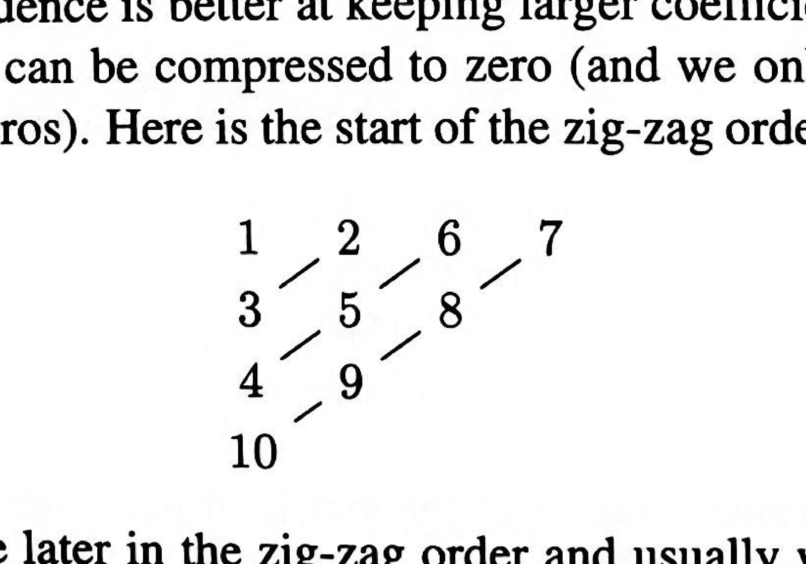
> <span style="color:#7f8c8d;">原书 zig-zag 扫描顺序图，书页 230（PDF p.232）；裁切自扫描页，图形未改动</span>

下面是这 $64$ 个系数的 zig-zag 顺序的开头部分（图中数字给出该系数在 zig-zag 序列中的位置）：
```math
\begin{matrix}
1 & 2 & 6 & 7 & 15 & 16 & 28 & 29 \\
3 & 5 & 8 & 14 & 17 & 27 & 30 & 43 \\
4 & 9 & 13 & 18 & 26 & 31 & 42 & 44 \\
10 & 12 & 19 & 25 & 32 & 41 & 45 & 54 \\
11 & 20 & 24 & 33 & 40 & 46 & 53 & 55 \\
21 & 23 & 34 & 39 & 47 & 52 & 56 & 61 \\
22 & 35 & 38 & 48 & 51 & 57 & 60 & 62 \\
36 & 37 & 49 & 50 & 58 & 59 & 63 & 64
\end{matrix}
```
在 zig-zag 顺序中，更高的频率排在更后面，通常对应的系数也更小。
现在，在 rounding（舍入）步骤给出 $q_{jk}$ 之前，我们可以放心地把那些数值重新缩放：
<span style="color:#2471a3;">**[example]**</span> **Quantization example（量化示例）**：把每个系数 $c_{jk}$ 除以 $j+k+3$，再四舍五入到最接近的整数，就得到 $q_{jk}$。
```math
q_{jk}=\frac{c_{jk}}{j+k+3}\quad \text{rounded to nearest integer}
```
> <span style="color:#1e8449;">[note] 译者注：**为什么“有损”还能像——DCT 交到量化器手里的是什么。** 本页把 JPEG 拆成两步，第 1 步（DCT）是无损的，损失全部发生在第 2 步的量化 $q_{jk}=\frac{c_{jk}}{j+k+3}$（四舍五入到最接近的整数）。这个分工很容易被含糊过去，但用你在 Cover 信息论前 6 章学的东西可以把话说得很精确：**可逆变换不改变熵，所以变换本身从来不产生压缩；熵只能靠量化来降。**</span>
>
> <span style="color:#1e8449;">**为什么正交变换“不减少信息”却仍然有用。** 矩阵 $C$（DCT 矩阵）的各列正交，$8\times 8$ 块的二维变换是 $C\otimes C$，是一个可逆变换；而熵只依赖概率分布，可逆映射只是把每个结果一对一改名，概率不变，所以 $H(T(X))=H(X)$。因此“DCT 减少了熵”是错的。DCT 真正做的是**去相关**：相邻像素的灰度高度相关，输入块落在高维空间里一个很“扁”的区域内；变换后能量集中到少数低频坐标上，其余系数很小。压缩率的来源是这种能量集中（更准确地说是系数方差的分布），不是变换本身。</span>
>
> <span style="color:#1e8449;">**量化才是真正丢熵的那一步。** 除以 $j+k+3$ 再四舍五入，把幅值小的系数直接压成 $0$，只留下少数几个非零整数和一长串零。此时系数的分布变得极度集中，熵真的下降了——也只有到这一步，“可压缩”才成立。所以有损与无损的分界线就在量化器上：**熵只能由量化来降，编码器只能逼近剩下那个熵**。</span>
>
> <span style="color:#1e8449;">**连接 Cover 信息论的具体两处。** ① 上面用到的“可逆变换下熵不变”，是 AEP 与熵的基本性质那一章的推论；② 最后一步（zig-zag 扫描 + 游程编码 + 熵编码）是在**兑现**已经降下来的熵：无损压缩的极限就是熵，你算过 Huffman 编码满足 $H(X)\le L\lt H(X)+1$，而信源编码定理说把 $N$ 个符号一起编码可以逼近 $NH(X)$。这也解释了为什么量化之后还要做熵编码——零变多了，熵已经小了，但要把“小熵”变成“少比特”，必须靠编码器去逼近它。顺带说清一个常见误解：如果量化后系数之间还残留相关性，一阶熵编码就达不到最优，所以前面的去相关 DCT是必要的预处理，而不是可有可无的装饰。</span>
>
> <span style="color:#1e8449;">**zig-zag（之字形扫描）是一次“为下游算法重排输入”的设计。** 按频率从低到高“之”字形扫描 $8\times 8$ 块，把二维的“右下角成片为零”变成一维的“末尾一长串零”，于是游程编码可以直接吃掉它。注意这与 page_227（书页 225）定义的 $\mathrm{vec}$（按列堆叠）目的完全不同：$\mathrm{vec}$ 是为矩阵运算服务的重排，zig-zag 是为压缩服务的重排——同一批 64 个数，按两种目的各排一遍。这是算法设计里很典型的一招：**改变数据的排列顺序，让后续算法变得更简单。**</span>
>
> <span style="color:#1e8449;">**为什么量化步长随频率增大。** 人的视觉对高频细节不敏感，而高频系数的能量本来也小，除以大数不会引入可见误差。真实 JPEG 用的是一张固定的 $8\times 8$ 整数量化表（ISO 通过大量测试定出的一套标准值；本书这一页（书页 230）引的斯坦福那份资料里给了表以及量化前后的对照示例，更详细的 DCT 讨论见本书列出的 SIAM Review 1999, 41(1), 135–147）。Strang 用的 $j+k+3$ 只是这张表的简化替身。这里可以接上你在 Strang 教材里学的 PCA：如果基是从数据协方差矩阵的特征向量里选出来的（PCA 的做法），对给定的相关结构是最优的去相关；但 JPEG 面对的是任意图像，没有“每张图训练一套基”的预算，所以改用一组固定的、对典型自然图像已经很接近最优的余弦基。**用固定基换掉训练开销，是工程上极常见的一笔交易。**</span>
>
> <span style="color:#1e8449;">顺带说一句你还没学到的部分：如果要把“损失多少”与“需要多少比特”的关系写成定量理论，那是率失真的问题——它问的是“允许失真 $D$ 时最少需要多少比特 $R(D)$”，在 Cover 书里比你现在读到的地方更靠后。它的结论形状与我们这里的做法一致：方差大的系数多分配比特、方差小的多丢一点。你已经学的这套（熵 + 量化 + 熵编码）足以看懂 JPEG 的骨架。</span>
>
> <span style="color:#1e8449;">**可迁移的结论**：任何“变换 + 量化 + 熵编码”的压缩系统都是这三拍的组合（音频、视频的变换编码也是这个形状）。分析一个压缩算法时问三句：变换可逆吗（它不产生压缩）？量化步长按什么准则分配（**损失只发生在这里**）？剩下的熵用什么编码器兑现（这决定了压缩率的上限）？</span>

---

<!-- page 233 -->
> <span style="color:#1e8449;">[note] 本页为书页 231：上半页是 §IV.4 Sine and Cosine Transforms from Kronecker Sums（由克罗内克和得到的正弦与余弦变换）的收尾，下半页是 Problem Set IV.4（习题集 IV.4）；书眉与页码为重复元素，不收录。</span>
> <span style="color:#1e8449;">[note] 译者注（OCR 修正）：本页 `Th e`／`tO`／`arti fac t`／`blockmg`／`nnging`／`compresslon` 等均为字符切分噪声，已按词义还原；`64 i ntegers qjkø` 中的 `ø` 为句点噪声，还原为 $q_{jk}$ 之后的句号。</span>
## （续）Sine and Cosine Transforms from Kronecker Sums（由克罗内克和得到的正弦与余弦变换）
> <span style="color:#7f8c8d;">Strang LaLFD §IV.4, p.231</span>
现在每一个 block 都由 $64$ 个整数 $q_{jk}$ 表示。
为效率起见，我们是把这些数编码之后再传输出去的。
接收端把图像的每一个分块重建出来——是近似的重建。
在彩色图像中，$64$ 变成 $192$。
因为每个像素都组合了三种颜色。
但是 Red-Green-Blue（红-绿-蓝）很可能并不是最好的坐标。
一个更好的第一坐标告诉我们 brightness（亮度）。
另外两个坐标则告诉我们 “chrominance（色度）”。
目标是得到三个在统计上相互独立的数。
当各分块被拼装起来时，完整的重建往往显示出两种不受欢迎的 artifact（伪影）。
其一是 blocking（块效应）：各分块衔接得不平滑。
（你在过度压缩的印刷图像中或许见过这种现象。）
第二种伪影是 ringing（振铃）：沿着图像内部的边缘出现快速振荡。
当八条余弦去逼近一个 step function（阶跃函数）时，这些振荡就是著名的 Gibbs phenomenon（吉布斯现象）。
对于 DCT 压缩之后的高质量图像，我们大体上可以抵消那些块效应与振铃伪影。
对于 high definition TV（高清晰度电视），压缩是必不可少的（要处理的位数太多，来不及跟上）。
这套 DCT 标准是由 JPEG experts group（JPEG 专家组）制定的。
随后人们造出硬件设备、写出软件，把图像处理变成一个真正有效的系统。
---

> <span style="color:#7f8c8d;">本页（书页见页首说明）原书为 Problem Set IV.4，共 4 道习题。按技能**铁律 9**（非必要习题不收录），此处不保留习题原文。</span>

---

<!-- page 234 -->
> <span style="color:#1e8449;">[note] 本页为书页 232，是 §IV.5 Toeplitz Matrices and Shift Invariant Filters（托普利茨矩阵与平移不变滤波器）的开篇页；书眉与页码为重复元素，不收录。</span>
> <span style="color:#1e8449;">[note] 译者注（OCR 修正）：本页 OCR 噪声：`Matnces` → Matrices、`penodic` → periodic、`Effectrvely` → Effectively、`Founer` → Fourier、`polynomal` → polynomial、`coeffcients` → coefficients、`symmetnc` → symmetric、`tnangular` → triangular、`s ep arate` → separate、`O`／`0` 混用；`a—l`／`01` → $a_{-1}$／$a_1$，矩阵记号 `蓋` → $T$／$C$。句中 `Section 2` 按本书内部引用体例补全为 §IV.2；`(where` 之后 OCR 截断，等距角度公式中的矩阵阶数 $N$ 按上下文补出。（原书此处 OCR 残缺）等距角度公式中被截断的收尾语与节号 §IV.2 的还原是否与纸书一致，请复核。</span>
## IV.5 Toeplitz Matrices and Shift Invariant Filters（托普利茨矩阵与平移不变滤波器）
> <span style="color:#7f8c8d;">Strang LaLFD §IV.5, p.232</span>
一个 Toeplitz matrix（托普利茨矩阵）具有 constant diagonals（常数对角线）。
第一行与第一列就告诉你矩阵的其余部分，因为这两者包含了每一条对角线的第一个元素。
还有一类 Circulant matrices（循环矩阵），它们是满足额外 wraparound condition（绕回条件）的 Toeplitz 矩阵，正是这个条件使它们成为周期的。
对 $4 \times 4$ 的 circulant 而言，$c_{-3}$ 实际上与 $c_1$ 是同一个。
```math
\text{Toeplitz matrix}\qquad A =
\begin{bmatrix}
a_0 & a_{-1} & a_{-2} & a_{-3}\\
a_1 & a_0 & a_{-1} & a_{-2}\\
a_2 & a_1 & a_0 & a_{-1}\\
a_3 & a_2 & a_1 & a_0
\end{bmatrix}
\qquad
\text{Circulant matrix}\qquad C =
\begin{bmatrix}
c_0 & c_3 & c_2 & c_1\\
c_1 & c_0 & c_3 & c_2\\
c_2 & c_1 & c_0 & c_3\\
c_3 & c_2 & c_1 & c_0
\end{bmatrix}
```
对 Discrete Fourier Transform（离散傅里叶变换，DFT）而言，Circulant matrices（循环矩阵）是完美无缺的。
永远有 $CD = DC$。
它们的 eigenvectors 就是 §IV.2 中 Fourier matrix（傅里叶矩阵）的各列。
它们的 eigenvalues 恰好就是 $C(\theta) = \sum_k c_k e^{ik\theta}$ 在等间距角度 $\theta = 0,\, 2\pi/N,\, 4\pi/N,\, \cdots$ 处的取值（其中 $N$ 是循环矩阵的阶数）。
而 Toeplitz matrices 则几乎是完美的。
它们正是我们在 signal processing（信号处理）与 convolutional neural nets, CNNs（卷积神经网络）中使用的矩阵。
它们不绕回，因此对 $A$ 的分析所依据的是 two-sided polynomial（双侧多项式）$A(\theta)$，其系数为 $a_{1-n}, \cdots, a_0, \cdots, a_{n-1}$。
这个 frequency response（频率响应）就是 $A$ 的 symbol（符号）：
```math
\begin{aligned}
& \textbf{Frequency response = symbol of } A && A(\theta) = \sum a_k e^{ik\theta} \\
& A(\theta) \textbf{ is real when } A \textbf{ is symmetric} && a_k e^{ik\theta} + a_k e^{-ik\theta} = 2a_k \cos k\theta \\
& C(\theta) \textbf{ is nonzero when } C \textbf{ is invertible} && \text{The symbol for } C^{-1} \text{ is } 1/C(\theta)
\end{aligned}
```
所谓的 frequency response（频率响应）就是 $A$ 的 symbol（符号），即 $A(\theta) = \sum_k a_k e^{ik\theta}$。
当 $A$ 为 symmetric（对称）时，$A(\theta)$ 是实的，因为 $a_k e^{ik\theta} + a_k e^{-ik\theta} = 2a_k \cos k\theta$。
当 $C$ 可逆时，$C(\theta)$ 处处非零；$C^{-1}$ 的符号就是 $1/C(\theta)$。
然而 $A(\theta) \ne 0$ 并不是判断 $A$ 可逆性的一个正确判据！
而且 $A^{-1}$ 一般不是 Toeplitz 的——triangular matrices（三角矩阵）属于例外。
而 Circulants（循环矩阵）$C$ 所作的是 cyclic convolutions（循环卷积）。
但 Toeplitz matrices 所作的是 noncyclic convolution（非循环卷积），它随后还要作一次投影：
```math
\begin{aligned}
\boldsymbol{x}\text{--space}\qquad & A\boldsymbol{x} &&= \text{convolve } \boldsymbol{a} * \boldsymbol{x}, \text{ then keep components } 0 \text{ to } n-1 \\
\theta\text{--space}\qquad & \widehat{A\boldsymbol{x}}(\theta) &&= \text{multiply } A(\theta)\widehat{\boldsymbol{x}}(\theta), \text{ then project back to } n \text{ coefficients}
\end{aligned}
```
我们希望用这个简单的多项式 $A(\theta)$ 来了解 Toeplitz 矩阵 $A$。
在许多问题中，Toeplitz 矩阵是 banded（带状）的。
矩阵只在主对角线之上与之下具有若干条对角线。
只有从 $a_{-w}$ 到 $a_w$ 的系数可以非零。
此时 bandwidth（带宽）为 $w$，总共有 $2w+1$ 条非零对角线。
```math
\text{Tridiagonal Toeplitz}\quad \text{Bandwidth } w = 1\qquad A = \begin{bmatrix}
a_0 & a_{-1} & & \\
a_1 & a_0 & a_{-1} & \\
& a_1 & a_0 & a_{-1}\\
& & a_1 & a_0
\end{bmatrix}
```
我们正是通过研究符号 $A(\theta) = a_{-1} e^{-i\theta} + a_0 + a_1 e^{i\theta}$，来理解大规模的三对角 Toeplitz 矩阵（以及它们的特征值）的。
它是由 $a_{-1},\, a_0,\, a_1$ 构造出来的。

---

<!-- page 235 -->
> <span style="color:#1e8449;">[note] 本页为书页 233，是 §IV.5 Toeplitz Matrices and Shift Invariant Filters（托普利茨矩阵与平移不变滤波器）的续页；书眉与页码为重复元素，不收录。</span>
> <span style="color:#1e8449;">[note] 译者注（OCR 修正）：本页 OCR 噪声较重：`mafrix`／`m atnx`／`matnces` → matrix／matrices、`ln`／`lt` → In／It、`ndamental` → fundamental、`Foun er` → Fourier、`desff0Y` → destroys、`s ep arate` → separate、`symmetnc` → symmetric、`epli tz` → Toeplitz、`0 3 ）` → $O(n^3)$、`0 2 ）` → $O(n^2)$、`什 0 m` → from、`ro padding` → zero padding；符号记号 `蓋` 一律还原为 $C(\theta)$，被破坏的公式按数学语境重建。（原书此处 OCR 残缺）`is assuming = 0 and + 1` 一句中被吞掉的角标，本译文按 0 基下标（信号为 $c_0,\ldots,c_{n-1}$）还原为 $c_{-1}=0$ 与 $c_n=0$，纸书若作 $c_{n+1}=0$ 请改正。</span>
## （续）Toeplitz Matrices and Shift Invariant Filters（托普利茨矩阵与平移不变滤波器）
> <span style="color:#7f8c8d;">Strang LaLFD §IV.5, p.233</span>
### Toeplitz Matrices: Basic Ideas（托普利茨矩阵：基本想法）
在 signal processing（信号处理）中，一个 Toeplitz matrix 就是一个 filter（滤波器）。
在 time domain（时域）中，矩阵乘法 $Ax$ 翻译到 frequency domain（频域）里，就变成普通的乘法 $A(\theta)x(\theta)$。
这就是那个 fundamental idea（根本想法），但事情并没有那么简单：Toeplitz theory（托普利茨理论）处在简单 Fourier analysis（傅里叶分析，一次只看一个频率）的边缘地带，而 boundaries（边界）会来干扰。
一个 finite length signal（有限长信号）$x = (x_0, \ldots, x_n)$ 在 $0$ 与 $n$ 处有边界。
这些边界破坏了对每一个单独频率的简单响应，我们不能只是乘上 $A(\theta)$。
在许多应用（但并非全部）中，这个不便的事实可以被压制下去。
于是 Toeplitz matrix 实质上产生一次 convolution（卷积）。
如果我们想要一个 bandpass filter（带通滤波器），它保留频率 $a \le \theta \le b$ 并去掉所有其它频率，那我们就构造 $A(\theta)$ 使其在该频带内接近 $1$、在频带之外接近零。
（同上，一个恰好取值为 $1$ 和 $0$ 的 ideal filter（理想滤波器）在 $n = \infty$ 之前是不可能的。）
> <span style="color:#1e8449;">[note] 译者注：**Toeplitz 矩阵就是“卷积算子”——平移不变性如何把 $n^{2}$ 个数压成 $2n-1$ 个。** 一个一般的 $n\times n$ 矩阵要用 $n^{2}$ 个数字才能写下来；而 Toeplitz 矩阵只要求“同一条对角线上的元素相同”，于是整张矩阵只由第一行和第一列决定，共 $2n-1$ 个数字。这不是记号上的小节省，而是结构上的巨大压缩：把 $O(n^{2})$ 的存储降到 $O(n)$。为什么“常数对角线”这个貌似随意的规定能换来控制矩阵乘法？因为它等价于一条非常强的物理/工程假设——**平移不变性**。</span>
>
> <span style="color:#1e8449;">把矩阵乘法写成分量形式：$(Ac)_i=\sum_{k} a_{i-k}c_k$。注意下标只以**差值** $i-k$ 的形式出现。这意味着：如果把输入向量整体向右平移一格（$c_k \to c_{k-1}$），输出也整体向右平移一格，形状分毫不变。这就是书上说的 LTI（线性时不变）与 LSI（线性平移不变），也是“滤波器”这个词的全部含义：滤波器不知道“现在几点”，它只看窗口内各点的相对位置。矩阵的每一行都是上一行向右移一格，所以滑窗卷积的代码就是那个你写过的双层循环——外层遍历输出位置 $i$，内层遍历固定的 $a_k$。</span>
>
> <span style="color:#1e8449;">这里可以接上你在 CSAPP 学过的东西。第 6 章讲存储层次与缓存：滑窗卷积的相邻两次迭代复用同一批输入元素，局部性天然很好；而一个通用的稠密矩阵乘法必须靠 cache blocking（分块）才能把缓存命中率拉起来。第 5 章讲循环优化（循环展开、减少过程调用）：卷积正是“循环展开最有效”的典型模式，因为循环体极短且长度已知。换句话说，Toeplitz 结构不只是省存储，它还让程序员的优化技巧（分块、展开、向量化）都能生效。</span>
>
> <span style="color:#1e8449;">书上还给了翻译字典：symbol $C(\theta)=\sum_k a_k e^{ik\theta}$。把矩阵“搬到频域”之后，本来是矩阵乘法的动作变成普通的逐点乘法 $C(\theta)\,\hat{c}(\theta)$。二阶差分矩阵 $-1,2,-1$ 的 symbol 是 $C(\theta)=2-2\cos\theta$，它处处 $\ge 0$，所以矩阵对称半正定；它在 $\theta=0$ 处为零，所以 $n$ 越大 $\lambda_{\min}$ 越小，无限矩阵奇异。这就是“矩阵的性质”与“函数的性质”之间的对应：正定性看 $C(\theta)$ 是否非负，奇异性看它是否碰到零。</span>
>
> <span style="color:#1e8449;">最后是边界这个“不方便的事实”。有限长信号只在 $0,\dots,n-1$ 上有定义，矩阵乘 $c$ 时其实是在暗地里假定 $c_{-1}=0,\;c_n=0$（zero padding，补零）。于是窗口滑到边缘时有一半落在零上，输出被系统性地拉偏——逼近在最需要小心的地方最不可靠。这就是书上专门提“边界行可以和 $a_0,a_1,a_{-1}$ 不同”的原因：它对应微分方程里的边界条件，也是滤波器设计里的边缘处理。可迁移的结论只有一句：**当你看到一个沿对角线常数的矩阵，先问它是不是某个平移不变算子的表示；如果是，就把它搬到频域去算，并且专门检查边界行。**</span>
令 finite difference equations（有限差分方程）的系数为 constant（常数），就产生 Toeplitz matrices。
这些方程随时间向前推进时不变，也就是 LTI = Linear Time Invariant（线性时不变）；在空间中移动时也不变，也就是 LSI = Linear Shift Invariant（线性平移不变）。
熟悉的 $-1, 2, -1$ second difference matrix（二阶差分矩阵）是一个重要例子：一个 tridiagonal（三对角）的 $-1,2,-1$ 矩阵，其 symbol 为
```math
A(\theta) = -e^{-i\theta} + 2 - e^{i\theta} = 2 - 2\cos\theta .
```
由 $A(\theta) \ge 0$ 这一事实可知，$A$ 是 symmetric positive semidefinite or definite（对称半正定或正定）的。
而当 $\theta = 0$ 时 $A(\theta) = 2 - 2 = 0$，这一事实则告诉我们，随着 $n$ 增大，$\lambda_{\min}(A)$ 将趋于零。
有限 Toeplitz matrix $A$ 只是勉强 positive definite（正定），而无限 Toeplitz matrix 是 singular（奇异）的——这一切都因为该 symbol 在 $\theta = 0$ 处取 $C(\theta) = 0$。
Toeplitz matrix $A$ 的 inverse（逆）通常不是 Toeplitz 的。例如
```math
A^{-1} = \begin{bmatrix} 2 & -1 & 0 \\ -1 & 2 & -1 \\ 0 & -1 & 2 \end{bmatrix}^{-1}
= \frac{1}{4}\begin{bmatrix} 3 & 2 & 1 \\ 2 & 4 & 2 \\ 1 & 2 & 3 \end{bmatrix}\qquad \text{is not Toeplitz}
```
而右边这个矩阵并不是 Toeplitz 的。
但 Levinson 找到了一种在 recursion（递推）中利用 Toeplitz pattern（托普利茨模式）的办法——把求解 $Ax = b$ 通常所需的 $O(n^3)$ 步降到 $O(n^2)$。
后来人们又提出了 superfast algorithms（超快算法），但对于中等规模的 $n$，Levinson-Durbin recursion（Levinson-Durbin 递推）更好。
超快算法对大 $n$ 给出的是 accurate（数值上准确）而非 exact（精确）的答案——其中一种做法是使用 circulant preconditioner（循环预条件子）。
再说一条更一般的评论。
经常出现的情况是，第一行和最后一行并不符合 shift invariance（平移不变性）的 Toeplitz pattern。
这些 boundary rows（边界行）中的元素可以和 $a_0$、$a_1$、$a_{-1}$ 不同。
这种改变来自微分方程中的 boundary conditions（边界条件），或者来自 filter 的边缘。
当 $A$ 乘以向量 $x = (x_1, \ldots, x_n)$ 时，那个（sharp cutoff，锐截止的）Toeplitz matrix 是在假定 $x_0 = 0$ 与 $x_{n+1} = 0$（zero padding（补零））。（续）ding（补零）在端点处可能给出很差的逼近。
我们常常改动边界行以获得更好的逼近。
对这些改动的细致分析可能很困难，因为 Toeplitz matrix 中 constant-diagonal（常数对角线）的模式被 perturbation（扰动）了。

---

<!-- page 236 -->
> <span style="color:#1e8449;">[note] 本页为书页 234，是 §IV.5 Toeplitz Matrices and Shift Invariant Filters（托普利茨矩阵与平移不变滤波器）的续页；书眉与页码为重复元素，不收录。</span>
> <span style="color:#1e8449;">[note] 译者注（OCR 修正）：本页 OCR 噪声严重：`Matnces` → Matrices，`tndiagonal` → tridiagonal，`th e` → the，`th at` → that，`Fo urier` → Fourier，`eplitz` → Toeplitz，`CycIic`／`Cyc lic` → Cyclic，`t0` → to，`0f` → of；`0-space`、`ln O-space` 依数学语境重建为 $\theta$-space（$\theta$ 空间，即频域，因为该处讨论的正是以 $\theta$ 为变量的频域乘法），`一 1` → $-1$，`size 2 + 1` → $2n-1$（与下文第 1 步中向量 $X$ 的大小 $2n-1$ 相互印证）；被破坏的算式与矩阵一律按数学语境重建。（原书此处 OCR 残缺）本页 `they are equal at every 9 = 2 丌 /` 依上下文重建为 $\theta = 2\pi k/n$，`(Also 1 and ... + 1)` 依上下文重建为 $e^{in\theta}$ 与 $1$ 在 $\theta = 2\pi k/n$ 处相等，`Higher frequencies in ） 可 9 ）` 的记号取其作 $C(\theta)X(\theta)$——三处均请以纸书复核。</span>
### Fast Multiplication by the FFT（用 FFT 快速乘法）
> <span style="color:#7f8c8d;">Strang LaLFD §IV.5, p.234</span>
对于 tridiagonal matrices，我们不需要什么特殊算法来做乘法 $Ax$，那只要 $3n$ 次单独的乘法。
但对于 full dense matrix（满稠密矩阵），托普利茨矩阵与 circulant matrix 的性质允许我们借助 Fast Fourier Transform（快速傅里叶变换）在 $\theta$-space（$\theta$ 空间）中大幅加速。
在 $\theta$-space 中，矩阵-向量乘法变成两个函数的乘积：
```math
\left( \sum_k c_k e^{ik\theta} \right)\left( \sum_k x_k e^{ik\theta} \right)
```
这个乘积会给出 $e^{i\theta}$ 的各次幂，其指数会跑到 $k = 0$ 到 $k = n-1$ 的范围之外。
循环矩阵所作的就是 cyclic convolution。
那些更高的 higher frequencies（频率）与负 negative frequencies（频率）是标准频率的 alias（混叠）——在每一个 $\theta = 2\pi k/n$ 处，它们彼此相等：
```math
\text{Aliasing}\qquad e^{in\theta} = 1 \quad \text{and} \quad e^{i(n+1)\theta} = e^{i\theta} \quad \text{and} \quad e^{i(n+p)\theta} = e^{ip\theta} \quad \text{at } \theta = \frac{2\pi}{n}, \frac{4\pi}{n}, \ldots
```
（同样，$e^{in\theta}$ 与 $1$ 在 $\theta = 2\pi k/n$ 处也相等。）这就是 aliasing（混叠）。
循环卷积 $c \circledast x$ 把 $\left(\sum c_ke^{ik\theta}\right)\left(\sum x_ke^{ik\theta}\right)$ 的每一项都折回到一个指数满足 $0 \le k < n$ 的项，所以一次循环矩阵乘法 $Cx$ 只需 $O(n\log_2 n)$ 步，这是因为卷积可以借助 Fast Fourier Transform 完成。
> <span style="color:#1e8449;">[note] 译者注：**用 FFT 把卷积从 $O(n^{2})$ 压到 $O(n\log n)$——加倍技巧与混叠。** circulant matrix（循环矩阵）有一个别的矩阵做梦都想要的性质：它的特征向量是**事先就知道的**，永远不变——就是傅里叶矩阵 $F$ 的各列。既然特征向量已知，矩阵乘法在频域里就退化成逐点相乘，一步 $O(n)$ 搞定。Toeplitz 矩阵没有这个福气（它的特征向量依赖具体数据），所以 Strang 用一个“嵌进去再截出来”的办法把 Toeplitz 问题偷换成循环问题。</span>
>
> <span style="color:#1e8449;">先讲清 aliasing（混叠），否则技巧看起来像变魔术。在 $n$ 个采样点 $\theta=2\pi k/n$ 上，$e^{i\theta}$ 与 $e^{i(\theta+2\pi)}$、$e^{i(\theta+4\pi)}$ 取**完全相同的值**。多项式乘法会产生 $e^{i(k+j)\theta}$ 这类高次项，指数跑出 $0\le\cdot\lt n$ 的范围；可是在采样点上，高次项与某个低次项无法区分，于是一个“折回”发生了：线性卷积（长度 $2n-1$）被压成循环卷积（长度 $n$），尾巴绕回来叠在头上。这正是你在算法课 MIT 6.006 Introduction to Algorithms里做多项式乘法时被反复叮嘱“要把长度补到 $2n-1$ 以上再变换”的那个细节——补零不是形式主义，它是防混叠。</span>
>
> <span style="color:#1e8449;">傅里叶变换为什么能做到 $O(n\log n)$？靠分治。把 $n$ 点变换按奇偶下标拆成两个 $n/2$ 点变换，递归式 $T(n)=2T(n/2)+O(n)$ 解出 $T(n)=O(n\log n)$。这是你熟悉的同一套递归分析：复杂度改善的来源永远是“把一个大问题拆成两个一半的问题，再花线性时间合并”。</span>
>
> <span style="color:#1e8449;">所谓 doubling trick（加倍技巧），就是把这三件事串起来：**1.** 把 $n$ 维向量补零成 $2n-1$（或 $2n$）维，让想保留的那段结果不被绕回来的尾巴污染；**2.** 把 $n\times n$ 的上三角/下三角 Toeplitz 数据填进一个 $(2n-1)\times(2n-1)$ 的循环矩阵 $C$，缺的位置补上合适的对角线；**3.** 做一次循环乘法（用 FFT），取前 $n$ 个分量，就是 $Ac$。整个动作可以用一句话概括：**把“有边界的卷积”嵌进“无边界的循环卷积”，算完之后把多余的切掉。**</span>
>
> <span style="color:#1e8449;">这里必须接上 CSAPP 的教训，才不至于把 $O(n\log n)$ 当成无条件的胜利。第一，常数因子：FFT 每次运算都要做复数乘加，$O(n\log n)$ 前面的常数比朴素卷积大得多；$n$ 小的时候直接算更快——书上正是因此说“对中等规模的 $n$，Levinson-Durbin 递推更好”（它用的还是 Toeplitz 结构，$O(n^{2})$ 但常数小）。第二，访存模式：FFT 的蝶形运算在原始顺序与位反转顺序之间来回跳，缓存不友好；这与 CSAPP 第 6 章“实际性能由缓存不命中率决定，而不只由运算次数决定”完全一致。第三，浮点：FFT 路径长、复数运算多，IEEE 754 舍入误差会累积，所以超快算法给的是数值上准确而不是 exact（精确）的答案——这也解释了书上为什么要提 circulant preconditioner（用循环矩阵做预条件子，把问题改造成容易被迭代法吃掉的形状）。</span>
>
> <span style="color:#1e8449;">可迁移的结论：**当你面对一个结构矩阵，不要急着优化朴素乘法，先问“有没有一个变换能把它对角化”。** 能对角化，矩阵乘法就变成逐点乘法，复杂度从 $n^{2}$ 掉到 $n\log n$ 甚至 $n$；代价是变换本身的开销、访存代价与数值误差，这三项决定了这个“降复杂度”到底划不划算。</span>
```math
\text{Cyclic convolution}\qquad c \circledast x \ \text{ and } \ c \circledast d \ \text{ give the entries of } Cx \text{ and } CD .
```
一次托普利茨矩阵乘法 $Ax$ 不是 cyclic 的：乘积 $A(\theta)x(\theta)$ 中的更高频率并不会完美地折回低频。
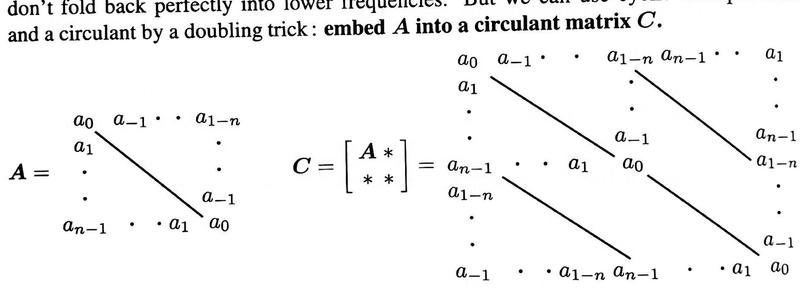
> <span style="color:#7f8c8d;">原书 Toeplitz→Circulant 嵌入图，书页 234（PDF p.236）；裁切自扫描页，图形未改动</span>

但我们可以用循环乘法，再加上一个把托普利茨矩阵嵌入循环矩阵的 doubling trick（加倍技巧）：把 $A$ 嵌入一个 circulant matrix $C$：
```math
A = \begin{bmatrix}
a_0 & a_{-1} & \cdot & \cdot & a_{1-n} \\
a_1 & \cdot & & & \cdot \\
\cdot & & \cdot & & \cdot \\
\cdot & & & \cdot & a_{-1} \\
a_{n-1} & \cdot & \cdot & a_1 & a_0
\end{bmatrix}
\qquad
C = \begin{bmatrix} A & * \\ * & * \end{bmatrix} =
\begin{bmatrix}
a_0 & a_{-1} & \cdot & a_{1-n} & a_{n-1} & \cdot & a_1 \\
a_1 & & & & & & \cdot \\
\cdot & & & & & & \cdot \\
\cdot & & & & a_{-1} & & a_{n-1} \\
a_{n-1} & \cdot & \cdot & a_1 & a_0 & & a_{1-n} \\
a_{1-n} & & & & & & \cdot \\
\cdot & & & & & & \cdot \\
\cdot & & & & & & a_{-1} \\
a_{-1} & \cdot & \cdot & a_{1-n} & a_{n-1} & \cdot & a_1 & a_0
\end{bmatrix}
```
要计算大小为 $n$ 的托普利茨矩阵乘法 $Ax$，我们可以使用这个大小为 $2n+1$ 的 circulant matrix $C$：
**1.** 添加 $n-1$ 个零，把向量 $c$ 扩展成大小为 $2n-1$ 的向量 $X$。
**2.** 用 Fast Fourier Transform 乘出 $CX$（即循环卷积）。
**3.** 于是 $CX$ 的前 $n$ 个分量就给出所需的 $Ax$。
如果更希望 $C$ 的大小为 $2n$，可以在 $a_{1-n}$ 与 $a_{n-1}$ 之间放一条由 $a_0$ 组成的对角线。
### Toeplitz Eigenvalues and Szegö's Theorem（托普利茨矩阵的特征值与塞格定理）
循环矩阵的 exact eigenvalues（精确特征值）已在 §IV.2 中求出。
它们的 eigenvectors 事先就知道——永远相同！
它们就是 Fourier matrix $F$ 的各列。
$C$ 的 eigenvalues 就是向量 $Fc$ 的各分量。
它们就是 $C(\theta)$ 在 $n$ 个 equally spaced points（等距点）上的取值。
换句话说，这些 eigenvalues 就是循环矩阵 $C$ 的第 $0$ 列的 discrete Fourier transform。

---

<!-- page 237 -->
> <span style="color:#1e8449;">[note] 本页为书页 235，是 §IV.5 的续页；书眉与页码为重复元素，不收录。</span>
> <span style="color:#1e8449;">[note] 译者注（OCR 修正）：本页 OCR 噪声较多，均已按数学语境重建：`1V5` 即 §IV.5，`孟@）` 为 $\hat{c}(\theta)$，`乪` 为 $\theta$，`心 刀 巳`／`−+` 为 $n \to \infty$，`什 om` 为 from，`@剧` 为 $\sum |c_k| < \infty$，`COV 了 忉 刀 ce` 为 covariance，`0 况 驷 况` 为 the signals，`0 纱` 为 only，`一 1` 为 $A^{-1}$，`AOO(O)` 为 $\hat{A}_\infty(\theta)$，`lt` 为 It，`l's` 为 1's，`S （ £ 0 ， 1 ，` 为 $S = (0, 1, \ldots)$，`Sc` 依 OCR 保留为 $S_c$；完整定理的编号 (3) 在 OCR 中丢失，但由书页 238 习题 1、2 对「(2) 与 (3)」「Szegő's Theorem (3)」的引用可以确证，故补为 (3)。另：本书自本页起把 symbol 记作 $\hat{c}(\theta)$（前几页记作 $C(\theta)$），二者是同一个频率响应函数，译文照原文记号保留。（原书此处 OCR 残缺）`An infinite one-step shift models the difficulties that come with` 之后的宾语被 OCR 吞掉（本译文按 $n \to \infty$ 重建），且末尾 `S = (0,1,0,\ldots)` 与 `S_c = (0,1,0,\ldots)` 两个序列在 OCR 中完全相同，$S_c$ 的确切形式请以纸书复核。</span>
> <span style="color:#7f8c8d;">Strang LaLFD §IV.5, p.235</span>
一如往常，循环矩阵的公式是精确的，而托普利茨矩阵的公式只是接近的。
你会看到的是积分，而不是 $\hat{c}(\theta)$ 的点值。
当尺寸 $n \to \infty$ 时，这些公式变成渐近形式，所以极限存在。
这一切都包含在关于 $A_n$ 的 eigenvalues 的 Szegő's Theorem（塞格定理）之中：先看两个特殊情形，然后再给出完整的定理。
<span style="color:#2471a3;">**[theorem]**</span> <span style="color:#c0392b;">**Szegő's Theorem（塞格定理）**</span>
当 $n \to \infty$ 时，托普利茨矩阵的 trace（迹）与 log determinant（对数行列式）满足
```math
\frac{1}{n}\,\text{trace}(A) = \frac{1}{2\pi}\int_{0}^{2\pi} A(\theta)\, d\theta = a_0 \tag{1}
```
```math
\lim_{n \to \infty} \frac{1}{n}\log(\det A) = \frac{1}{2\pi}\int_{0}^{2\pi} \log(A(\theta))\, d\theta \tag{2}
```
任何矩阵的迹与行列式，都是其特征值之和与特征值之积。
我们在 (1) 中看到的是这些特征值的 arithmetic mean（算术平均），在 (2) 中看到的是它们的 geometric mean（几何平均）：$\log(\det A)$ 等于 $\sum \log \lambda_k$。
这两条极限正是完整定理中最重要的两种情形：$F(\lambda) = \lambda$ 与 $F(\lambda) = \log \lambda$。
> <span style="color:#1e8449;">[note] 译者注：**Szegő 定理——特征值分布就是 symbol 的“采样”，一个用期望去读的极限定理。** 这条定理乍看像分析学里的怪物，其实它的左边和右边分别是你已经有两门课基础的两个东西：**样本均值**与**期望**。把 $\theta$ 看成一个在 $[0,2\pi)$ 上均匀分布的随机变量 $\Theta$，那么右边 $\frac{1}{2\pi}\int_0^{2\pi}F(A(\theta))\,d\theta$ 就是 $\mathbb{E}\big[F(A(\Theta))\big]$——函数 $\hat c$ 在“均匀抽取一个频率”时的期望值。左边 $\frac1n\sum_{k=1}^n F(\lambda_k)$ 是特征值的经验平均。定理说的是：$n\to\infty$ 时，Toeplitz 矩阵特征值的经验分布收敛到 symbol 取值的分布。</span>
>
> <span style="color:#1e8449;">为什么会这样？上一页（page_236／书页 234）已经给出钥匙：**循环矩阵**的特征值是精确的采样——$\hat c(\theta)$ 在 $\theta=2\pi k/n$ 这 $n$ 个等距点上的取值。而“$n$ 个等距点上的平均”正是黎曼和除以区间长度，$n\to\infty$ 时收敛为积分除以 $2\pi$。对循环矩阵，定理是平凡的。Szegő 定理的贡献在于：**Toeplitz 矩阵的特征值虽然不像循环矩阵那样精确等于采样值，但它们的整体分布仍然被同一个 symbol 钉死**。这也呼应本页开头那句话——循环矩阵的公式是精确的，Toeplitz 的公式只是接近的。</span>
>
> <span style="color:#1e8449;">你在 6.431 学的“样本均值逼近期望”依靠随机性与大数定律；这里不靠随机性，靠的是**等距采样 + 黎曼和收敛**。这个对照值得记住：**同一句“平均收敛到积分”的话，在概率论里是定律，在数值分析里是求积法则。** 两条路给出同样的极限，是因为它们背后的对象（经验测度）本质是同一个。</span>
>
> <span style="color:#1e8449;">为什么 $F(\lambda)=\lambda$ 与 $F(\lambda)=\log\lambda$ 是两种最重要的情形？因为任何矩阵的迹是特征值之和、行列式是特征值之积，于是 $\frac1n\operatorname{trace}(A_n)$ 是特征值的**算术平均**，$\frac1n\log\det A_n=\frac1n\sum\log\lambda_k$ 是它们的**几何平均**的对数。几何平均对小特征值极其敏感：只要 symbol 在某个频率上取到 $0$，$\log\hat c$ 就在那里发散，行列式随 $n$ 增大而急剧塌向零。回到前面那个例子（page_235／书页 233）：$-1,2,-1$ 的 symbol 是 $2-2\cos\theta$，在 $\theta=0$ 处为零，所以有限矩阵只是“勉强正定”，无限矩阵奇异。**符号函数的一个零点，决定了整个矩阵族在极限中的死活**——这就是这条定理的实用价值。</span>
>
> <span style="color:#1e8449;">本页还提到一个非常漂亮的应用出口：离散时间**弱平稳**随机过程。平稳的意思是统计性质不随时间平移而改变，于是时刻 $t$ 与 $T$ 处信号的协方差只依赖时差 $T-t$，协方差矩阵就自动是 Toeplitz 的，也就是平移不变的。把 Szegő 定理套上去，立刻得到你在概率论课程 MIT 6.431 Applied Probability里会（或已经）见到的结论：**协方差矩阵的特征值分布就是过程的功率谱密度**。大矩阵的特征值问题被翻译成“对一个已知函数求平均”，不需要真的去算 $n$ 个特征值。定理成立需要一定的控制条件，书上给的是 Wiener 条件 $\sum|c_k|<\infty$（它保证 symbol 连续、不发散）；想深入的话，书上点名的 Stanford 讲义 ee.stanford.edu/~gray/toeplitz.pdf（Gray 教授）是可直接取用的公开来源。</span>
>
> <span style="color:#1e8449;">可迁移结论：**当一个矩阵大到无法求特征值，但它具有平移不变结构时，你根本不需要求特征值——求它的 symbol，然后对 symbol 做平均（期望）或积分。** 这是“局部规则决定全局统计”的一个可计算版本。</span>
而完整定理允许 $F$ 是特征值的任意连续函数：
<span style="color:#2471a3;">**[theorem]**</span> <span style="color:#c0392b;">**Szegő's Theorem（塞格定理，完整形式）**</span>
```math
\lim_{n \to \infty} \frac{1}{n}\sum_{k=0}^{n-1} F(\lambda_k) = \frac{1}{2\pi}\int_{0}^{2\pi} F(A(\theta))\,d\theta . \tag{3}
```
对 $\hat{c}(\theta)$ 的控制来自 Wiener's condition（维纳条件）：$\sum |c_k| < \infty$。
Stanford（斯坦福）网站 ee.stanford.edu/~gray/toeplitz.pdf 上张贴了非常优秀的讲义。
Gray 教授的讲义还展开了一个重大应用：discrete time random processes（离散时间随机过程）。
当该过程是 weakly stationary（弱平稳）时，统计量在每一个时间步都保持不变。
时刻 $t$ 与时刻 $T$ 的信号之间的 covariance（协方差）只依赖于时差 $T - t$。
于是 covariance matrix（协方差矩阵）就是托普利茨的，也就是 shift invariant（平移不变）的。
在讲应用之前，我们再提一下托普利茨矩阵理论中另外三个关键主题：
- 关于 $A^{-1}$ 的 Gohberg-Semencul formula（Gohberg-Semencul 公式）——Gohberg 确实是非凡的人物。
- 无限系统的 Wiener-Hopf factorization（Wiener-Hopf 分解），即求解 $A_\infty x = b$——这是 Wiener 的工作！
- $A_\infty$ 可逆的判别条件：$\hat{A}_\infty(\theta) \neq 0$，且 winding number（绕数）$= 0$。
一个无穷的“一步”shift（位移）恰好模型化了 $n \to \infty$ 随之而来的种种困难。
它在主对角线上方或下方只有一条由 $1$ 组成的对角线。
它的 symbol 恰好是 $e^{i\theta}$ 或 $e^{-i\theta}$（永远不为零）。
但当 $\theta$ 从 $0$ 走到 $2\pi$ 时，$e^{i\theta}$ 会绕着零点转圈，因此这个 infinite shift matrix（无限移位矩阵）是不可逆的。
```math
S(x_0, x_1, \ldots) = (x_1, x_2, \ldots) \quad \text{or} \quad Sx = (0, x_0, x_1, \ldots)
```

---

<!-- page 238 -->
> <span style="color:#1e8449;">[note] 本页为书页 236，含 §IV.5 的 Lowpass Filters in Signal Processing（信号处理中的低通滤波器）与 Averages and Differences and Wavelets（平均、差分与小波）两小节正文及图 IV.3；书眉与页码为重复元素，不收录。</span>
> <span style="color:#1e8449;">[note] 译者注（OCR 修正）：`Matnces` → Matrices，`avera ging` → averaging，`entnes` → entries，`re al` → real，`mnus` → minus，`Ä(9)` → $\hat{A}(\theta)$，`C08` → $\cos$，`力 方 e`／`劍 r` → filter，`行 0 m` → from，`ru g`／`rll 靴` → running，`山 at` → that，`ghp ass` → highpass；频响公式依数学语境重建为 $\hat{c}(\theta) = \frac{1+\cos\theta}{2}$（它才等于 $\frac{1}{2} + \frac{1}{4}e^{i\theta} + \frac{1}{4}e^{-i\theta}$，且在 $\theta = 0$ 处为 $1$、在 $\theta = \pi$ 处为 $0$）；带状的 $C$ 依「对称、三条对角线元素为 $\frac14, \frac24, \frac14$」重建为 $\frac14\,\mathrm{tridiag}(1,2,1)$。（原书此处 OCR 残缺）`Equiripple 力 方 e` 一句中被 OCR 吞掉的冠词与复数形式，本译文按 equiripple filters（等波纹滤波器）重建，请以纸书复核。</span>
### Lowpass Filters in Signal Processing（信号处理中的低通滤波器）
> <span style="color:#7f8c8d;">Strang LaLFD §IV.5, p.236</span>
一个 filter 本质上就是一次 convolution：即乘以一个托普利茨矩阵。
经过一个 “lowpass filter（低通滤波器）” 之后，常数向量 $x = (\ldots, 1, 1, 1, \ldots)$ 可以原样不变地出来：$Ax = x$。
但像 $y = (\ldots, -1, 1, -1, 1, \ldots)$ 这样的 oscillating high-frequency signal（振荡的高频信号）则有 $Ay \approx 0$。
这些就是 $A(0) = \sum a_k = 1$ 且 $A(\pi) \approx 0$ 时的输出。
下面就是一个低通滤波器的例子。
```math
\text{Lowpass averaging filter}\qquad (Ax)_n = \frac{1}{4}x_{n+1} + \frac{1}{2}x_n + \frac{1}{4}x_{n-1} .
```
这个托普利茨矩阵 $A$ 是对称的。
它的三条对角线上的元素分别是 $\frac{1}{4}, \frac{2}{4}, \frac{1}{4}$。
它的 symbol $A(\theta)$（也就是频率响应）是实值的，并且在频率 $\theta = 0$ 处等于 $1$：这就是低通滤波器。
```math
\text{Frequency response}\qquad A(\theta) = \frac{1}{4}\left( e^{-i\theta} + 2 + e^{i\theta} \right) = \frac{1}{2}(1 + \cos\theta) \ge 0 .
```
```math
\text{}\left(e^{i\theta} + e^{-i\theta}\right) \geq 0
```
最高的频率 $\theta = \pi$ 会产生无穷长的正负交替信号 $y = (\ldots, -1, 1, -1, 1, \ldots)$。
该信号的 $Ay = 0$，它被完全滤除了。
$Ay$ 的典型分量是 $-\frac{1}{4} + \frac{1}{2} - \frac{1}{4} = 0$。
而从 symbol 也能看出这一点：$A(\theta) = \frac{1}{2}(1+\cos\theta)$ 在 $\theta = \pi$ 处为零。

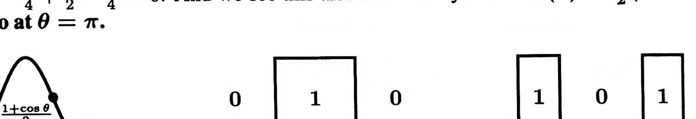
> <span style="color:#7f8c8d;">原书 Figure IV.3，书页 236（PDF p.238）；裁切自扫描页，图形未改动</span>

**Figure IV.3:** Frequency responses $\hat{A}(\theta)$: Short lowpass filter, ideal lowpass, ideal highpass（图 IV.3：频率响应 $\hat{A}(\theta)$——短低通滤波器、理想低通、理想高通）。
> <span style="color:#1e8449;">[note] 图 IV.3 并列了三条频率响应曲线：短低通滤波器的响应在 $\theta = 0$ 附近等于 $1$、在 $\theta = \pi$ 处降为 $0$；理想低通与理想高通则是取值为 $1$ 与 $0$ 的矩形曲线（图中坐标标注为 $0$ 与 $1$）。图片本身保留原貌，此处只译出图号与图注。</span>
你在图 IV.3 中看到的是两个“理想”的响应。
它们只有在矩阵含有无穷多条非零对角线时才能实现，因为一个普通的多项式不可能保持常数。
沿 $A$ 的各条对角线排布的那些数 $a_k$，正是 $A(\theta)$ 的 Fourier coefficients（傅里叶系数）。
在实践中，滤波器总是在“短”与“理想”之间做折中。
其中 equiripple filters（等波纹滤波器）是一种很自然的选择——它们在 1 附近和 0 附近振荡。
这些 ripple（波纹，即在理想值附近的振荡）的高度全都相同。
随着我们使用更多的系数，这个高度会下降。
滤波器变得更 sharp（锐利）——从 1 掉到 0 的过程更陡——但计算起来也更费时间。
### Averages and Differences and Wavelets（平均、差分与小波）
低通滤波器是 running averages（滑动平均）。
高通滤波器是 running differences（滑动差分）。
“running”这个词的意思是：一个 window（窗口）沿着向量 $x$ 移动。
假设这个窗口只让信号的 3 个分量透出来。
低通滤波器把它们分别乘以 $\frac{1}{4}, \frac{1}{2}, \frac{1}{4}$ 然后相加，得到平均后的信号 $Ax$。
而高通滤波器可以把这些符号交替过来，得到 $-\frac{1}{4}, \frac{1}{2}, -\frac{1}{4}$。
这时 $A$ 所做的是取 second differences（二阶差分），而不是平均的平均。

---

<!-- page 239 -->
> <span style="color:#1e8449;">[note] 本页为书页 237，是 §IV.5 的续页；书眉与页码为重复元素，不收录。</span>
> <span style="color:#1e8449;">[note] 译者注（OCR 修正）：本页 OCR 文本损坏严重：`蓋` 依语境分别为矩阵 $A$ 或运算符 $A$（averaging，取平均），`D` 为 difference operator（差分算子）；`Ы`、`@)`、`æ`、`讹` 为被破坏的记号；`№ w frequencies` 应为 low frequencies；`：1 十 3 + 3 一 1` 与 `一 1 3 一 一 3 一 + 1` 依上下文重建为滤波器系数 $a_k = 1, 3, 3, 1$ 与 $d_k = 1, -3, 3, -1$（高通系数即低通系数的符号交替，且两者内积为 $1-9+9-1=0$，与正交性相容）；$(Ac)_n$ 的展开式依「窗口只让 3 个分量透出、系数为 $\frac14, \frac12, \frac14$」重建为三项；小波变换的流程图按数学语境重建，未能确定处保留结构而不臆造数值。（原书此处 OCR 残缺）重建后的滤波器系数与流程图结构请与纸书复核。</span>
> <span style="color:#7f8c8d;">Strang LaLFD §IV.5, p.237</span>
这个 moving window（滑动窗口）生成一次 convolution——即托普利茨矩阵 $A$ 或 $D$：
```math
(Ax)_n = \frac{1}{4}x_{n-1} + \frac{1}{2}x_n + \frac{1}{4}x_{n+1} \qquad (Dx)_n = -\frac{1}{4}x_{n-1} + \frac{1}{2}x_n - \frac{1}{4}x_{n+1}
```
所谓 wavelets（小波）的思想，就是同时使用两个滤波器：取平均的 $A$ 与取差分的 $D$。
对输出做 downsampling（降采样）：删去奇数 $n$ 的 $(Ax)_n$ 与 $(Dx)_n$，只保留一半信号。
接着，把半长信号 $(Ax)_{2n}$ 再送过两个滤波器 $A$、$D$，并再次降采样：

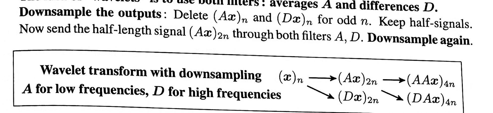
> <span style="color:#7f8c8d;">原书小波变换框图（正向），书页 237（PDF p.239）；裁切自扫描页，图形未改动</span>

```math
\text{Wavelet transform with downsampling}\qquad (x)_n \longrightarrow (Ax)_{2n} \longrightarrow (AAx)_{4n} \quad (Dx)_{2n} \longrightarrow (DAx)_{4n}
```
```math
\text{$A$ for low frequencies, $D$ for high frequencies}\qquad\qquad\qquad \searrow (Dx)_{2n} \longrightarrow (DAx)_{4n}
```
小波变换不改变信号的总长度 $(A^2x)_{4n}, (DAx)_{4n}, (Dx)_{2n}$，但它把信号分成若干频率块：low-low（低-低）、high-low（高-低）以及 high（高）。
我们分别压缩这些片段，而高频部分被压缩得最多。
> <span style="color:#1e8449;">[note] 译者注：**小波 = 平均滤波器 + 差分滤波器 + 降采样——一栋递归的“频率分块”建筑。** 这一页把三件事拼到了一起，值得逐层拆开：**滤波器是滑窗**，**滑窗给出卷积**，**两个互补的滤波器加降采样就构成一次递归分解**。低通滤波器 $A$ 做的是滑动平均（保留缓慢变化的成分），高通滤波器 $D$ 做的是滑动差分（保留快速振荡的成分）。把信号同时送过 $A$ 与 $D$，再**降采样**（删掉奇数位置的输出，只留一半），你得到两个长度减半的信号。对其中那个“已经去掉高频”的半长信号重复同样的操作，就得到多层结构：low-low、high-low、high 等频率块。总长度始终不变——一半 + 一半 = 全部，没有丢信息，只是重新排版。</span>
>
> <span style="color:#1e8449;">“降采样为什么可以不丢信息”这个问题，答案就在前面讲混叠的地方（page_236／书页 234）：低通滤波之后，信号里已经不含高于一半带宽的频率成分；按 Nyquist 采样定理，带宽减半的信号的采样率也可以减半，两个不同频率不会被折到同一个采样点上（也就是不会发生混叠）。如果省掉低通直接把信号抽掉一半点，高频就会被折成假的低频——这就是混叠的破坏力，也是为什么小波变换必须“先滤波、再降采样”而不能反过来。</span>
>
> <span style="color:#1e8449;">接下来的结构与你在算法课 MIT 6.006 Introduction to Algorithms学过的分治完全同型：每一层对半长信号做同样的事，递归 $\log n$ 层，每层总工作量 $O(n)$，总复杂度 $O(n\log n)$。FFT 和小波变换是同一个递归骨架上的两种基。它们的差别在于基向量的“支撑”（非零范围）：FFT 的基向量是 $e^{ik\theta}$，它在整个时间轴上都有值，是**全局**的；小波的基向量只覆盖一个局部窗口，是**局部**的。这个差别决定了用途：想知道“信号里有哪些频率”用 FFT；想知道“信号在哪个时间段发生了什么变化”用小波——一幅图像里物体的边缘是局部事件，用局部基描述它只需要少数几个大系数。</span>
>
> <span style="color:#1e8449;">为什么“高频部分被压缩得最多”？这是信息论里你已经建立的直觉的直接应用：压缩的可能空间来自**分布的不均匀**。小波变换之后，大部分能量集中在低频的少数几个大系数上，高频系数普遍很小；把小的系数粗糙量化甚至直接置零，代价很小。你在 Cover 前几章学的“熵给出平均码长的下界”告诉我们：分布越集中，熵越低，可用的码越短。低频块多留比特、高频块少留比特，是把这句话工程化的标准做法（图像压缩正是在这条思路上）。</span>
>
> <span style="color:#1e8449;">本页还强调了两点工程现实。第一，滤波器必须“挑得好”：最好的选择让 $A$ 与 $D$ 成为正交矩阵（或保持对称），这样逆变换就是把流程倒着走——先升采样（插入零），再按反向箭头重新组装。书上提到的 Daubechies 四系数滤波器（对角线元素形如 $1,3,3,1$ 与 $1,-3,3,-1$）就是这样一种常用选择，它的价值在于用极短的窗口同时做到正交与局部；书里给的是便于展示的整数化示意版本，实际使用时要按正交性条件配上归一化因子。第二，**边界又要动手了**：有限 Toeplitz 矩阵在边界处必须调整，而且好的小波通常用“反射”（把信号在端点处镜像延续）而不是补零——补零会在端点制造一个从有到无的假跳变，那是纯粹人为的高频，会被高通滤波器抓出来当成真实信号。对照 page_235（书页 233）讲的 zero padding，这里是同一个问题更讲究的解法。</span>
>
> <span style="color:#1e8449;">可迁移结论：**任何“一对互补滤波器 + 降采样 + 递归”的分解，都是一种多分辨率表示。它的价值在于把先验写进基里——如果你相信“重要的东西是局部的、突出的”，就用局部基，并让大系数承担信息、小系数承担误差。**</span>
要反演小波变换，就沿着流程图倒着走：先对变换的每个片段做 upsampling（升采样），即插入零；然后颠倒箭头的方向，由变换的那些分块 $AAx, DAx, Dx$ 重新组装出原始信号 $(x)_n$：
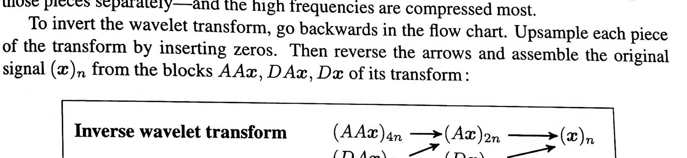
> <span style="color:#7f8c8d;">原书小波变换框图（逆向），书页 237（PDF p.239）；裁切自扫描页，图形未改动</span>

```math
\text{Inverse wavelet transform}\qquad (AAx)_{4n} \longrightarrow (Ax)_{2n} \longrightarrow (x)_n
```
```math
\qquad\qquad\qquad\qquad\qquad \searrow (DAx)_{4n} \longrightarrow (Dx)_{2n} \nearrow
```
这一过程使用精心挑选的滤波器 $A$ 与 $D$，在尽量不丢失我们想看到、想听到的信息的前提下缩短信号长度。
最好的小波变换经过调整，使 $A$ 与 $D$ 产生 orthogonal matrices（正交矩阵）或 symmetric matrices（对称矩阵）。
常用的选择是 Daubechies 4-coefficient filters（Daubechies 四系数滤波器），它们在 $A$ 与 $D$ 中具有如下对角线元：
```math
a_k = 1+\sqrt{3},\quad 3+\sqrt{3},\quad 3-\sqrt{3},\quad 1-\sqrt{3} \qquad d_k = \sqrt{3}-1,\quad 3-\sqrt{3},\quad -3-\sqrt{3},\quad \sqrt{3}+1
```
一如既往，具有这些对角线元的有限托普利茨矩阵必须在边界处加以调整。
托普利茨矩阵在矩阵之外取零，但好的小波常常使用 reflections（反射）。

---

<!-- page 240 -->
> <span style="color:#1e8449;">[note] 本页为书页 238，是 Problem Set IV.5（习题集 IV.5）；书眉与页码为重复元素，不收录。本页为习题页，题干保留英文原文，仅把 OCR 乱码修正为 LaTeX。</span>
> <span style="color:#1e8449;">[note] 译者注（OCR 修正）：`丸`、`Ä`、`儿` 等为 $\lambda$、$A$、$T$ 等记号被破坏后的残留；`Ch 01e sky` 即 Cholesky（乔列斯基）；`冚 angular` 即 triangular（三角）；`风` 为 $T^{T}$；`−+ ？` 为 $n \to \infty$；`det = 5 = + 1` 依渲染页读作 $\det A = 5 = n + 1$（$n=4$ 时 $-1,2,-1$ 的行列式确实是 $n+1=5$）；习题 3 的 $L$、$U$ 依「$U$ 的对角元之积等于 $\det = 6$」且 $(LU)_{44} = 2$ 重建为 $L$ 的下对角线 $-\frac{1}{2}, -\frac{2}{3}, -\frac{3}{4}, -\frac{4}{5}$ 与 $U$ 的对角元 $2, \frac{3}{2}, \frac{4}{3}, \frac{5}{4}, \frac{6}{5}$；习题 5 的符号依 $(2-e^{i\theta})(2-e^{-i\theta}) = 5 - 2e^{i\theta} - 2e^{-i\theta}$ 修正为 $5 - 2e^{i\theta} - 2e^{-i\theta}$（OCR 首项误作 4）；习题 2 的符号依 OCR 的双层括号取 $(A(\theta))^2$。（原书此处 OCR 残缺）习题 5 中 $S$ 的首项系数与习题 3 中 $L$、$U$ 的角标还原请与纸书复核。</span>

> <span style="color:#7f8c8d;">本页（书页见页首说明）原书为 Problem Set IV.5，共 6 道习题。按技能**铁律 9**（非必要习题不收录），此处不保留习题原文；仅保留被正文引用的第 1、2 题的英文原题。</span>

<span style="color:#2471a3;">**[problem]**</span>
**1.** Show that equations (2) and (3) are the same when $F(\lambda) = \log \lambda$.
<span style="color:#2471a3;">**[problem]**</span>
**2.** Suppose $F(\lambda) = \lambda^2$. Then Szegő's Theorem (3) gives the limit of the average eigenvalue of $A^2$.
**(a)** Show by squaring with diagonals $a_{-1}, a_0, a_1$ that the symbol of $A^2$ is $(A(\theta))^2$.
**(b)** Integrating that polynomial $(A(\theta))^2$ from $0$ to $2\pi$ produces its constant term. What is that term for the $-1, 2, -1$ matrix?

---

<!-- page 241 -->
> <span style="color:#7f8c8d;">本页为书页 239，§IV.6 Graphs and Laplacians and Kirchhoff's Laws（图、拉普拉斯矩阵与基尔霍夫定律）开篇；页眉与页码为重复元素，不译。</span>
> <span style="color:#1e8449;">**[note] 译者注（OCR 修正）：** 本页 OCR 噪声密集：`蓋`／`风` 重建为关联矩阵 $A$，`饶`／`况` 为节点数 $n$，`什 om`／`t0` 为 from／to，`co 襯`／`c 况 况 m` 为 column，`po 豆 咖 e d` 为 positive semidefinite（半正定），`AI = 0` 与 `AT 蓋` 分别重建为 $A\mathbf{1} = \mathbf{0}$ 与 $A^{T}A$；被 OCR 拆散的句子 `一 1 co 襯 and + 1 c 况 况 m k` 按「第 $j$ 列取 $-1$、第 $k$ 列取 $+1$」重建。页内 $5 \times 4$ 矩阵在 OCR 中只留下散落的 $0$／$1$，故按 $m = 5$、$n = 4$ 与本页给出的 $L = A^{T}A = D - B$（即 $D = \operatorname{diag}(2,3,3,2)$、节点 $1$ 与节点 $4$ 之间缺一条边）反推重建，并把原书版式标注 `one missing edge` 还原到公式右侧。四项基清单中第 2 条 OCR 只剩 `the first −1 columns of … or a −1 columns of`，此处按「$C(A)$ 由 $A$ 的 $n-1$ 个线性无关的列张成」重建。（原书此处 OCR 残缺）该条后半句原文究竟指「$A$ 的任意 $n-1$ 列」还是「$A^{T}$ 的 $n-1$ 列」，OCR 无法判定。</span>
§IV.6 Graphs and Laplacians and Kirchhoff's Laws（图、拉普拉斯矩阵与基尔霍夫定律）
> <span style="color:#7f8c8d;">Strang LaLFD §IV.6, p.239</span>
一个 graph（图）由一组 nodes（节点）以及这些节点之间的若干条 edges（边）构成。
这是 discrete applied mathematics（离散应用数学）中最重要的模型：简单、有用而且足够一般。
*discrete*（离散）一词正是与 *continuous*（连续）相对而言的：我们处理向量而不是函数，取差值与求和而不是导数与积分，依靠线性代数而不是微积分。
先从图的 incidence matrix（关联矩阵）说起。
设图有 $m$ 条边与 $n$ 个节点，则关联矩阵是 $m \times n$ 的；$A$ 的第 $i$ 行对应图中的第 $i$ 条边。
若这条边从节点 $j$ 连到节点 $k$，则该行在第 $j$ 列取 $-1$、在第 $k$ 列取 $+1$。
于是 $A$ 的每一行之和都为零，常向量 $\mathbf{1} = (1, 1, \ldots, 1)$ 落在 $A$ 的 nullspace（零空间）之中。
也就是说，$A$ 的零空间包含所有常向量。
我们假定图是 connected（连通的）：即使节点 $j$ 与节点 $k$ 之间没有直接的边，也至少存在一条由边组成的 path（路径）把二者连接起来。
四个子空间的维数如下：
```math
\begin{aligned}
\dim \mathbf{N}(A) &= 1\\
\dim \mathbf{C}(A) &= \dim \mathbf{C}(A^{\mathrm{T}}) = n - 1\\
\dim \mathbf{N}(A^{\mathrm{T}}) &= m - n + 1
\end{aligned}
```
常向量 $\mathbf{1} = (1, 1, \ldots, 1)$ 是 nullspace basis（零空间基）最简单的选择。
于是 row space（行空间）包含所有满足 $c_1 + c_2 + \cdots + c_n = 0$ 的向量——它们全都与 $\mathbf{1}$ 正交。
要为这四个子空间都找出基，可以借助 trees（树）与 loops（回路）：
**1.** $C(A^{T})$：$A$ 的 $n - 1$ 行可以生成图中的一棵树（树没有回路）。
**2.** $C(A)$：$A$ 的前 $n - 1$ 列（连通图里任意 $n - 1$ 列都可以）。
**3.** $N(A^{T})$：在图中 $m - n + 1$ 个 small loops（小回路）上绕行的 flows（流）：见公式 (3)。
**4.** 若需要 orthogonal bases（正交基），就取 $A = U\Sigma V^{T}$ 中的右奇异向量与左奇异向量。
<span style="color:#2471a3;">**[example]**</span>
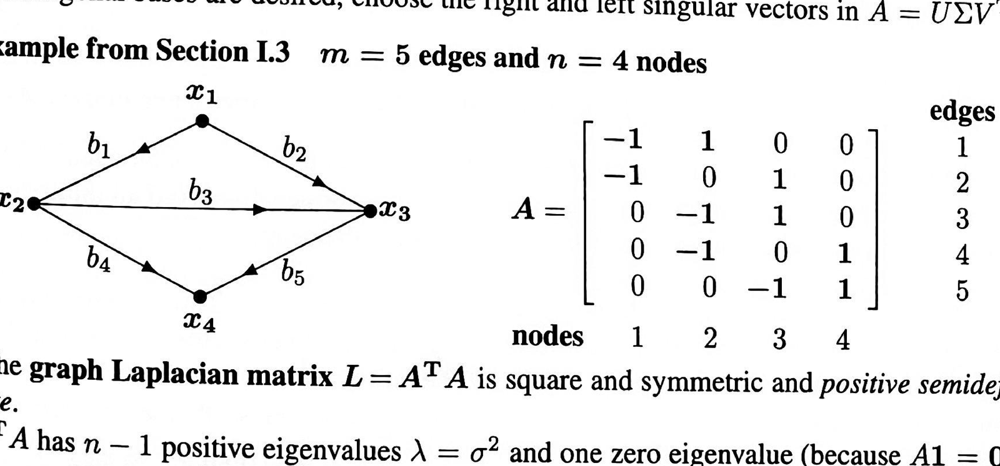
> <span style="color:#7f8c8d;">原书 Figure（§I.3 的例图：节点-边图与关联矩阵 $A$），书页 239（PDF p.241）；裁切自扫描页，图形未改动</span>

**例（取自 §I.3）**：$m = 5$ 条边，$n = 4$ 个节点。
```math
A =
\begin{bmatrix}
-1 & 1 & 0 & 0\\
-1 & 0 & 1 & 0\\
0 & -1 & 1 & 0\\
0 & -1 & 0 & 1\\
0 & 0 & -1 & 1
\end{bmatrix}
\qquad
\begin{array}{l}
\text{rows} = \text{edges}\\
\text{columns} = \text{nodes}
\end{array}
```
graph Laplacian matrix（图拉普拉斯矩阵）$L = A^{T}A$ 是方阵、对称且 symmetric and positive semidefinite（半正定）的。
$L$ 有 $n - 1$ 个正特征值 $\lambda_1, \ldots, \lambda_{n-1}$，以及一个零特征值（因为 $A\mathbf{1} = \mathbf{0}$）。
在 $m = 5$ 条边、$n = 4$ 个节点的例子里，特殊形式 $A^{T}A = D - B$ 格外醒目（缺失一条边）：
```math
A^{T}A =
\begin{bmatrix}
2 & -1 & -1 & 0\\
-1 & 3 & -1 & -1\\
-1 & -1 & 3 & -1\\
0 & -1 & -1 & 2
\end{bmatrix}
= D - B
\qquad (\text{one missing edge})
```

---

<!-- page 242 -->
> <span style="color:#7f8c8d;">本页为书页 240，是 §IV.6 的续页；页眉 “Special Matrices” 与印页码为重复元素，不译。</span>
> <span style="color:#1e8449;">**[note] 译者注（OCR 修正）：** 本页 `一 一 1 ） edges` 与 `（ 一 1` 重建为 $n(n-1)/2$ 条边与 $D = (n-1)I$；`觐 0 0 s`（loops，回路）、`巳`（tree，树）、`蓋`（$A$）依上下文修正；`Fie dler` 等页内噪声同前。页首 OCR 把「完全图」的定义重复读出两次，已按原文合并为一句，未删任何信息；三张图的关联矩阵按「每行 $-1$ 在 $+1$ 之前」与两棵 $4$ 节点 $3$ 边生成树重建，其中完全图关联矩阵与书页 241（page_243）公式 (2) 的 $A^{T}$ 互为转置，可交叉核对。</span>
degree matrix（度矩阵）是 $D = \operatorname{diag}(2, 3, 3, 2)$：它数出汇集在 node（节点）$1, 2, 3, 4$ 上的边数。
adjacency matrix（邻接矩阵）$B$ 的元素只取 $0$ 与 $1$：一条从 $j$ 到 $k$ 的 edge（边）产生 $b_{jk} = 1$。
一个 complete graph（完全图，即所有边都出现）有 $D = (n - 1) I$ 与 $B = $ 全 $1$ 矩阵减去 $I$。
若每一对节点之间都由一条边相连，则该图是 complete（完全）的。
它将有 $m = (n - 1) + (n - 2) + \cdots + 1 = \frac{1}{2} n (n - 1)$ 条边。
此时 $B$ 就是全 $1$ 矩阵（减去 $I$）。
所有度都等于 $n - 1$，所以 $D = (n - 1) I$。
在另一极端，连通图里只有 $n - 1$ 条边。
此时连通图中没有 loops（回路）：该图就是一棵 tree（树）。
任何连通图的边数 $m$ 都介于 $m = n - 1$ 与 $m = \frac{1}{2} n (n - 1)$ 之间。
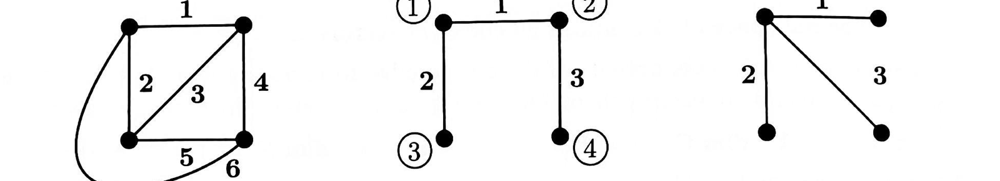
> <span style="color:#7f8c8d;">原书 Figure IV.4，书页 240（PDF p.242）；裁切自扫描页，图形未改动</span>

Figure IV.4（图 IV.4）：complete graph（完全图）与两棵 trees（树），三者都含 $n = 4$ 个节点：$m = 6$ 或 $3$ 条边。中间的图给出了三个图中四个节点的统一编号。
> <span style="color:#7f8c8d;">Strang LaLFD §IV.6, p.240</span>
> <span style="color:#7f8c8d;">图片本身无法翻译：左图为完全图（$m = 6$ 条边），中、右两图分别为两棵生成树（spanning tree，各 $m = 3$ 条边）；节点 $1, 2, 3, 4$ 的编号见中图。</span>
中间的图给出了三张图中四个节点的统一编号。
这些图通过它们的 $m \times n$ incidence matrix（关联矩阵）$A, A_2, A_3$ 与线性代数联系起来：
```math
\begin{bmatrix}
-1 & 1 & 0 & 0\\
-1 & 0 & 1 & 0\\
0 & -1 & 1 & 0\\
0 & -1 & 0 & 1\\
0 & 0 & -1 & 1\\
-1 & 0 & 0 & 1
\end{bmatrix}
\qquad
\begin{bmatrix}
-1 & 1 & 0 & 0\\
-1 & 0 & 1 & 0\\
0 & -1 & 0 & 1
\end{bmatrix}
\qquad
\begin{bmatrix}
-1 & 1 & 0 & 0\\
-1 & 0 & 1 & 0\\
-1 & 0 & 0 & 1
\end{bmatrix}
```
（左：complete graph 的 incidence matrix $A$；中：first tree 的 $A_2$；右：second tree 的 $A_3$。）
我们的约定是：在每一行里 $-1$ 都出现在 $+1$ 之前。
但这些并不是 directed graphs（有向图）！边上的 flows（流，也就是电流 $y_1$ 到 $y_m$）可以取正值，也可以取负值。
而关于一个图（它的节点与边）的全部信息，都由它的关联矩阵揭示出来。
当图有 $n$ 个节点时，关联矩阵就有 $n$ 列。
这些列向量之和是零向量；换一种说法：全 $1$ 向量 $\mathbf{1} = (1, 1, 1, 1)$ 同时位于这三个 incidence matrix 的 nullspace（零空间）之中。
$A$ 的 nullspace 是穿过该全 $1$ 向量的一条直线。$Ax = \mathbf{0}$ 要求
```math
\begin{matrix}
-x_1 & +x_2 & & & = 0 & (\text{then } x_1 = x_2)\\
-x_1 & & +x_3 & & = 0 & (\text{then } x_1 = x_3)\\
& -x_2 & +x_3 & & = 0 &\\
& -x_2 & & +x_4 & = 0 & (\text{then } x_2 = x_4)\\
& & -x_3 & +x_4 & = 0 &\\
-x_1 & & & +x_4 & = 0 &
\end{matrix}
\tag{1}
```
```math
-x_1 + x_3 = 0 \qquad (\text{then } x_1 = x_3)
```
```math
-x_2 + x_3 = 0
```
```math
-x_2 + x_4 = 0 \qquad (\text{then } x_2 = x_4)
```
```math
-x_3 + x_4 = 0
```
```math
Ax = \mathbf{0}\qquad -x_1 + x_4 = 0 \tag{1}
```
于是 $x = (c, c, c, c)$：零空间正是常向量那条直线。

---

<!-- page 243 -->
> <span style="color:#7f8c8d;">本页为书页 241，§IV.6 Graphs and Laplacians and Kirchhoff's Laws（图、拉普拉斯矩阵与基尔霍夫定律）正文；页眉与页码为重复元素，不译。</span>
> <span style="color:#1e8449;">**[note] 译者注（OCR 修正）：** 本页 OCR 噪声严重：`蓋`／`风` 为 $A$，`刊` 为 the，`AT` 依上下文为 $A^{T}$，`T = 0` 为 $A^{T}y = 0$，`1V.6` 为 IV.6，`一 襯 + 1` 为 $m - n + 1$，`（ 2 ）` 为公式编号 (2)，`鼐 ow`／`且 ow`／`FIow` 为 flow，`100p`／`op`／`№ op`／`0 砒记纱` 为 loop，`p 佣 谳 里 e definite` 为 positive definite。电流向量的字母取自本页 `6 unknown y's` 一句，全书（含书页 243 的 $A^{T}y = 0$ 与 Problem Set IV.6 第 5、7 题）一致记作 $y$；公式 (2) 的碎片按 $A^{T}$ 为 $4 \times 6$（节点 × 边）重建，最后一个方程（节点 $4$）恰为 $y_4 + y_5 + y_6 = 0$。公式 (3) 的三个向量 OCR 只剩孤立数字，按 $A^{T}y = 0$ 的独立解重建；回路 1 的走法 OCR 词序已乱（`Forw ard on edge 2 ， b ackward 0n edges 3 and 1`），依 (3) 的第一列修正为「沿边 $1$ 与边 $2$ 正向走、沿边 $3$ 反向走」（三条回路分别是三角形 $1$-$2$-$3$、$1$-$3$-$4$、$2$-$3$-$4$，三者之和正是外回路 $1$-$2$-$4$）。页末外回路向量的 OCR 首项 `一 1` 为噪点：三条回路解之和为 $(1, 0, 0, -1, 0, 1)$，且它才是 $A^{T}y = 0$ 的解（$(-1,0,0,-1,0,1)$ 不满足节点 $1$ 的方程）。（原书此处 OCR 残缺）本批 notes_n3b.md 的同页译者注沿用 `$f$` 作为电流向量记号，本页与 page_244、page_245 均用 `$y$`，此处依译文正文统一为 `$y$`。</span>
Kirchhoff's Current Law（基尔霍夫电流定律）
> <span style="color:#7f8c8d;">Strang LaLFD §IV.6, p.241</span>
方程 $Ac = 0$ 并不十分有趣：它的所有解都是常向量。
而方程 $A^{T}y = 0$ 则极其有趣——它是应用数学的一个中心方程。
我们需要看清它的含义，并找出全部 $n - m + 1$ 个独立解。
<span style="color:#2471a3;">**[theorem]**</span>
<span style="color:#c0392b;">**Kirchhoff's Current Law（基尔霍夫电流定律）**</span>
KCL（基尔霍夫电流定律）就是 $A^{T}y = 0$：
```math
A^{T}y =
\begin{bmatrix}
-1 & -1 & 0 & 0 & 0 & -1\\
1 & 0 & -1 & -1 & 0 & 0\\
0 & 1 & 1 & 0 & -1 & 0\\
0 & 0 & 0 & 1 & 1 & 1
\end{bmatrix}
\begin{bmatrix}
y_1\\ y_2\\ y_3\\ y_4\\ y_5\\ y_6
\end{bmatrix}
=
\begin{bmatrix}
0\\ 0\\ 0\\ 0
\end{bmatrix}
\tag{2}
```
首先数一数解的个数。
有 $m = 6$ 个未知量 $y$，而独立方程只有 $r = 3$ 个，于是有 $6 - 3$ 个独立解。
$A^{T}$ 的零空间维数是 $m - r = 3$。
我们要为 $\mathbf{R}^6$ 的这个子空间找出一组基。
那么基尔霍夫电流定律 $A^{T}y = 0$ 中这四个方程的含义是什么？
每一个方程都是关于流入或流出某个节点的电流的 balance law（平衡定律）：
基尔霍夫电流定律即电流的平衡——流入每个节点的流量等于从该节点流出的流量。
在节点 $4$ 处，(2) 中的最后一个方程是 $y_4 + y_5 + y_6 = 0$：流入节点 $4$ 的净流量为零，否则电子就会 pile up（堆积）起来。
这种电流、力或金钱的平衡在工程、科学与经济学中处处出现，它就是 equilibrium（平衡态）的平衡方程。
求解 $A^{T}y = 0$ 的关键在于观察图中的小回路。
loop（回路）是由若干条边组成的 cycle（环）——一条回到起点的路径。
图 IV.4 中的第一个图有三个小回路。沿着这些回路走一圈涉及以下各边：
loop 1：沿边 $2$ 正向走，沿边 $3$ 与边 $1$ 反向走。
loop 2：沿边 $3$ 与边 $5$ 正向走，沿边 $4$ 反向走。
loop 3：沿边 $6$ 正向走，沿边 $5$ 与边 $2$ 反向走。
让流量绕着每个回路环行，就得到基尔霍夫电流定律的解。
在回路中的每个节点处，流入该节点的流量又流向下一节点。
图中的这三个回路给出 $A^{T}y = 0$ 的三个独立解，每一个都给出绕某个回路的六条边电流：
```math
A^{\mathrm{T}}y = 0 \quad \text{for} \quad y_1 = \begin{bmatrix} -1 \\ 1 \\ -1 \\ 0 \\ 0 \\ 0 \end{bmatrix} \quad \text{and} \quad y_2 = \begin{bmatrix} 0 \\ 0 \\ 1 \\ -1 \\ 1 \\ 0 \end{bmatrix} \quad \text{and} \quad y_3 = \begin{bmatrix} 0 \\ -1 \\ 0 \\ 0 \\ -1 \\ 1 \end{bmatrix} . \tag{3}
```
即使存在更多（更大）的回路，也不会有更多的独立解！
绕整个图的大回路恰好是这三个小回路之和。
因此，那个外回路的解 $y = (-1, 0, 0, -1, 0, 1)$ 正好等于 $y_1 + y_2 + y_3$。
> <span style="color:#1e8449;">**[note] 译者注：** 基尔霍夫电流定律 $A^{T}y=0$ 就是线性代数——回路空间与四个基本子空间</span>
> <span style="color:#1e8449;">这一页是 Strang 把图论和线性代数焊在一起的地方，值得把机制彻底讲透。图有 $m$ 条边、$n$ 个节点，关联矩阵 $A$ 是 $m\times n$：第 $i$ 行对应第 $i$ 条边，从节点 $j$ 到节点 $k$ 的边在第 $j$ 列写 $-1$、第 $k$ 列写 $+1$。于是**每一行之和为零**，等价地 $A\mathbf{1}=\mathbf{0}$：常向量 $\mathbf{1}=(1,\dots,1)$ 在零空间里。为什么？因为每一行都在说“一条边的两端”，两端相加自然抵消。</span>
> <span style="color:#1e8449;">方程 $A^{T}y=0$ 是基尔霍夫电流定律，它的第 $i$ 个方程说的是“流入／流出节点 $i$ 的净流量为零”。这一页最漂亮的观察是解的结构：**6 个未知数、只有 4 个方程、其中只有 3 个独立（因为 4 个方程相加恒为 0），所以解空间维数是 $6-3=3$；而它的基恰好是图中的 3 个小回路上的绕行电流。** 机制一目了然：沿着一个环走一圈，每到一个节点，“进来多少”和“出去多少”自动相等，守恒律自动满足——所以每个回路都白送一个解。反过来，任何守恒流都能拆成若干回路的叠加，所以回路给全了。这就是本页那句“绕整个图的大回路恰好是这三个小回路之和”的含义：外圈回路的解等于那三个小回路解的和，它不提供新的独立方向（三个小回路解之和是 $(1,0,0,-1,0,1)$，正好又落在这三个方向张成的平面里）。</span>
> <span style="color:#1e8449;">现在把这个结论翻译成 6.042J 的语言。连通图的边数 $m$、节点数 $n$、独立回路数 $m-n+1$ 之间的关系，你在离散数学里已经用过：**树是连通且无环的图，恰好有 $n-1$ 条边**。这正对应本书的两个极端：树的时候 $m-n+1=0$，$A^{T}y=0$ 只有 $y=0$，也就是“树对应的那些行线性无关”（书页 240 即 page_242 的那两棵树就是这种情形）；完全图的时候独立回路最多。**每往树上加一条边，就多出恰好一个独立回路，零空间维数就加一。** 于是离散数学里的计数等式 $m-n+1$，在矩阵语言里就是零空间维数 $\dim N(A^{T})$。维数公式不是背出来的，它是“数环”。</span>
> <span style="color:#1e8449;">四子空间的完整对应（Strang 的核心洞察）可以列成一张表：**$N(A)$** 是 $\mathbf{1}$ 张成的一条直线（1 维）——所有节点取同一个电位，物理上对应“整体加一个常数电压，什么都不变”；**$C(A^{T})$**（行空间，$n-1$ 维）是满足 $c_1+\cdots+c_n=0$ 的向量，即所有“各节点电位差可以取到的形态”，也是“在一棵生成树上流动的电流”，因为 $A$ 的 $n-1$ 条独立行正好选出图的一棵树；**$C(A)$**（$n-1$ 维）是所有“可以写成势差”的边向量，即每条边上的电压降；**$N(A^{T})$**（$m-n+1$ 维）是所有守恒的流，基是回路。注意维数对偶：$\dim C(A)+\dim N(A^{T})=(n-1)+(m-n+1)=m$——整个 $m$ 维边空间恰好被分成“梯度型（势差）”与“守恒型（回路流）”两部分。</span>
> <span style="color:#1e8449;">还有一个可以带走的算法直觉：在 6.006 里判断连通性用 BFS／DFS，$O(m+n)$；在这里等价的动作是“从 $A$ 里挑出 $n-1$ 条线性无关的行”，挑法就是选一棵生成树。**“选生成树”和“给矩阵选一组行基”是同一个动作的两种说法。** 顺带，本页提醒我们：这些边并不是有向的，$-1$ 在 $+1$ 之前只是记账约定；流可正可负，所以反转某条边的记号只会翻转 $y$ 的符号，不改变 $A^{T}A$（这一点在 Problem Set IV.6 的第 2 题被点明，见 page_246／书页 244）。</span>
> <span style="color:#1e8449;">可迁移结论：**以后凡遇到“每行零和”的矩阵，先别急着做消元；问它的零空间是不是“守恒律”、行空间是不是“势差”、以及“独立守恒量有多少个”能否用一个计数公式（这里是 $m-n+1$）直接写出来。** 守恒律 + 势，是所有网络型问题的统一骨架。</span>

---

<!-- page 244 -->
> <span style="color:#7f8c8d;">本页为书页 242，§IV.6 正文续页；页眉 “Special Matrices” 与页码为重复元素，不译。</span>
> <span style="color:#1e8449;">**[note] 译者注（OCR 修正）：** 本页 `a42` 为页码噪声，`蓋` 为 $A$，`AT` 为 $A^{T}$，`rc 0 ， s Law` 为 Kirchhoff's Law，`T = 0` 为 $A^{T}y = 0$，`山 at` 为 that，`ÄTCA` 为 $\hat{A}^{T}C\hat{A}$，`p 佣 谳 里 e definite` 为 positive definite，`一 1 = 3` 为 $n - 1 = 3$；OCR 的 `Ac = 0` 与 `(Ac)TC(Ac)` 依上下文重建为 $Au = \mathbf{0}$ 与 $(Au)^{T}C(Au)$（电压向量在本页记作 $u$，与 `04 = 0` 即 $u_4 = 0$ 一致）。Euler 恒等式的三项顺序按子空间维数关系重建：$\dim N(A^{T}) = m - n + 1$ 与 $n - 1 = m - \dim N(A^{T})$ 给出「节点数 $-$ 边数 $+$ 回路数 $= 1$」。第三个方程的 OCR 只留下 `f =`，按「三式合并为 $A^{T}CAu = f$」重建为 $A^{T}w = f$（$w$ 为各边电流，$f$ 为注入节点的电流源）。</span>
子空间的维数导出了拓扑学中一个基本恒等式（由 Euler 发现）：
```math
\boxed{(\text{Number of nodes}) - (\text{Number of edges}) + (\text{Number of loops}) = (n) - (m) + (m - n + 1) = 1.} \tag{4}
```
读者已经知道，树没有回路。
我们的第二个和第三个图都是树，各有 $4$ 个节点与 $3$ 条边。
此时 Euler 计数为 $4 - 3 + 0 = 1$。
而 $A^{T}y = 0$ 只有解 $y = 0$：对每一棵树，$A$ 的各行都是线性无关的。
```math
A_2 =
\begin{bmatrix}
-1 & 1 & 0 & 0\\
-1 & 0 & 1 & 0\\
0 & -1 & 0 & 1
\end{bmatrix}
\quad\text{and}\quad
A_3 =
\begin{bmatrix}
-1 & 1 & 0 & 0\\
-1 & 0 & 1 & 0\\
-1 & 0 & 0 & 1
\end{bmatrix} .
```
The $A^{T}CA$ Framework in Applied Mathematics（应用数学中的 $A^{T}CA$ 框架）
> <span style="color:#7f8c8d;">Strang LaLFD §IV.6, p.242</span>
图是三个方程的绝佳范例，我在工程、科学与经济学中处处见到它们。
这些方程描述一个处于 steady state（稳态）平衡的系统。
对于电网中的流动（flow，即我们第一个图中沿六条边的电流），这三个方程把四个节点上的未知 voltage（电压）$x = (x_1, x_2, x_3, x_4)$ 与沿六条边的六个未知 direct currents（电流）$y = (y_1, y_2, y_3, y_4, y_5, y_6)$ 联系起来。
```math
\text{Voltage differences across edges}\qquad e = Ax
```
```math
\text{Ohm's Law on each edge}\qquad y = Ce
```
```math
\text{Kirchhoff's Law with current sources}\qquad f = A^{\mathrm{T}}y
```
（$e_1$ = voltage at end node 2 − voltage at start node 1；current $y_1 = c_1$ times $e_1$ = (conductance)(voltage)；current sources $f$ into nodes balance the internal currents $y$。）
其中 $e_1 = x_2 - x_1$ 是终点节点 $2$ 的 voltage（电压）减去起点节点 $1$ 的电压，即边 $1$ 两端的电压差；电流 $y_1 = c_1 e_1$ 等于 conductance（电导）乘以电压。（续）电导）（电压）；流入节点的电流源与内部电流相平衡。
这三个方程 $e = Ax$、$y = Ce$ 与 $f = A^{\mathrm{T}}y$ 合为一个 equilibrium equation（平衡方程）$A^{\mathrm{T}}CAx = f$。
这正是如此众多基本定律的形式。
其美妙之处在于 $A$ 与 $A^{\mathrm{T}}$ 同时出现。
结果是：governing matrix（控制矩阵）$A^{\mathrm{T}}CA$ 是对称的。
$A^{\mathrm{T}}CA$ 是 positive semidefinite（半正定）的，因为 $Ax = \mathbf{0}$ 有全 $1$ 解 $x = (1, \ldots, 1)$。（续）
若再加上一个 boundary condition（边界条件），例如 $x_4 = 0$（这使节点 $4$ grounded（接地），并去掉 $A$ 的最后一列），则约化矩阵 $A^{\mathrm{T}}CA$ 变成 symmetric positive definite（对称正定）。
接地网络有 $n - 1 = 3$ 个未知电压（$x_4 = 0$ 是已知的）。
约化后的关联矩阵现在是 $6 \times 3$：full rank（满秩）为 $3$。
系统矩阵 $\hat{A}^{T}C\hat{A}$ 的规模是 $(3 \times 6)(6 \times 6)(6 \times 3) = 3 \times 3$。
能量为正：$x^{\mathrm{T}}A^{\mathrm{T}}CAx = (Ax)^{\mathrm{T}}C(Ax) > 0$，只要 $x \ne 0$。
现在 $A^{\mathrm{T}}CA$ 既对称、可逆，又是 positive definite（正定）的。

---

<!-- page 245 -->
> <span style="color:#7f8c8d;">本页为书页 243，续 §IV.6 Graphs and Laplacians and Kirchhoff's Laws（图、拉普拉斯矩阵与基尔霍夫定律）正文；页眉与页码为重复元素，不译。</span>
> <span style="color:#1e8449;">**[note] 译者注（OCR 修正）：** 本页 OCR 噪声较重：`蓋` 依语境修正为 $A$，`AT`／`儿`／`A丁` 为 $A^{T}$，`Tlus` 为 This，`1V.6` 为 IV.6，`ln`／`山 at`／`宙 at` 为 in／that，`CO 沅 况 0 况 s` 为 continuous；被破坏的公式均按数学语境重建，例如 `ATCAG = ATCb` 依正规方程重建为 $A^{T}CA\,\hat{x} = A^{T}Cb$，事实 1 与事实 5 中的 `= 0` 重建为 $A\mathbf{1} = \mathbf{0}$（$A^{T}\mathbf{1} = \mathbf{0}$ 在数学上不成立）。`AT y = 0` 依 OCR 保留为 $A^{T}y = 0$：它与书页 241（page_243）的基尔霍夫电流定律同为 $A^{T}y = 0$，电流向量记作 $y$；而书页 242（page_244）的 $A^{T}CA$ 框架把边上的电流记作 $w$、把注入节点的电流源记作 $f$——这是原书在不同小节的记号，译文一律照原书保留。同理，原书在书页 239（page_241）把 $A^{T}A$ 记作 $L$，本页把单位权重的拉普拉斯记作 $G$、把加权拉普拉斯记作 $K$，§IV.7 又把归一化的 $D^{-1/2}A^{T}CAD^{-1/2}$ 记作 $L$；$G$ 的用法可由 Problem Set IV.6 第 9 题（page_246）“$G = A^{T}A$”交叉核对。本页无图，故无图注。</span>
这个 $A^{T}CA$ 框架是我在 MIT 开设的 18.085 Computational Science and Engineering（计算科学与工程）课程的基石。
正是在这里，线性代数对大规模计算（large-scale computations，例如 finite element method（有限元方法））给出了重要的信息。
我的视频课程与教科书都强调 $A^{T}$ 与 $A^{T}CA$ 的应用。
通过保持控制方程（governing equations，它们常常是 partial differential equations（偏微分方程））的对称正定结构，$A^{T}CA$ 这一格式与科学定律相契合。
基尔霍夫电流定律 $A^{T}y = 0$ 成为一切平衡定律的模型：电荷的守恒、力的平衡、经济学中净收入为零、质量与能量的守恒，以及各种连续性方程。
同一个 $A^{T}CA$ 矩阵也出现在线性回归（linear regression，即应用于 $Ax = b$ 的最小 least squares（二乘））中：
```math
\begin{aligned}
A^{T}A\,\hat{x} &= A^{T}b && \text{Normal equation for the } \hat{x} \text{ that best fits the data } b\\
A^{T}CA\,\hat{x} &= A^{T}Cb && \text{Least squares weighted by the inverse matrix } C = V^{-1}\\
\\min_{x}\ \|b - Ax\|_{C}^{2} && \text{Minimum squared error } (b - Ax)^{\mathrm{T}}C(b - Ax)
\end{aligned}
```
最后**一章**中的 deep learning（深度学习）同样是一个 optimization problem（优化问题）。
我们要找出各层 neurons（神经元）之间的 weights（权重），使学习函数 $F$ 能正确分类 training data（训练数据）。
在 20 世纪，当 $F$ 为线性时，这一做法并不那么成功。
到了本世纪，每个神经元还会施加一个非线性 nonlinear activation function（激活函数），例如 ReLU（即 $0$ 与 $x$ 中较大者）。
深度学习如今已变得惊人地强大。
用于分类数据的整体函数 $F$ 是连续的且分段 linear（线性的）。
它的图像拥有数量惊人的小平坦片段。
每施加一次 ReLU 都会给 $F$ 的图形增加一个 fold（折痕）。
这个折痕与其他折痕相交，从而把特征空间划分成许许多多的片段。
请参见 §VII.1 关于深度 deep neural nets（神经网络）的讨论。
构造出所有这些平坦片段，正是深度学习背后的数学动力。
The Graph Laplacian Matrix（图拉普拉斯矩阵）
> <span style="color:#7f8c8d;">Strang LaLFD §IV.6, p.243</span>
$K = A^{T}CA$ 是一个加权图 weighted graph Laplacian（拉普拉斯矩阵）——权重就放在 $C$ 中。
标准的拉普拉斯矩阵是 $G = A^{T}A$，取单位权重（$C = I$）。
这两个拉普拉斯矩阵在理论与应用上都是至关重要的矩阵。
关于 $A^{T}$ 与 $A^{T}CA$ 的主要事实适用于每一个 connected graph（连通图）。
$K$ 在工程中可以是 stiffness matrix（刚度矩阵），也可以是 conductance matrix（电导矩阵）。
<span style="color:#2471a3;">**[theorem]**</span>
<span style="color:#c0392b;">**图拉普拉斯矩阵 $G$ 与 $K$ 的五条基本事实 Five Facts about the Graph Laplacians**</span>
**1.** $G$ 与 $K$ 的每一行、每一列之和都为零，因为 $x = (1, \ldots, 1)$ 满足 $Ax = \mathbf{0}$。（续）$A$ 的每一行恰有一个 $+1$ 与一个 $-1$）。
**2.** $G = A^{T}A$ 是对称的，因为边都是双向的（undirected graph（无向图））。
**3.** 对角元 $(A^{T}A)_{ii}$ 计入汇集在节点 $i$ 处的边数，即该节点的 degree（度）。
**4.** 当一条边连接节点 $i$ 与节点 $j$ 时，非对角元为 $(A^{T}A)_{ij} = -1$。
**5.** $G$ 与 $K$ 是 positive semidefinite（半正定）但不是 positive definite（正定）的（因为第 1 条中的 $Ax = 0$）。
```math
A^{T}A = \text{diagonal} + \text{off-diagonal} = \text{degree matrix} - \text{adjacency matrix} = D - B
```
> <span style="color:#1e8449;">**[note] 译者注：** $L=A^{T}CA$：从加权最小二乘到“行列式数生成树”，一个矩阵撑起四门课</span>
> <span style="color:#1e8449;">图拉普拉斯矩阵 $L=A^{T}CA$ 是全书最有“复用价值”的一个对象，因为它在至少四个语境下是同一个东西：图论里的加权拉普拉斯、电路里的电导矩阵、结构力学里的刚度矩阵、统计学里加权最小二乘的正规方程矩阵。它不是“恰好长得像”，而是**同一个数学结构在这四个领域各自的语言里出现**。</span>
> <span style="color:#1e8449;">先把三条方程串起来，这是理解一切的钥匙。$e=A^{T}u$：每条边两端节点的电位差（梯度）。$w=Ce$：每条边的本构关系（欧姆定律，$C$ 是各边电导组成的对角矩阵）。$A^{T}w=f$：每个节点的流量守恒（基尔霍夫电流定律）。三步代入：$A^{T}CAu=f$。它的对称性来自“$A$ 与 $A^{T}$ 成对出现”；它的正定性来自能量：$u^{T}A^{T}CAu=(Au)^{T}C(Au)=\sum_{\text{边}} c_e(\Delta u_e)^{2}$，即“所有边上的势差平方乘权重之和”。这个量 $\ge 0$，且在每条边的势差都为零时取 $0$。所以：**由 $A$ 定义的“差”和由 $C$ 定义的“权重”一旦确定，矩阵的定性（正定还是只半正定）就完全由“除了整体常数之外还有没有非零的零能量状态”决定**。全 $1$ 向量对应每个节点同电位（能量为零），所以 $A^{T}CA$ 只是半正定；接地（grounding，把节点 4 固定为 $u_4=0$，也就是删掉 $A$ 的一列）之后，全 $1$ 向量不再是候选解，矩阵立刻变成正定。</span>
> <span style="color:#1e8449;">把 $C$ 看成权重 $V^{-1}$，这套东西立刻变成你在 Strang 教材里学过的加权最小二乘：极小化 $(b-Ac)^{T}C(b-Ac)$，令梯度为零得到 $A^{T}CA\,\hat c=A^{T}Cb$。$C=I$ 时就是普通正规方程 $A^{T}A\hat x=A^{T}b$。注意这里有一步观念上的跳跃很值得玩味：最小二乘里的 $A$ 是“参数到观测”的映射（通常 $m>n$），图里的 $A$ 是关联矩阵——两者形状意义都不同，但最终的矩阵**形式完全相同**。原因在于它们解决的是同一个模板问题：**在一个由 $A$ 描述的“差”结构上，最小化加权平方和**。权重大 = 方差小 = 这个数据／这条边更可信，这正是加权最小二乘的统计含义（你在概率论里学的方差的倒数作为权重）。</span>
> <span style="color:#1e8449;">然后是本页五条基本事实背后的图论内容：$A^{T}A=D-B$，其中 $D$ 是度矩阵（对角元数出每个节点连了多少条边），$B$ 是邻接矩阵（相连为 1，否则为 0），非对角元是 $-1$，所以每行每列和为零。把它接到 6.042J：你已经知道“连通图的生成树”这个概念，也知道树满足 $m=n-1$。**计数版本就是基尔霍夫矩阵树定理：把 $A^{T}A$ 删掉第 $k$ 行第 $k$ 列（等价于把节点 $k$ 接地），剩下矩阵的行列式等于图的生成树个数；带权重时改为“对每棵生成树，把它的边权相乘，再对所有生成树求和”。** 这与你在本页看到的“接地使矩阵变正定”是同一件事的两面：删掉一行一列让矩阵可逆，而它的行列式不是随便一个数——它在数树。</span>
> <span style="color:#1e8449;">为什么行列式会去数树？标准证明的思路可以这样搭脚手架：把删掉第 $k$ 列后的关联矩阵记为 $\hat A$（$m\times(n-1)$），则删行删列后的拉普拉斯是 $\hat A^{T}\hat A$；用 Cauchy–Binet 把它按“从 $m$ 条边里选 $n-1$ 条”展开，每一项是所选各列对应子式的平方。**只有当这 $n-1$ 条边恰好构成一棵生成树时，对应的子式才不为零——此时它等于 $\pm1$，平方后贡献 $1$；含环、或让某个节点孤立的选择都会让子式线性相关而变成零。** 于是行列式就只剩树的贡献。你在 Strang 教材里学过的“行列式为零 ⟺ 存在线性相关的一行”，在这里成了一条计数原理。可以用完全图 $K_4$ 自检：$n=4$ 的完全图有 $4^{4-2}=16$ 棵生成树，删掉任一行任一列后算出的行列式应当正好是 $16$（$K_4$ 的约化拉普拉斯是 $4I_3-J_3$，特征值为 $1,4,4$，乘积即 $16$）。</span>
> <span style="color:#1e8449;">可迁移结论：**$A^{T}CA$ 是把“局部差分 + 局部权重 + 全局守恒”这三句话写成矩阵的通用模板。遇到任何守恒律问题（电流、力、质量、流量、钱），先找它的 $A$、$C$，剩下的定性结论（对称、正定、零空间维数）就都是免费的；而同一个矩阵的行列式往往还数着某个组合量（这里是生成树）——线性代数与图论在这里不是类比，是同一条定理的两种写法。**</span>

---

<!-- page 246 -->

> <span style="color:#7f8c8d;">本页原书为 Problem Set IV.6，共 9 道习题。按技能**铁律 9**（非必要习题不收录），此处不保留习题原文（正文未引用本页任何题）。</span>

---

<!-- page 247 -->
> <span style="color:#7f8c8d;">本页为书页 245，是 §IV.7 Clustering by Spectral Methods and k-means（谱方法与 k-means 聚类）的开篇页；页眉与印页码为重复元素，不收录。</span>
> <span style="color:#1e8449;">**[note] 译者注（OCR 修正）：** 本页 OCR 噪声极重：`Clustenng`→Clustering、`S Methods`→Spectral Methods、`means`→k-means、`℃`→to、`酣`→all、`starnng pornt`→starting point、`sep arate`→separate、`fnends`→friends、`山`→than／and（依语境）、`s i 皿 I`→similar、`什`→of、`ldentlfying`→identifying、`glve`→give、`0 ur`→our、`decodmg`→decoding、`gen`→genes、`someumes`→sometimes、`llul pathway`→cellular pathway、`gre at achlevement`→great achievement、`fitung`→fitting、`creatm g`→creating、`犭`→$\frac{1}{3}$、`丐`→$x_i$、`0 y`→only、`娓`→$R$、`丿`→$R_{ij}$、`CO 廓 s`→columns、`咒 h as`→$k$ has。图中的节点次序在 OCR 中不可完全辨读，下面的 $C$、$R$ 依文中两个质心的均值与指示含义重建：$C$ 为 $2\times2$（两列质心），$R$ 为 $2\times5$（两行指示），与 $CR=(m\times k)(k\times n)$ 中 $m=2$、$k=2$、$n=5$ 相符（原稿曾把维数写成 $5\times2$ 与 $2\times5$，与之不符，已改正）。</span>
如何理解一个拥有许多节点（且并非所有可能的边都存在）的 graph（图）？
一个重要的起点，是把这些节点分成两个或更多个 cluster（簇）——就像一群群朋友那样。
edges（边）更可能落在同一个簇内部，而较少跨越不同的簇。
我们希望各个簇的 size（规模）相近，这样才不至于只是挑出几个孤立的节点。
辨识出这些簇，会让我们对这张图获得第一层粗略的理解。
在解码 genetic data（基因数据）时，一个关键步骤是把 expression levels（表达水平）高度相关（有时甚至是反相关！）的基因聚成簇。
聚在一起的基因可能位于同一条 cellular pathway（细胞通路）之中。
Human Genome Project（人类基因组计划）的伟大成就，是告诉了我们生命之谜中的那些拼块——即 $G$ 的各行。
如今我们面对一个更重大的问题：把这些拼块组装起来以产生功能，例如合成 protein（蛋白质）。
An Example with Two Clusters（一个含两个簇的例子）
> <span style="color:#7f8c8d;">Strang LaLFD §IV.7, p.245</span>
下图给出了 $n = 5$ 个节点，这些节点被分成 2 个簇。
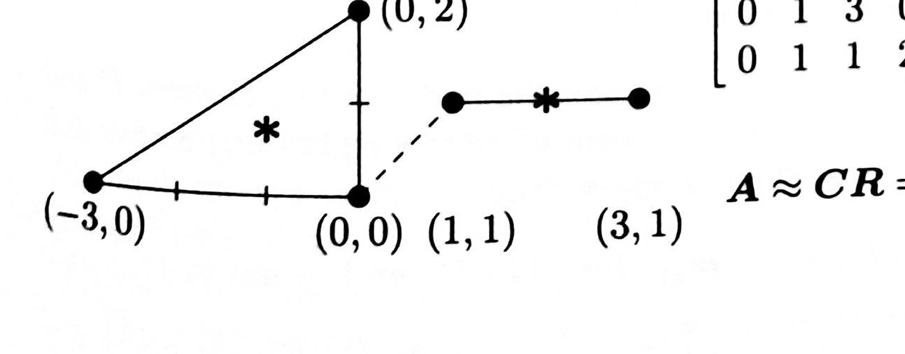
> <span style="color:#7f8c8d;">原书 Figure（五节点两簇的 k-means 例图），书页 245（PDF p.247）；裁切自扫描页，图形未改动</span>

用 * 标出的点是两个簇的 centroid（质心），分别为 $(2,1)$ 与 $(-1,2/3)$。
第一个质心是那 2 个点的平均 $\frac{1}{2}\big[(1,1)+(3,1)\big]=(2,1)$，第二个质心则是 3 个点的平均 $\frac{1}{3}\big[(0,0)+(-3,0)+(0,2)\big]=(-1,2/3)$。
这两个质心 $c_1$ 与 $c_2$ 使各点到簇内质心的 squared distances（距离平方和）$\|c - a_j\|^2$ 达到最小，其中 $a_j$ 是簇内的点。
这些簇是由著名的 k k-means algorithm（均值算法）在 $k = 2$ 时产生的。
这是把节点聚成簇的一种简单方法——但并不是唯一的方法（对于大规模的节点集合，它很可能也不是最快或最好的方法）。
在运用 eigenvalues（特征值）与 cuts（割）来产生簇之前，我们先说明：k 均值如何又一次成为本书一个核心主题的出色范例——
```math
\text{Approximate an } m \times n \text{ matrix } A \text{ by } CR = (m \times k)(k \times n)
\tag{1}
```
$CR$ 的秩很低，因为 $C$ 只有 $k$ 列，而 $R$ 只有 $k$ 行。
在 k 均值近似中，$C$ 的各列就是各簇的质心。
那么 $R$ 是什么？
$R$ 的每一列只有一个 1 与 $k-1$ 个 0。
更精确地说，若质心 $i$ 离点 $x_j$ 最近（否则不最近），则 $R_{ij} = 1$（或 $0$）。
于是 $R$ 第 $i$ 行中的那些 1，就告诉我们：$C$ 第 $i$ 列中那个质心（用 * 标出）周围的节点属于哪个簇。
对于 5 个节点和 2 个簇，在 $A \approx CR$ 中 $R$ 只有两个不同的列（即两个质心）：
```math
\begin{bmatrix}
0 & 1 & 3 & 0 & -3\\
0 & 1 & 1 & 2 & 0
\end{bmatrix}
\approx
\begin{bmatrix}
-1 & 2 & 2 & -1 & -1\\
2/3 & 1 & 1 & 2/3 & 2/3
\end{bmatrix}
```
```math
A \approx CR =
\begin{bmatrix}
-1 & 2\\
2/3 & 1
\end{bmatrix}
\begin{bmatrix}
1 & 0 & 0 & 1 & 1\\
0 & 1 & 1 & 0 & 0
\end{bmatrix}
```
> <span style="color:#7f8c8d;">图片本身无法翻译：5 个节点为第一簇的 $(1,1),(3,1)$ 与第二簇的 $(0,0),(-3,0),(0,2)$，两簇质心用 * 标出，分别为 $(2,1)$ 与 $(-1,2/3)$；$C$ 是 $2\times2$ 的质心矩阵，$R$ 是 $2\times5$ 的指示矩阵。</span>
> <span style="color:#1e8449;">**[note] 译者注：** k 均值就是一次“带约束的低秩逼近”——聚类与 SVD／PCA 是同一件事的两种取舍</span>
> <span style="color:#1e8449;">本页把 $m\times n$ 的数据矩阵写成 $X\approx CR$，其中 $C$ 是 $m\times k$、$R$ 是 $k\times n$。这个写法一下子把聚类从“算法”抬到了“矩阵分解”的高度，值得慢慢拆。首先，$CR$ 的秩最多是 $k$，因为 $C$ 只有 $k$ 列：**k 均值做的是一次低秩逼近**。其次，$R$ 的每一列是 one-hot（只有一个 $1$，其余全 $0$），$R_{ij}=1$ 的意思是“点 $x_i$ 离质心 $c_j$ 最近”。于是 $CR$ 的第 $i$ 列就是 $x_i$ 所属簇的质心——用 $k$ 个不同的向量去近似 $n$ 个数据点。</span>
> <span style="color:#1e8449;">把它与你已经学过的 SVD（奇异值分解）／PCA（主成分分析）对照，差别非常清楚。截断 SVD 给出的低秩逼近是平方误差意义下**最优**的（这是 Strang 书里那条低秩逼近定理的内容），但它的基向量是任意方向的奇异向量，你无法指着某一个说“这就是第 3 类”。k 均值反过来：它放弃了最优性，换来了**可解释性**——每个点被硬分到一个簇。用本页的记号说，SVD 允许 $R$ 是任意实矩阵，k 均值把 $R$ 限制成 one-hot。**自由度换可解释性**，这个取舍决定了你在什么场合该用哪个：想压缩／去噪／看主方向，用 SVD；想做“分组、贴标签、负载切分”，用聚类。</span>
> <span style="color:#1e8449;">再看优化结构，这一步正好用得上你在 Boyd 前五章建立的语言。目标函数是 $E=\sum_{i\in P}\lVert v_i-c_P\rVert^{2}+\sum_{i\in Q}\lVert v_i-c_Q\rVert^{2}$。若**固定分配**（哪个点属于哪一簇），$E$ 是质心的二次函数：令梯度为零，即 $2\sum_{i\in P}(c_P-v_i)=0$，得到的驻点正是“质心 = 簇内点的平均”。若**固定质心**，最优分配就是把每个点丢给最近的质心（只需比较 $k$ 个距离）。两步轮流做，就是 Lloyd 算法：每一步都让 $E$ 不增，而 $E\ge 0$ 有下界，所以算法**一定收敛**。但收敛到的是局部最优，不是全局最优——原因也正好是 Boyd 的主线：**联合起来对 $(C,R)$ 并不凸**（$R$ 是离散的 one-hot 集合），而“凸性保证局部最优即全局最优”这条定理在这里不适用。这就是为什么实践中要多次随机初始化、挑最优的那次。</span>
> <span style="color:#1e8449;">复杂度同样接得上 6.006：一次迭代的代价是 $O(nkd)$（$n$ 个点、$k$ 个簇、$d$ 维，每点要算 $k$ 个距离）。对比一下分治式的算法分析习惯——总代价 = 迭代次数 × 单轮代价，而迭代次数没有理论上的紧界，只能靠经验与收敛准则，这是聚类算法和排序／FFT 这类“有清晰复杂度保证”的算法在性格上的区别。</span>
> <span style="color:#1e8449;">本页末尾还留了一个接口，是通往下一节的桥：目标函数 $E$ 用的是欧几里得距离，但**节点表示成向量 $v_i$ 这件事本身可以是任意的**；更进一步，核 k 均值只用一个核矩阵 $K_{ij}=v_i\cdot v_j$ 就够了，距离与均值都可以由核算出。这等于说：**k 均值真正需要的不是坐标，而是内积（相似度）**。而图恰恰只给你相似度（边权），不给你坐标——所以谱聚类的思路就是把图先“嵌入”成一个向量空间（用拉普拉斯矩阵的特征向量作坐标），再在这个空间里做 k 均值。于是两种方法不是竞争关系，而是同一条流水线的两段。</span>
> <span style="color:#1e8449;">可迁移结论：**看到“把数据分成若干组”，先问：它在用什么样的低秩分解逼近数据？约束加在哪里——加在基（质心、奇异向量）还是加在系数（one-hot 与实数）？** 回答了这两个问题，你就能判断这个方法会偏向“最优的重构”还是“可解释的标签”，也就能判断换一个相似度度量、换一个核，哪些结论还成立。</span>

---

<!-- page 248 -->
> <span style="color:#7f8c8d;">本页为书页 246，续 §IV.7 Clustering by Spectral Methods and k-means 正文；页眉 “Special Matrices” 与印页码为重复元素，不收录。</span>
> <span style="color:#1e8449;">**[note] 译者注（OCR 修正）：** 本页 OCR 噪声：`asslgning`→assigning、`c 0 mmunic atio n`→communication、`sparsee`→sparse、`p artition`→partition、`ÄDz`→$\lambda Dz$、`刀`→$D$、`讫`→normalizes、`Fie dler`→Fiedler、`/\=Ä2`→$\lambda=\lambda_2$、`CO 0 e 0 歹 括`→components、`加 0 c 豆 e 可 刀 Od`→two clusters of the graph、`ILaplacian`→Laplacian、`忉`→$w_{ij}$、`乥`→$\sum w_{ij}$、`rmnimum`→minimum、`刀 orm 磊 五 ze`→normalize、`尸`→$P$、`0 f`→of、`1 〗`／`1 ·`／`2 ·` 为条目编号。方法编号依原文补回（OCR 漏掉 `II.`）。另：`刀 orm 讫 “ the Laplacian` 依上下文为 “$D$ normalizes the Laplacian”，原稿误作 $\frac{1}{2}D$，已改正。公式 (2) 左侧依 (5) 式统一记作 $\text{links}(P)$（即“跨越该割的权重之和”）。</span>
Four Methods for Clustering（聚类的四种方法）
> <span style="color:#7f8c8d;">Strang LaLFD §IV.7, p.246</span>
在许多应用之中，我们先从这一个开始：把一张图切成两块。
这两块就是节点的簇。
大多数边应当落在其中一个簇的内部。
**1.** 每个簇应当大致包含一半的节点。
**2.** 簇与簇之间的边的数目应当相对较少。
在高性能 high performance computing（计算）中做 load balancing（负载均衡）时，我们是在把等量的工作分配给两个处理器（并让它们之间的通信量很小）。
对于 social networks（社交网络），我们是在辨识两个彼此不同的群体。
我们是在对一幅图像做分割。
我们是在重排一个矩阵的行与列，使非对角块变得稀疏。
已经并且还将有大量算法被发明出来，用于对图做 partition（划分）。
我将聚焦于四种成功的方法，它们都能推广到更困难的问题：谱聚类（spectral clustering，它使用 graph Laplacian（图拉普拉斯矩阵）或 modularity matrix（模块度矩阵））、minimum cut（最小割），以及加权 k weighted k-means（均值）。
这四种方法如下：
**I.** 求出满足 $A^{T}CAz = \lambda Dz$ 的 Fiedler vector（费德勒向量）$z$。
矩阵 $A^{T}CA$ 就是图拉普拉斯矩阵。
它的对角元 $D$ 包含进入每个节点的各条边上的总权重。
$D$ 使拉普拉斯矩阵实现 normalize（归一化）。
该费德勒向量具有以下性质：
**1.** 对应 $\lambda_1 = 0$ 的特征向量是 $(1,1,\dots,1)$。
**2.** Fiedler eigenvalue（费德勒特征值）紧随其后：$\lambda = \lambda_2$。
该特征向量中正、负的 components（分量）指明了图中的两个簇。
**II.** 用 modularity matrix（模块度矩阵）$M$ 替换图拉普拉斯矩阵 $A^{T}CA$。
选取伴随 $M$ 最大特征值的那个特征向量。
同样地，正是其正、负分量指示出两个簇：
```math
\text{Modularity matrix} \quad M = (\text{adjacency matrix}) - \frac{1}{2m} d d^{T}
```
向量 $d$ 给出各节点的度（degree，即与该节点相邻的边数）。
矩阵 $M = M^{T}$ 的每一行与每一列之和都为零，所以 $M$ 的一个特征向量是 $(1,1,\dots,1)$。
如果它对应的特征值 $= 0$ 恰好是最大的——也就是说 $M$ 没有正特征值——那么所有节点都将会、也应该进入同一个簇。
Mark Newman 在 *PNAS* **103** (2006) 8577–8582 上的文章，为用模块度矩阵对节点做聚类给出了强有力的论证。
**III.** 求出把节点分成两个簇 $P$ 与 $Q$ 的最小 minimum normalized cut（归一化割）。
一个割的未归一化度量，是跨越该割的各条边权重之和。
这些边把一个 $P$ 中的节点连到一个 $P$ 之外的节点：
```math
\textbf{Weight across cut} \quad \textit{links}(P) = \sum w_{ij} \quad \text{for } i \text{ in } P \text{ and } j \text{ not in } P.
\tag{2}
```
按这个度量，一个最小割可能使 $P$ 中一个节点也没有。
所以我们把 $P$ 与 $Q$ 的规模归一化。
这些规模是各簇内部权重之和：
```math
\textbf{Size of cluster} \quad \textit{size}(P) = \sum w_{ij} \quad \text{for } i \text{ in } P.
\tag{3}
```

---

<!-- page 249 -->
> <span style="color:#7f8c8d;">本页为书页 247，续 §IV.7 Clustering by Spectral Methods and k-means 正文（方法 III 收尾、方法 IV 与归一化拉普拉斯矩阵）；页眉 “IV.7. Clustering by Spectral Methods and k-means” 与印页码为重复元素，不收录。</span>
> <span style="color:#1e8449;">**[note] 译者注（OCR 修正）：** 本页 OCR 噪声：`clustenng`→clustering、`minimzing`→minimizing、`lcmeans`→k-means、`nuninuze`→minimize、`algo 山 m`→algorithm、`matnx`→matrix、`什 om`→from、`01`→$v_1$、`Kt 丿`→$K_{ij}$、`‰ 与`→$v_i \cdot v_j$、`S hl`→Shi、`(E ） 刀 P`→簇 $P$ 中各向量的平均、`ma t 血`→matrix。公式 (4)(5)(6) 依上下文与谱聚类、k 均值的标准定义重建；`Iinks(Pt)` 依原文保留为 $\text{links}(P_t)$。`th e m by “ incidence m atri x` 中的 `“` 即 $n$：关联矩阵是 $m \times n$（$m$ 条边、$n$ 个节点，见 bookmap 与书页 239），原稿误作 $n\times m$，已改正。$A$ 的列数即节点数、行数即边数，故 $A^{T}A$ 为 $n\times n$。</span>
注意，位于 $P$ 内部的一条边被计了两次，即分别计为 $w_{ij}$ 与 $w_{ji}$。
若不加权，则只需数节点个数，那会导出 ratio cut（比例割）。
而这里我们用 $P$ 与 $Q$ 的加权 weighted size（规模）来分摊割所越过的权重，从而把关键量 $c$ normalize（归一化）：
```math
\text{Normalized cut weight } \text{Ncut}(P,Q)
= \frac{\text{links}(P)}{\text{size}(P)} + \frac{\text{links}(Q)}{\text{size}(Q)} .
\tag{4}
```
Shi 与 Malik 发现，极小化 $\text{Ncut}(P,Q)$ 能给出图的一个良好划分。
他们的应用是图像分割。
他们由此揭示了它与 Laplacian（拉普拉斯矩阵）$L$ 之间的联系。
$c$ 的定义由两个簇 $P$ 与 $Q$ 推广到 $k$ 个簇 $P_1,\dots,P_k$：
```math
\text{Normalized K-cut } \text{Ncut}(P_1,\dots,P_k)
= \sum_{t=1}^{k}\frac{\text{links}(P_t)}{\text{size}(P_t)}
\tag{5}
```
我们正在接近 k 均值聚类。
先从 $k=2$ 个簇（即 $P$ 与 $Q$）开始。
**IV. k-means** 把图中的节点表示成向量 $a_1,\dots,a_n$。
簇 $P$ 与 $Q$ 各有中心 $c_P$ 与 $c_Q$。
我们极小化从各节点到这两个质心的总平方距离：
```math
\text{2-means clustering}\quad c_P, c_Q = \text{centroids}\qquad \text{Minimize } E=\sum_{i \text{ in } P}\lVert a_i - c_P\rVert^2 + \sum_{i \text{ in } Q}\lVert a_i - c_Q\rVert^2 \tag{6}
```
质心就是簇 $P$ 中各向量的 average（平均）$c_P = (\sum a_i)/|P|$。
向量 $a_i$ 未必表示节点 $i$ 的物理位置，所以聚类的目标函数 $E$ 并不局限于欧几里得 Euclidean distance（距离）。
更一般的核 k kernel k-means algorithm（均值算法）完全只用一个 kernel matrix（核矩阵）$K$ 来运作，其元素给出内积 $K_{ij} = a_i^{\mathrm{T}}a_j$。
距离与均值都由加权后的 $K$ 计算得到。
距离度量 $E$ 同样会被加权，以改进簇 $P$ 与 $Q$。
The Normalized Laplacian Matrix（归一化拉普拉斯矩阵）
> <span style="color:#7f8c8d;">Strang LaLFD §IV.7, p.247</span>
走向 $L$ 的第一步是 $A^{\mathrm{T}}A$。这个 $A$ 是该图的 $m\times n$ incidence matrix（关联矩阵）。
在非对角位置上，当一条边连接节点 $i$ 与节点 $j$ 时，$A^{T}A$ 的第 $i,j$ 个元素为 $-1$。
对角元则使每一行的和为零。
于是 $(A^{T}A)_{ii}$ 就是汇集到节点 $i$ 的边数，即节点 $i$ 的 degree（度）。
当所有权重都等于 $1$ 时，$A^{T}A=\text{degree matrix}-\text{adjacency matrix}$（度矩阵减邻接矩阵）。
$C$ 中的 edge weights（边权重）可以是 conductance（电导）、弹簧常数或边长。它们出现在 $A^{\mathrm{T}}CA = D - W$ 的对角线上与非对角线上，其中 $D - W$ 就是 node weight matrix（节点权重矩阵）减 edge weight matrix（边权重矩阵）。
在对角线之外，$-W$ 的元素就是各权重 $w_{ij}$ 取负号；而对角元 $d_i$ 仍使所有行的和为零：$D = \mathrm{diag}(\mathrm{sum}(W))$。

---

<!-- page 250 -->
> <span style="color:#7f8c8d;">本页为书页 248，续 §IV.7（归一化拉普拉斯矩阵的三条性质、归一化与非归一化的对比）；页眉 “Special Matrices” 与印页码为重复元素，不收录。</span>
> <span style="color:#1e8449;">**[note] 译者注（OCR 修正）：** 本页 OCR 噪声：`云 1 = 0`→$A\mathbf{1}=\mathbf{0}$、`l 0`／`vibratl 0 n`→vibration、`dru m`→drum、`muluply`→multiply、`symmeü•y`→symmetry、`耐 皿 gle`→triangle、`忉`→$w_{ij}$、`鬱`→第二个特征向量（OCR 残损，暂记作 $v$，以区别于第 2 条中 $\lambda=0$ 的特征向量 $u$）、`山 z`→with $z$、`0 hogonal`→orthogonal、`go 山 ms`→goals、`re sults`→results、`cor 五 O ma t 冂`→correlation matrix。`The next eigenvector is 1 e the lowest vibration mode of a drum` 中的 `1 e` 无法辨读，此处按「第二个特征向量与 $\mathbf{1}$ 正交、是鼓面最低振动模态的类比」重建，未强加公式。`Lv = D 一 1/2 … 山 z = …` 一句缺少把 $L$ 的特征方程接到 $A^{T}CAz=\lambda Dz$ 的那一步，译文补出「若 $Lv=\lambda v$ 且 $z=D^{-1/2}v$」，以补上原稿的逻辑缺口；第 3 条与 (9) 式中试验向量的记号在原文中为 $c$（见 `The quoüent cTLc/cTc`），与特征向量 $v$ 区分。公式 (8)(9)(10) 中 $L$ 的矩阵元素依上下文重建。</span>
全 $1$ 向量 $\mathbf{1}=(1,\dots,1)$ 位于 $A^{T}CA$ 的 nullspace（零空间）中，因为 $A\mathbf{1}=\mathbf{0}$。
$A$ 的每一行都含一个 $1$ 与一个 $-1$。
等价地说，$D\mathbf{1}$ 与 $W\mathbf{1}$ 相互抵消（所有行的和都为零）。
下一个特征向量与 $\mathbf{1}$ 正交，它就像鼓面最低的那个振动模态，对应的特征值 $\lambda_2>0$。
对于归一化的加权 normalized weighted Laplacian（拉普拉斯矩阵），我们在 $A^{T}CA$ 的左右两边分别乘上 $D^{-1/2}$，从而保持对称性。
第 $i$ 行与第 $j$ 列分别除以 $\sqrt{d_i}$ 与 $\sqrt{d_j}$，于是 $w_{ij}$ 被除以 $\sqrt{d_i\,d_j}$。
这样一来，$L$ 的对角线上就出现了 $1$。
```math
\begin{array}{ll}
\text{Normalized Laplacian } L & L = D^{-1/2} A^{\mathrm{T}}CA D^{-1/2} = I - N \quad n_{ij} = \dfrac{w_{ij}}{\sqrt{d_i d_j}} \\
\text{Normalized weights } n_{ij} &
\end{array}
\tag{7}
```
其中 $N$ 由归一化后的权重 $n_{ij} = w_{ij}/\sqrt{d_id_j}$ 构成。
一个三角形图有 $n=3$ 个节点与 $m=3$ 条带权重的边（$c_1,c_2,c_3$，即 $w_{12},w_{13},w_{23}$）：
```math
A^{T}CA = D - W =
\begin{bmatrix}
w_{12}+w_{13} & -w_{12} & -w_{13}\\
-w_{21} & w_{21}+w_{23} & -w_{23}\\
-w_{31} & -w_{32} & w_{31}+w_{32}
\end{bmatrix}
\qquad
L = D^{-1/2}A^{T}CA\,D^{-1/2} =
\begin{bmatrix}
1 & -\dfrac{w_{12}}{\sqrt{d_1d_2}} & -\dfrac{w_{13}}{\sqrt{d_1d_3}}\\[2mm]
-\dfrac{w_{21}}{\sqrt{d_2d_1}} & 1 & -\dfrac{w_{23}}{\sqrt{d_2d_3}}\\[2mm]
-\dfrac{w_{31}}{\sqrt{d_3d_1}} & -\dfrac{w_{32}}{\sqrt{d_3d_2}} & 1
\end{bmatrix}
```
```math
A^{\mathrm{T}}CA = D - W \qquad L = D^{-1/2}A^{\mathrm{T}}CA\,D^{-1/2} \tag{8}
```
归一化拉普拉斯矩阵 $L=D^{-1/2}A^{T}CA\,D^{-1/2}$ 很像统计学中的 correlation matrix（相关矩阵），它的对角线上的元素全是 $1$。
它的三条性质对聚类至关重要：
**1.** $L$ 是对称 symmetric positive semidefinite（半正定的）：特征向量正交，特征值 $\lambda\ge 0$。
**2.** 对应 $\lambda=0$ 的特征向量是 $u = (\sqrt{d_1}, \dots, \sqrt{d_n})$。
于是 $Lu = D^{-1/2}A^{\mathrm{T}}CA\mathbf{1} = \mathbf{0}$。
**3.** $L$ 的第二个特征向量 $v$ 在某个子空间上极小化 Rayleigh quotient（瑞利商）：
```math
\begin{array}{l}
\lambda_2 = \text{smallest nonzero eigenvalue of } L \\
\text{Minimize subject to } x^{\mathrm{T}}\mathbf{u} = 0
\end{array}
\quad
\min \frac{x^{\mathrm{T}}Lx}{x^{\mathrm{T}}x} = \frac{v^{\mathrm{T}}Lv}{v^{\mathrm{T}}v} = \lambda_2 \text{ at } x = v
\tag{9}
```
对任何与第一个特征向量 $D^{1/2}\mathbf{1}$ 正交的向量 $x$，商 $x^{\mathrm{T}}Lx/x^{\mathrm{T}}x$ 都给出 $\lambda_2$ 的一个上界。
而 $\lambda_2$ 的一个好的下界则更难找到。
> <span style="color:#1e8449;">**[note] 译者注：** 为什么“第二小”的特征向量能给出最小割——瑞利商、子空间上的极小化与松弛的代价</span>
> <span style="color:#1e8449;">这一页收敛到谱聚类的核心命题，两个问题必须先答清楚：**为什么用第二小而不是最小？为什么“第二小特征向量”会和“割”扯上关系？**</span>
> <span style="color:#1e8449;">先看第一个，机制纯粹是瑞利商与正交约束。对对称矩阵，任意向量 $x$ 的瑞利商 $x^{T}Lx/x^{T}x$ 都落在 $[\lambda_{\min},\lambda_{\max}]$ 之间；原因是 $L$ 有正交特征向量基，把 $x=\sum_i a_i q_i$ 代进去，分子是 $\sum_i\lambda_i a_i^{2}$、分母是 $\sum_i a_i^{2}$，所以瑞利商就是**特征值以 $a_i^{2}$ 为权重的加权平均**。这是一个非常朴素的观察，却解释了一切：要让加权平均最小，就把全部重量压到最小的 $\lambda$ 上，得到 $\lambda_1=0$ 与其特征向量——本页告诉我们那是 $u=D^{1/2}\mathbf{1}$，分量全正、没有符号变化，对应“所有节点在同一个簇里”，那是一个平凡的、没有信息量的解。于是我们必须**排除它**：要求候选向量与第一特征向量正交（在归一化写法里是 $u^{T}D^{1/2}\mathbf{1}=0$，在非归一化的广义问题里就是本页 $(10)$ 的 $\mathbf{1}^{T}Dz=0$）。正交意味着 $a_1=0$，重量不能放在 $\lambda_1$ 上，只能放到 $\lambda_2$ 上——这就是“第二小”的来源。你在 PCA 里做过完全相同的事，只是方向相反：那里按方差从大到小挑方向；这里从最小往上挑，跳过那个平凡的零方向。这两端合起来就是极小极大原理（Courant–Fischer）：**第 $k$ 个特征值 = 在“与前 $k-1$ 个特征向量正交”的子空间上极小化瑞利商。**</span>
> <span style="color:#1e8449;">再看第二个问题，需要把瑞利商翻译成“割”的大小。对拉普拉斯类矩阵有一个关键恒等式：$x^{T}Lx=\sum_{\text{边 }ij}w_{ij}(x_i-x_j)^{2}$（本页前面 $A^{T}A=D-W$ 的写法直接蕴含它）。它说明能量只惩罚“同一条边两端取值差异大”。现在做一步想象：如果 $x$ 是一个**分类指示向量**，属于簇 $P$ 的节点取 $+1$、属于簇 $Q$ 的取 $-1$，那么 $(x_i-x_j)^{2}$ 只有在边跨越两个簇时才是 $4$，其余为 $0$。于是 $x^{T}Lx=4\times(\text{跨越割的权重之和})$——**割的大小被写成了一个二次型**。这就把“在离散的所有划分中找最小割”（一个组合优化问题，候选数量随 $n$ 指数增长）变成了“在一个二次型上求最小值”。可惜约束“$x_i$ 只能取 $\pm1$”仍然是离散的，问题依旧难；谱聚类的做法是**松弛**：允许 $x$ 取任意实数，只保留“与常向量正交”这一条（它对应“两边都不能是空的”），求出的最小值就是 $\lambda_2$，最优解就是 Fiedler 向量。最后把 Fiedler 向量的正负号当作 $\pm1$ 舍入回一个真正的划分。</span>
> <span style="color:#1e8449;">把这条思路和你在 Boyd 里学到的东西接起来：这是“松弛 + 舍入”的标准范式——离散问题难解，就放宽可行域到连续（凸）集合，解一个可解的问题，再把解搬回离散域。关键区别是：Boyd 前五章的凸松弛往往给出**界**（比如对偶给出的下界），而谱松弛给出的是一个**启发式近似**，不保证最优。本页非常诚实地指出了这个不对称：任何与第一特征向量正交的向量都给 $\lambda_2$ 一个**上界**（因为它是一个可行的试验向量，瑞利商不会小于最小值），而 $\lambda_2$ 的好**下界**要难得多。换句话说，“$\lambda_2$ 小 ⟹ 存在一个小割”和“存在小割 ⟹ $\lambda_2$ 小”这两个方向的难度完全不对等；确实有定理能把 $\lambda_2$ 与最优归一化割的大小在常数因子范围内互相控制，但那需要额外得多的分析工作，不是这一节能顺手给出的。</span>
> <span style="color:#1e8449;">最后一点关于归一化：本页的 $L=D^{-1/2}A^{T}CAD^{-1/2}=I-N$ 是对称的，对角线上全是 $1$，因此它像统计学里的相关矩阵（你把每个变量除以自己的标准差，就是为了让不同尺度的变量可比）。归一化的作用很实际：度数差别巨大的图里，不归一化会让“割掉一个度数很小的节点”看起来很便宜，于是算法倾向于把孤立的小群体切出去；除以 $\sqrt{d_i d_j}$ 相当于按度数把每个节点的话筒音量调平。这也是为什么会得到广义特征值问题 $A^{T}CAz=\lambda Dz$（本页 (10)）——它只是把归一化版本换回非归一化的坐标来写。</span>
> <span style="color:#1e8449;">顺带说一句它在今天的位置，但要有分寸。谱方法的价值在于：它只需要“谁和谁相似”这张关系表（图），不需要坐标，就能把整体结构最粗的一层（哪些点成团）压成少数几个特征向量——这与当下把关系结构表示成低维向量的动机是一致的，所以图上的谱工具在表示学习和图神经网络里反复出现（本页提到的模块度矩阵，Newman 的 PNAS 103 (2006) 8577–8582 那篇文章就是这条线上的工作）。但必须诚实：谱聚类回答的是“给定相似度之后如何分组”，它**不解释相似度从哪里来**，也不等于任何意义上的“理解”；它是一个把图结构翻译成几何结构、从而可计算的桥梁。把它当成“通往智能的充分条件”，是过度解读。</span>
> <span style="color:#1e8449;">可迁移结论：**遇到离散的组合选择问题，先试着三问：(1) 目标能不能写成二次型？(2) 约束能不能写成“与某个向量正交”？(3) 松弛后能不能舍入回离散解？** 谱聚类是这三问全答“能”的样本；而本页最后那句“下界更难找”提醒你，松弛几乎总会留下一个无法免费弥补的缺口——知道缺口在哪，比记住算法更重要。</span>
Normalized versus Unnormalized（归一化与非归一化）
> <span style="color:#7f8c8d;">Strang LaLFD §IV.7, p.248</span>
聚类算法本可以使用非归一化的矩阵 $A^{T}CA$。
但 $L$ 通常给出更好的结果。
两者之间的联系是 $Lv = D^{-1/2}A^{\mathrm{T}}CAD^{-1/2}v = \lambda v$：若 $z = D^{-1/2}v$，它就化成简单而重要的形式而重要的形式 $A^{T}CAz=\lambda Dz$：
```math
\text{Normalized Fiedler vector } z:\quad A^{T}CAz=\lambda Dz\ \text{ with } \mathbf{1}^{T}Dz=0
\tag{10}
```
对这个 “generalized（广义的）” 特征值问题而言，$\lambda=0$ 对应的特征向量仍然是全 $1$ 向量 $\mathbf{1}=(1,\dots,1))$。
下一个特征向量 $z$ 与 $\mathbf{1}$ 正交（在 $D$ 内积的意义下），这正意味着 $\mathbf{1}^{\mathrm{T}}Dz = 0$。
